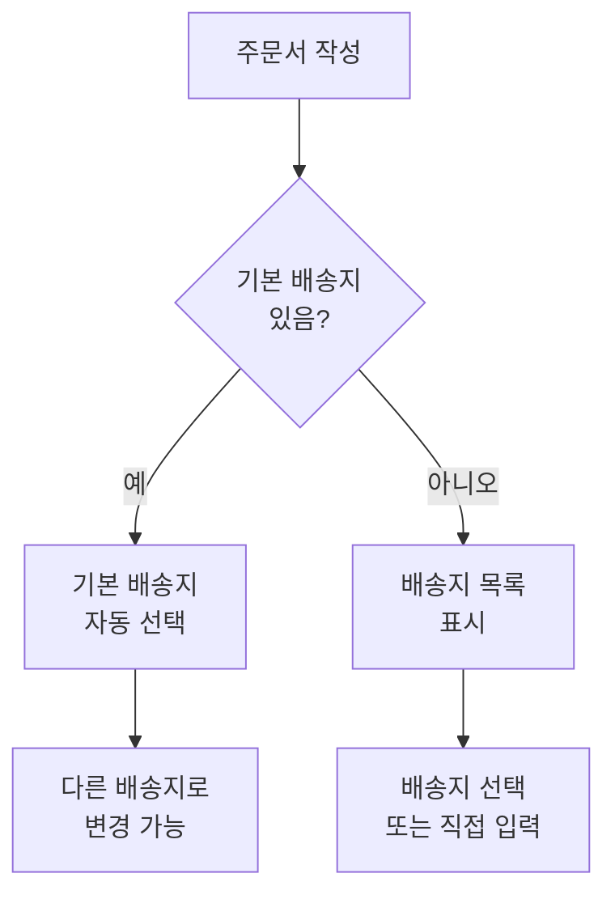

# 배송지 관리 (Shipping Address)

**Version 1.0** | **2025-12-27** | **ko&clo Project**

---

## 목차

1. [개요](#1-개요)
2. [ADDR-001 배송지 등록](#2-addr-001-배송지-등록)
3. [ADDR-002 배송지 목록 조회](#3-addr-002-배송지-목록-조회)
4. [ADDR-003 배송지 수정](#4-addr-003-배송지-수정)
5. [ADDR-004 배송지 삭제](#5-addr-004-배송지-삭제)
6. [ADDR-005 기본 배송지 설정](#6-addr-005-기본-배송지-설정)

---

## 1. 개요

> **하위 목차**
> - [1.1 기능 목록](#11-기능-목록)
> - [1.2 핵심 비즈니스 의사결정](#12-핵심-비즈니스-의사결정)

### 1.1 기능 목록

| 기능 ID | 기능명 | 사용자 | 우선순위 |
|---------|--------|--------|----------|
| ADDR-001 | 배송지 등록 | Consumer (회원) | P0 (MVP) |
| ADDR-002 | 배송지 목록 조회 | Consumer (회원) | P0 (MVP) |
| ADDR-003 | 배송지 수정 | Consumer (회원) | P0 (MVP) |
| ADDR-004 | 배송지 삭제 | Consumer (회원) | P0 (MVP) |
| ADDR-005 | 기본 배송지 설정 | Consumer (회원) | P0 (MVP) |

### 1.2 핵심 비즈니스 의사결정

| # | 의사결정 | 최종 결정 |
|---|----------|-----------|
| 1 | 배송지 저장 대상 | 회원만 (비회원은 주문 시 직접 입력) |
| 2 | 최대 배송지 개수 | 10개 |
| 3 | 기본 배송지 | 1개 필수 설정 |
| 4 | 주소 검색 | 주소 검색 API 연동 |
| 5 | 해외 배송 | MVP에서는 국내만 지원 (향후 확장 고려) |

---

## 2. ADDR-001 배송지 등록

| 항목 | 내용 |
|------|------|
| 기능 ID | ADDR-001 |
| 기능명 | 배송지 등록 |
| 사용자 유형 | Consumer (회원) |
| 우선순위 | P0 (MVP 필수) |

### 2.1 사용자 요구사항

- 자주 사용하는 배송지를 미리 저장해둘 수 있어야 한다.
- 주소 검색으로 쉽게 주소를 입력할 수 있어야 한다.
- 배송지에 별칭을 붙여서 구분할 수 있어야 한다.
- 등록한 배송지를 주문 시 바로 선택할 수 있어야 한다.

### 2.2 배송지 입력 정보

| 필드 | 필수 | 설명 |
|------|------|------|
| 배송지명 | Y | 별칭 (예: 집, 회사) |
| 수령인 | Y | 받는 사람 이름 |
| 연락처 | Y | 받는 사람 전화번호 |
| 주소 | Y | 주소 검색으로 입력 |
| 상세주소 | N | 동/호수 등 상세 주소 |
| 기본 배송지 | N | 기본 배송지로 설정 여부 |

### 2.3 배송지 등록 흐름

### 2.4 제한 사항

| 항목 | 정책 |
|------|------|
| 최대 등록 개수 | 10개 |
| 초과 시 | "배송지는 최대 10개까지 등록할 수 있습니다" 안내 |

---

## 3. ADDR-002 배송지 목록 조회

| 항목 | 내용 |
|------|------|
| 기능 ID | ADDR-002 |
| 기능명 | 배송지 목록 조회 |
| 사용자 유형 | Consumer (회원) |
| 우선순위 | P0 (MVP 필수) |

### 3.1 사용자 요구사항

- 등록한 배송지 목록을 확인할 수 있어야 한다.
- 기본 배송지가 상단에 표시되어야 한다.
- 각 배송지의 정보를 한눈에 볼 수 있어야 한다.

### 3.2 배송지 목록 표시 정보

| 항목 | 내용 |
|------|------|
| 배송지명 | 별칭 + 기본 배송지 뱃지 |
| 수령인 | 받는 사람 이름 |
| 연락처 | 전화번호 |
| 주소 | 전체 주소 |
| 액션 | 수정, 삭제, 기본 설정 버튼 |

### 3.3 정렬 순서

| 순서 | 기준 |
|------|------|
| 1 | 기본 배송지 최상단 |
| 2 | 최근 등록순 |

---

## 4. ADDR-003 배송지 수정

| 항목 | 내용 |
|------|------|
| 기능 ID | ADDR-003 |
| 기능명 | 배송지 수정 |
| 사용자 유형 | Consumer (회원) |
| 우선순위 | P0 (MVP 필수) |

### 4.1 사용자 요구사항

- 등록한 배송지 정보를 수정할 수 있어야 한다.
- 모든 필드를 수정할 수 있어야 한다.
- 주소도 다시 검색하여 변경할 수 있어야 한다.

### 4.2 수정 가능 항목

| 항목 | 수정 가능 |
|------|----------|
| 배송지명 | O |
| 수령인 | O |
| 연락처 | O |
| 주소 | O (재검색) |
| 상세주소 | O |

---

## 5. ADDR-004 배송지 삭제

| 항목 | 내용 |
|------|------|
| 기능 ID | ADDR-004 |
| 기능명 | 배송지 삭제 |
| 사용자 유형 | Consumer (회원) |
| 우선순위 | P0 (MVP 필수) |

### 5.1 사용자 요구사항

- 더 이상 사용하지 않는 배송지를 삭제할 수 있어야 한다.
- 실수로 삭제하지 않도록 확인 과정이 있어야 한다.

### 5.2 삭제 규칙

| 상황 | 처리 |
|------|------|
| 일반 배송지 삭제 | 확인 후 즉시 삭제 |
| 기본 배송지 삭제 | 다른 배송지를 기본으로 지정하도록 안내 |
| 마지막 배송지 삭제 | 삭제 가능 (기본 배송지 없음 상태) |

---

## 6. ADDR-005 기본 배송지 설정

| 항목 | 내용 |
|------|------|
| 기능 ID | ADDR-005 |
| 기능명 | 기본 배송지 설정 |
| 사용자 유형 | Consumer (회원) |
| 우선순위 | P0 (MVP 필수) |

### 6.1 사용자 요구사항

- 자주 사용하는 배송지를 기본으로 설정할 수 있어야 한다.
- 주문 시 기본 배송지가 자동으로 선택되어야 한다.
- 언제든지 기본 배송지를 변경할 수 있어야 한다.

### 6.2 기본 배송지 정책

| 항목 | 정책 |
|------|------|
| 기본 배송지 개수 | 1개 |
| 첫 번째 배송지 등록 시 | 자동으로 기본 설정 |
| 기본 배송지 변경 | 다른 배송지 선택 시 기존 기본 해제 |
| 주문서 자동 입력 | 기본 배송지 정보 자동 채움 |

### 6.3 주문 시 배송지 선택

---

## 변경 이력

| 버전 | 날짜 | 변경 내용 |
|------|------|-----------|
| 1.0 | 2025-12-27 | 비즈니스 요구사항 작성 |
