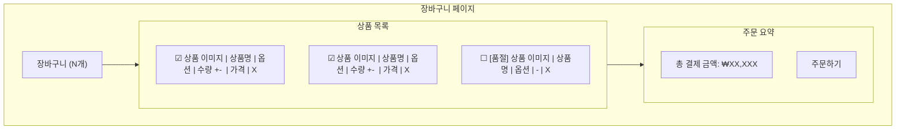

# 장바구니 (Shopping Cart)

**Version 1.1** | **2025-12-31** | **ko&clo Project**

---

## 목차

1. [개요](#1-개요)
2. [CART-001 장바구니 담기](#2-cart-001-장바구니-담기)
3. [CART-002 장바구니 조회](#3-cart-002-장바구니-조회)
4. [CART-003 수량 변경](#4-cart-003-수량-변경)
5. [CART-004 상품 제거](#5-cart-004-상품-제거)
6. [비회원 장바구니 정책](#6-비회원-장바구니-정책)

---

## 1. 개요

> **하위 목차**
> - [1.1 기능 목록](#11-기능-목록)
> - [1.2 핵심 비즈니스 의사결정](#12-핵심-비즈니스-의사결정)

### 1.1 기능 목록

| 기능 ID | 기능명 | 사용자 | 우선순위 |
|---------|--------|--------|----------|
| CART-001 | 장바구니 담기 | Consumer | P0 (MVP) |
| CART-002 | 장바구니 조회 | Consumer | P0 (MVP) |
| CART-003 | 수량 변경 | Consumer | P0 (MVP) |
| CART-004 | 상품 제거 | Consumer | P0 (MVP) |

### 1.2 핵심 비즈니스 의사결정

| # | 의사결정 | 최종 결정 |
|---|----------|-----------|
| 1 | 비회원 장바구니 지원 | 지원 (로컬스토리지 기반) |
| 2 | 회원 전환 시 장바구니 병합 | MVP에서는 별개 처리 (추후 검토) |
| 3 | 장바구니 최대 상품 수 | 50개 SKU |
| 4 | 수량 제한 방식 | 회원: 재고까지, 비회원: 제한 없음 |
| 5 | 품절 상품 처리 | 장바구니에 유지 + 품절 표시 + 결제 제외 |
| 6 | 장바구니 보존 기간 | 회원: 탈퇴 시까지 / 비회원: 브라우저 데이터 삭제 시 |

---

## 2. CART-001 장바구니 담기

| 항목 | 내용 |
|------|------|
| 기능 ID | CART-001 |
| 기능명 | 장바구니 담기 |
| 사용자 유형 | Consumer (비회원/회원) |
| 우선순위 | P0 (MVP 필수) |

### 2.1 사용자 요구사항

- 상품 상세 페이지에서 원하는 상품을 장바구니에 담을 수 있어야 한다.
- 옵션(색상, 사이즈)을 선택한 후 장바구니에 담을 수 있어야 한다.
- 수량을 지정하여 장바구니에 담을 수 있어야 한다.
- 장바구니 담기 성공 시 확인 메시지를 볼 수 있어야 한다.

### 2.2 장바구니 담기 흐름

### 2.3 처리 규칙

| 상황 | 처리 |
|------|------|
| 이미 담긴 동일 옵션 | 기존 수량에 추가 |
| 재고 부족 (회원) | "재고가 N개만 남았습니다" 안내 |
| 장바구니 50개 초과 | "장바구니는 최대 50개 상품까지 담을 수 있습니다" 안내 |
| 품절 상품 | 담기 불가, 품절 안내 |
| 판매 종료 상품 | 담기 불가, 판매 종료 안내 |

---

## 3. CART-002 장바구니 조회

| 항목 | 내용 |
|------|------|
| 기능 ID | CART-002 |
| 기능명 | 장바구니 조회 |
| 사용자 유형 | Consumer (비회원/회원) |
| 우선순위 | P0 (MVP 필수) |

### 3.1 사용자 요구사항

- 장바구니에 담긴 상품 목록을 확인할 수 있어야 한다.
- 각 상품의 이미지, 이름, 옵션, 수량, 가격을 볼 수 있어야 한다.
- 품절된 상품은 명확하게 구분되어야 한다.
- 가격이 변경된 경우 알 수 있어야 한다.
- 총 결제 금액을 확인할 수 있어야 한다.

### 3.2 UI 구성

### 3.3 상품 상태 표시

| 상태 | 표시 방식 |
|------|-----------|
| 정상 | 기본 표시 |
| 품절 | "품절" 뱃지, 체크박스 비활성화, 결제 금액에서 제외 |
| 재고 부족 | "재고 N개" 경고, 수량 조절 안내 |
| 판매 종료 | "판매 종료" 표시, 체크박스 비활성화 |
| 가격 변동 | 변경 전/후 가격 표시 |

---

## 4. CART-003 수량 변경

| 항목 | 내용 |
|------|------|
| 기능 ID | CART-003 |
| 기능명 | 수량 변경 |
| 사용자 유형 | Consumer (비회원/회원) |
| 우선순위 | P0 (MVP 필수) |

### 4.1 사용자 요구사항

- 장바구니에서 상품 수량을 변경할 수 있어야 한다.
- +/- 버튼으로 수량을 조절할 수 있어야 한다.
- 수량을 직접 입력할 수 있어야 한다.
- 수량 변경 시 가격이 즉시 반영되어야 한다.

### 4.2 수량 변경 규칙

| 상황 | 처리 |
|------|------|
| 수량 1에서 - 클릭 | 삭제 확인 또는 최소 1개 유지 |
| 재고 초과 (회원) | "최대 N개까지 담을 수 있습니다" 안내 |
| 수량 0 입력 | 상품 제거 처리 |
| 음수 입력 | 입력 무시 |

---

## 5. CART-004 상품 제거

| 항목 | 내용 |
|------|------|
| 기능 ID | CART-004 |
| 기능명 | 상품 제거 |
| 사용자 유형 | Consumer (비회원/회원) |
| 우선순위 | P0 (MVP 필수) |

### 5.1 사용자 요구사항

- 개별 상품을 장바구니에서 삭제할 수 있어야 한다.
- 여러 상품을 선택하여 한 번에 삭제할 수 있어야 한다.
- 품절/판매종료 상품만 선택하여 삭제할 수 있어야 한다.

### 5.2 삭제 방식

| 방식 | 설명 |
|------|------|
| 개별 삭제 | X 버튼 클릭으로 해당 상품 즉시 삭제 |
| 선택 삭제 | 체크박스로 선택 후 "선택 삭제" 버튼 클릭 |
| 품절 삭제 | "품절 상품 삭제" 버튼으로 품절/판매종료 상품 일괄 삭제 |

---

## 6. 비회원 장바구니 정책

### 6.1 비회원 요구사항

- 회원가입 없이도 장바구니를 사용할 수 있어야 한다.
- 브라우저를 닫았다가 다시 열어도 장바구니가 유지되어야 한다.
- 비회원 상태에서도 담기, 수량 변경, 삭제 기능을 사용할 수 있어야 한다.

### 6.2 비회원 장바구니 특성

| 항목 | 정책 |
|------|------|
| 저장 위치 | 브라우저 로컬스토리지 (서버 저장 X) |
| 보존 기간 | 브라우저 데이터 삭제 시까지 |
| 수량 제한 | 재고 실시간 확인 불가하여 제한 없음 |
| 항목 수 제한 | 최대 50개 (회원과 동일) |
| 다른 기기 동기화 | 불가 |

### 6.3 비회원 → 회원 전환

| 항목 | MVP 정책 |
|------|----------|
| 로그인 시 병합 | 별개로 유지 (병합하지 않음) |
| 향후 검토 | 병합 여부 사용자 선택 옵션 |

> **TODO**: 고객 피드백 후 병합 정책 결정

---

## 변경 이력

| 버전 | 날짜 | 변경 내용 |
|------|------|-----------|
| 0.1 | 2025-12-25 | TBD placeholder 생성 |
| 1.0 | 2025-12-27 | 비즈니스 요구사항 작성 |
| 1.1 | 2025-12-31 | CART-005 장바구니 비우기 기능 제거 |
