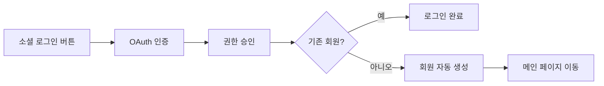
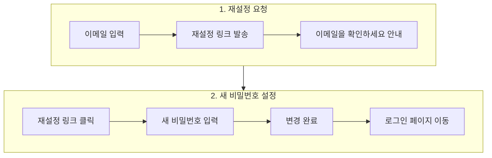
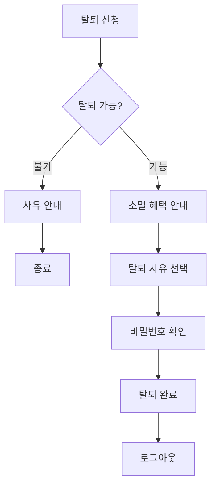
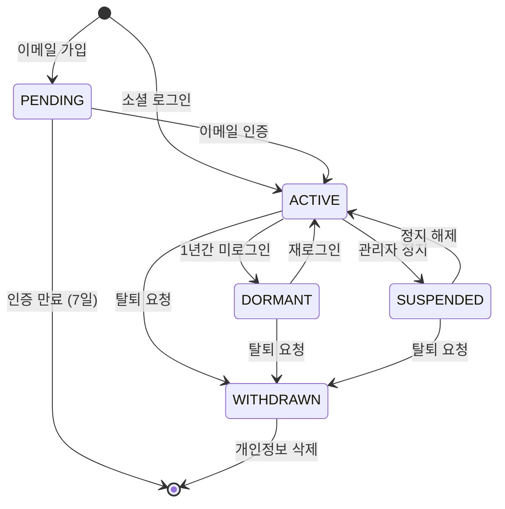

# 회원 관리 (Member Management)

**Version 1.0** | **2025-12-25** | **ko&clo Project**

---

## 목차

1. [개요](#1-개요)
2. [MBR-001 회원가입](#2-mbr-001-회원가입)
3. [MBR-002 로그인/로그아웃](#3-mbr-002-로그인로그아웃)
4. [MBR-003 비밀번호 재설정](#4-mbr-003-비밀번호-재설정)
5. [MBR-004 회원정보 수정](#5-mbr-004-회원정보-수정)
6. [MBR-005 회원 탈퇴](#6-mbr-005-회원-탈퇴)
7. [배송지 관리](#7-배송지-관리)
8. [관리자 기능](#8-관리자-기능)

---

## 1. 개요

> **하위 목차**
> - [1.1 기능 목록](#11-기능-목록)
> - [1.2 가입 방식 우선순위](#12-가입-방식-우선순위)

회원 관리 시스템은 개인정보보호법 및 관련 법령을 준수하는 개인정보 처리 정책에 기반하여 설계됩니다. 사용자의 개인정보를 안전하게 보호하면서도 편리한 서비스 이용 경험을 제공하는 것을 목표로 합니다.

### 1.1 기능 목록

| 기능 ID | 기능명 | 사용자 | 우선순위 | 상세 설명 |
|---------|--------|--------|----------|-----------|
| MBR-001 | 회원가입 | Consumer | P0 (MVP) | 소셜 로그인 또는 이메일 가입 |
| MBR-002 | 로그인/로그아웃 | Consumer | P0 (MVP) | 로그인 상태 유지, 자동 로그인 |
| MBR-003 | 비밀번호 재설정 | Consumer | P0 (MVP) | 이메일 인증을 통한 비밀번호 변경 |
| MBR-004 | 회원정보 수정 | Consumer | P0 (MVP) | 이름, 연락처, 프로필 이미지 변경 |
| MBR-005 | 회원 탈퇴 | Consumer | P0 (MVP) | 개인정보 삭제, 주문내역 익명화 |
| - | 회원 목록 조회 | Admin | P0 (MVP) | 검색, 필터링, 페이지네이션 |
| - | 회원 상태 관리 | Admin | P1 | 활성/휴면/정지 상태 변경 |

### 1.2 가입 방식 우선순위

| 순위 | 방식 | 설명 |
|------|------|------|
| 1 | 소셜 로그인 (권장) | 카카오, 네이버, 구글 |
| 2 | 이메일 가입 | 이메일/비밀번호 + 이메일 인증 |

---

## 2. MBR-001 회원가입

> **하위 목차**
> - [2.1 소셜 로그인 가입](#21-소셜-로그인-가입)
> - [2.2 이메일 가입](#22-이메일-가입)
> - [2.3 필수 동의 항목](#23-필수-동의-항목)

| 항목 | 내용 |
|------|------|
| 기능 ID | MBR-001 |
| 기능명 | 회원가입 (Sign Up) |
| 사용자 유형 | 비회원 |
| 우선순위 | P0 (MVP 필수) |

### 2.1 소셜 로그인 가입

#### 요구사항

- 사용자는 소셜 계정(카카오, 네이버, 구글)을 통해 간편하게 회원가입할 수 있어야 한다.
- 소셜 로그인 시 별도의 이메일 인증 없이 즉시 회원 가입이 완료되어야 한다.
- 각 소셜 Provider에서 닉네임과 이메일 정보를 수집해야 한다.

#### 가입 흐름

#### 지원 소셜 Provider

| Provider | 필수 동의항목 | 우선순위 |
|----------|---------------|----------|
| 카카오 | 닉네임, 이메일 | P0 |
| 네이버 | 이름, 이메일 | P0 |
| 구글 | 이름, 이메일 | P0 |

### 2.2 이메일 가입

#### 요구사항

- 사용자는 이메일/비밀번호를 통한 자체 회원가입을 선택할 수 있어야 한다.
- 이메일 가입의 경우 이메일 인증 절차를 통해 본인 확인을 수행해야 한다.
- 이메일 인증이 완료되기 전까지 로그인이 불가능해야 한다.

#### 가입 흐름

#### 입력 필드

| 필드 | 필수 | 검증 규칙 |
|------|------|-----------|
| 이메일 | Y | 이메일 형식, 중복 불가 |
| 비밀번호 | Y | 8~20자, 영문+숫자+특수문자 조합 |
| 비밀번호 확인 | Y | 비밀번호와 일치 |
| 이름 | Y | 2~50자, 한글 또는 영문 |
| 휴대폰 번호 | N | 숫자만, 선택적 |

### 2.3 필수 동의 항목

#### 요구사항

- 회원가입 시 필수 약관에 대한 명시적 동의를 받아야 한다.
- 마케팅 정보 수신 동의는 선택사항으로 제공되어야 한다.
- 동의 일시를 기록해야 한다.

#### 동의 항목

| 약관 | 필수 여부 | 설명 |
|------|----------|------|
| 이용약관 | 필수 | 서비스 이용 조건 |
| 개인정보 처리방침 | 필수 | 개인정보 수집/이용 동의 |
| 마케팅 정보 수신 | 선택 | 프로모션, 이벤트 알림 |

---

## 3. MBR-002 로그인/로그아웃

> **하위 목차**
> - [3.1 소셜 로그인](#31-소셜-로그인)
> - [3.2 이메일 로그인](#32-이메일-로그인)
> - [3.3 로그아웃](#33-로그아웃)
> - [3.4 자동 로그인](#34-자동-로그인)

| 항목 | 내용 |
|------|------|
| 기능 ID | MBR-002 |
| 기능명 | 로그인/로그아웃 |
| 사용자 유형 | Consumer |
| 우선순위 | P0 (MVP 필수) |

### 3.1 소셜 로그인

#### 요구사항

- 사용자는 가입한 소셜 계정으로 로그인할 수 있어야 한다.
- 소셜 로그인 시 비밀번호 입력 없이 간편하게 로그인되어야 한다.

### 3.2 이메일 로그인

#### 요구사항

- 사용자는 가입한 이메일/비밀번호로 로그인할 수 있어야 한다.
- 이메일 인증이 완료되지 않은 계정은 로그인이 불가능해야 한다.
- 로그인 실패 시 명확한 오류 메시지를 표시해야 한다.

#### 로그인 실패 처리

| 상황 | 사용자에게 표시되는 메시지 |
|------|---------------------------|
| 이메일 또는 비밀번호 불일치 | "이메일 또는 비밀번호가 일치하지 않습니다" |
| 이메일 미인증 | "이메일 인증을 완료해주세요" |
| 정지된 계정 | "정지된 계정입니다. 고객센터로 문의해주세요" |
| 탈퇴한 계정 | "탈퇴한 계정입니다" |

### 3.3 로그아웃

#### 요구사항

- 사용자는 언제든지 명시적으로 로그아웃할 수 있어야 한다.
- 로그아웃 시 로그인 페이지로 이동해야 한다.

### 3.4 자동 로그인

#### 요구사항

- 로그인 상태는 적절한 기간 동안 유지되어야 한다.
- "자동 로그인" 체크 시 더 긴 기간 동안 로그인 상태가 유지되어야 한다.
- 보안을 위해 장기간 미사용 시 자동 로그아웃되어야 한다.

#### 세션 유지 기간

| 옵션 | 유지 기간 |
|------|-----------|
| 일반 로그인 | 1일 |
| 자동 로그인 체크 | 30일 |

---

## 4. MBR-003 비밀번호 재설정

> **하위 목차**
> - [4.1 적용 대상](#41-적용-대상)
> - [4.2 재설정 흐름](#42-재설정-흐름)
> - [4.3 보안 정책](#43-보안-정책)

| 항목 | 내용 |
|------|------|
| 기능 ID | MBR-003 |
| 기능명 | 비밀번호 재설정 |
| 사용자 유형 | Consumer (이메일 가입 회원) |
| 우선순위 | P0 (MVP 필수) |

### 4.1 적용 대상

| 가입 방식 | 비밀번호 재설정 |
|-----------|-----------------|
| 이메일 가입 | 가능 |
| 소셜 로그인 | 불가 (각 소셜 서비스에서 관리) |

### 4.2 재설정 흐름

#### 요구사항

- 사용자는 이메일 인증을 통해 비밀번호를 재설정할 수 있어야 한다.
- 재설정 링크는 일정 시간(1시간) 후 만료되어야 한다.
- 재설정 링크는 1회만 사용 가능해야 한다.

#### 재설정 프로세스

### 4.3 보안 정책

| 항목 | 정책 |
|------|------|
| 이메일 열거 방지 | 이메일 존재 여부와 관계없이 동일한 응답 |
| 링크 유효 기간 | 1시간 |
| 링크 일회성 | 사용 후 즉시 만료 |
| 비밀번호 규칙 | 8~20자, 영문+숫자+특수문자 조합 |
| 이전 비밀번호 재사용 | 불가 |

---

## 5. MBR-004 회원정보 수정

> **하위 목차**
> - [5.1 수정 가능 항목](#51-수정-가능-항목)
> - [5.2 프로필 이미지](#52-프로필-이미지)
> - [5.3 비밀번호 변경](#53-비밀번호-변경)
> - [5.4 마케팅 수신 동의](#54-마케팅-수신-동의)

| 항목 | 내용 |
|------|------|
| 기능 ID | MBR-004 |
| 기능명 | 회원정보 수정 |
| 사용자 유형 | Consumer (로그인 회원) |
| 우선순위 | P0 (MVP 필수) |

### 5.1 수정 가능 항목

| 항목 | 이메일 가입 | 소셜 로그인 |
|------|-------------|-------------|
| 이름 | 수정 가능 | 수정 가능 |
| 휴대폰 번호 | 수정 가능 | 수정 가능 |
| 프로필 이미지 | 수정 가능 | 수정 가능 |
| 비밀번호 | 수정 가능 | 불가 |
| 이메일 | 불가 | 불가 |
| 마케팅 수신 동의 | 수정 가능 | 수정 가능 |

### 5.2 프로필 이미지

#### 요구사항

- 사용자는 프로필 이미지를 등록하고 변경할 수 있어야 한다.
- 지원 형식: JPG, PNG, WebP
- 파일 크기: 최대 5MB

### 5.3 비밀번호 변경

#### 요구사항

- 비밀번호 변경 시 현재 비밀번호 확인이 필요하다.
- 새 비밀번호는 기존과 동일할 수 없다.
- 소셜 로그인 회원은 비밀번호 변경 기능이 표시되지 않아야 한다.

### 5.4 마케팅 수신 동의

#### 요구사항

- 마케팅 수신 동의 여부를 언제든지 변경할 수 있어야 한다.
- 동의 변경 시 변경 일시가 기록되어야 한다.

---

## 6. MBR-005 회원 탈퇴

> **하위 목차**
> - [6.1 탈퇴 조건](#61-탈퇴-조건)
> - [6.2 탈퇴 시 안내사항](#62-탈퇴-시-안내사항)
> - [6.3 개인정보 처리](#63-개인정보-처리)
> - [6.4 탈퇴 프로세스](#64-탈퇴-프로세스)

| 항목 | 내용 |
|------|------|
| 기능 ID | MBR-005 |
| 기능명 | 회원 탈퇴 |
| 사용자 유형 | Consumer (로그인 회원) |
| 우선순위 | P0 (MVP 필수) |

### 6.1 탈퇴 조건

#### 탈퇴 불가 조건

| 조건 | 해결 방법 |
|------|-----------|
| 진행 중인 주문 (결제완료/배송중) | 배송 완료 후 탈퇴 가능 |
| 환불 진행 중 | 환불 완료 후 탈퇴 가능 |

### 6.2 탈퇴 시 안내사항

#### 요구사항

- 탈퇴 시 소멸되는 혜택을 명확히 안내해야 한다.
- 사용자의 명시적 확인을 받아야 한다.

#### 소멸 항목

| 항목 | 처리 |
|------|------|
| 보유 포인트 | 즉시 소멸 |
| 보유 쿠폰 | 즉시 소멸 |
| 작성한 리뷰 | 익명화 처리 (내용 유지) |

### 6.3 개인정보 처리

#### 즉시 처리

- 회원 상태 → 탈퇴 상태로 변경
- 로그인 불가 처리
- 포인트/쿠폰 초기화

#### 5일 이내 처리 (개인정보보호법 준수)

- 이름, 연락처, 이메일 등 개인정보 삭제
- 배송지 정보 삭제
- 프로필 이미지 삭제

#### 법적 보관 (전자상거래법)

- 주문/결제 기록: 5년간 분리 보관
- 분리 보관된 정보는 법적 의무 외 접근 불가

### 6.4 탈퇴 프로세스

#### 탈퇴 사유 선택지

| 사유 |
|------|
| 서비스 불만족 |
| 이용 빈도 낮음 |
| 다른 서비스 이용 |
| 개인정보 우려 |
| 기타 |

---

## 7. 배송지 관리

> **하위 목차**
> - [7.1 기능 개요](#71-기능-개요)
> - [7.2 배송지 등록](#72-배송지-등록)
> - [7.3 기본 배송지](#73-기본-배송지)

### 7.1 기능 개요

| 항목 | 내용 |
|------|------|
| 기능명 | 배송지 관리 |
| 사용자 유형 | Consumer (로그인 회원) |
| 우선순위 | P0 (MVP 필수) |

### 7.2 배송지 등록

#### 요구사항

- 사용자는 여러 개의 배송지를 등록하고 관리할 수 있어야 한다.
- 배송지 입력 시 주소 검색(우편번호) 기능을 제공해야 한다.
- 회원당 최대 10개까지 등록 가능하다.

#### 입력 항목

| 필드 | 필수 | 설명 |
|------|------|------|
| 배송지명 | N | '집', '회사' 등 |
| 받는 분 | Y | 수령인 이름 |
| 연락처 | Y | 휴대폰 번호 |
| 우편번호 | Y | 주소 검색으로 입력 |
| 기본 주소 | Y | 도로명 또는 지번 주소 |
| 상세 주소 | N | 동/호수 등 |

### 7.3 기본 배송지

#### 요구사항

- 기본 배송지를 지정할 수 있어야 한다.
- 첫 번째 등록 배송지는 자동으로 기본 배송지로 설정된다.
- 주문 시 기본 배송지가 자동으로 선택된다.

---

## 8. 관리자 기능

> **하위 목차**
> - [8.1 회원 목록 조회](#81-회원-목록-조회)
> - [8.2 회원 상태 관리](#82-회원-상태-관리)
> - [8.3 회원 상태 전이](#83-회원-상태-전이)

### 8.1 회원 목록 조회

#### 요구사항

- 관리자는 전체 회원 목록을 조회할 수 있어야 한다.
- 검색 (이름, 이메일, 연락처) 기능을 제공해야 한다.
- 필터링 (가입일, 상태, 가입 방식) 기능을 제공해야 한다.
- 페이지네이션을 지원해야 한다.

#### 표시 항목

| 항목 | 설명 |
|------|------|
| 회원 ID | 고유 식별자 |
| 이름 | 회원 이름 |
| 이메일 | 가입 이메일 |
| 가입 방식 | 소셜/이메일 |
| 가입일 | 회원가입 일시 |
| 최근 로그인 | 마지막 로그인 일시 |
| 상태 | 활성/휴면/정지/탈퇴 |

### 8.2 회원 상태 관리

#### 요구사항

- 관리자는 회원의 상태를 변경할 수 있어야 한다.
- 상태 변경 시 사유를 기록해야 한다.

#### 회원 상태

| 상태 | 설명 |
|------|------|
| 대기 (PENDING) | 이메일 인증 대기 중 |
| 활성 (ACTIVE) | 정상 이용 가능 |
| 휴면 (DORMANT) | 1년간 미로그인 |
| 정지 (SUSPENDED) | 관리자에 의해 정지됨 |
| 탈퇴 (WITHDRAWN) | 탈퇴 처리됨 |

### 8.3 회원 상태 전이

---

## 변경 이력

| 버전 | 날짜 | 변경 내용 |
|------|------|-----------|
| 1.0 | 2025-12-25 | TDD 기반 초기 작성, 기술 명세 제외 |
