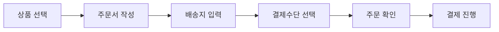
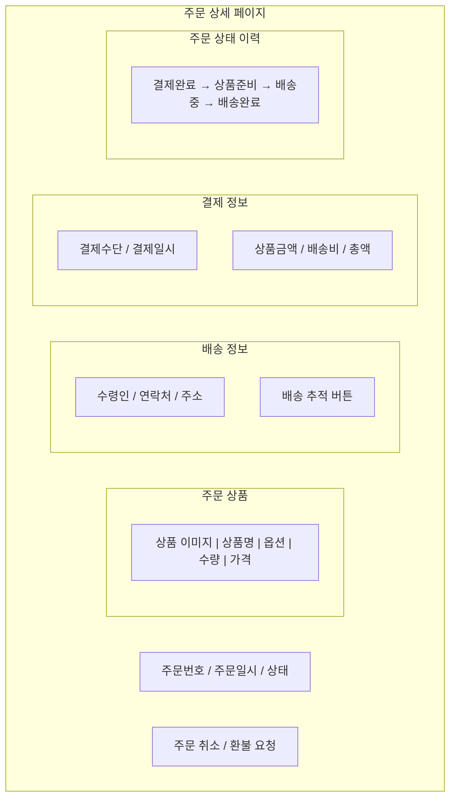
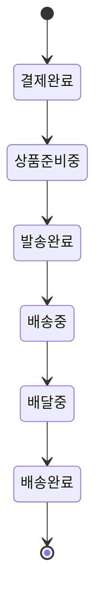
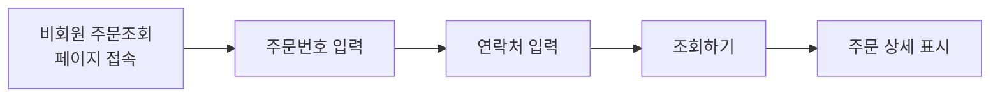

# 주문/결제 (Order & Payment)

**Version 1.0** | **2025-12-27** | **ko&clo Project**

---

## 목차

1. [개요](#1-개요)
2. [ORD-001 주문하기](#2-ord-001-주문하기)
3. [ORD-002 결제하기](#3-ord-002-결제하기)
4. [ORD-003 주문 내역 조회](#4-ord-003-주문-내역-조회)
5. [ORD-004 주문 상세 확인](#5-ord-004-주문-상세-확인)
6. [ORD-005 주문 취소](#6-ord-005-주문-취소)
7. [ORD-006 배송 추적](#7-ord-006-배송-추적)
8. [비회원 주문](#8-비회원-주문)

---

## 1. 개요

> **하위 목차**
> - [1.1 기능 목록](#11-기능-목록)
> - [1.2 핵심 비즈니스 의사결정](#12-핵심-비즈니스-의사결정)

### 1.1 기능 목록

| 기능 ID | 기능명 | 사용자 | 우선순위 |
|---------|--------|--------|----------|
| ORD-001 | 주문하기 | Consumer | P0 (MVP) |
| ORD-002 | 결제하기 | Consumer | P0 (MVP) |
| ORD-003 | 주문 내역 조회 | Consumer | P0 (MVP) |
| ORD-004 | 주문 상세 확인 | Consumer | P0 (MVP) |
| ORD-005 | 주문 취소 | Consumer | P0 (MVP) |
| ORD-006 | 배송 추적 | Consumer | P0 (MVP) |

### 1.2 핵심 비즈니스 의사결정

| # | 의사결정 | 최종 결정 |
|---|----------|-----------|
| 1 | 비회원 주문 지원 | 지원 (주문번호 + 연락처로 조회) |
| 2 | 최소 주문금액 | 없음 |
| 3 | 무료 배송 조건 | 50,000원 이상 구매 시 |
| 4 | 기본 배송비 | 3,000원 |
| 5 | 주문 취소 가능 시점 | 배송 시작 전까지 |
| 6 | 환불 가능 시점 | 배송 완료 후 7일 이내 |

---

## 2. ORD-001 주문하기

| 항목 | 내용 |
|------|------|
| 기능 ID | ORD-001 |
| 기능명 | 주문하기 (Checkout) |
| 사용자 유형 | Consumer (비회원/회원) |
| 우선순위 | P0 (MVP 필수) |

### 2.1 사용자 요구사항

- 장바구니에서 원하는 상품을 선택하여 주문할 수 있어야 한다.
- 상품 상세 페이지에서 바로 구매할 수 있어야 한다.
- 배송지 정보를 입력할 수 있어야 한다.
- 주소 검색 기능으로 쉽게 주소를 입력할 수 있어야 한다.
- 배송 메모를 남길 수 있어야 한다.
- 결제 전에 주문 내용과 총 금액을 확인할 수 있어야 한다.

### 2.2 주문 흐름

### 2.3 주문서 구성

| 섹션 | 내용 |
|------|------|
| 주문 상품 | 상품 이미지, 상품명, 옵션, 수량, 가격 |
| 주문자 정보 | 이름, 연락처, 이메일 |
| 배송지 정보 | 수령인, 연락처, 주소, 상세주소, 배송 메모 |
| 결제 정보 | 결제수단 선택 |
| 결제 금액 | 상품금액, 배송비, 할인금액, 총 결제금액 |

### 2.4 배송비 정책

| 조건 | 배송비 |
|------|--------|
| 50,000원 이상 구매 | 무료 |
| 50,000원 미만 구매 | 3,000원 |

### 2.5 배송 메모 옵션

| 옵션 |
|------|
| 문 앞에 놔주세요 |
| 경비실에 맡겨주세요 |
| 배송 전 연락 부탁드립니다 |
| 직접 입력 |

---

## 3. ORD-002 결제하기

| 항목 | 내용 |
|------|------|
| 기능 ID | ORD-002 |
| 기능명 | 결제하기 (Payment) |
| 사용자 유형 | Consumer (비회원/회원) |
| 우선순위 | P0 (MVP 필수) |

### 3.1 사용자 요구사항

- 다양한 결제수단으로 결제할 수 있어야 한다.
- 결제가 안전하게 처리되어야 한다.
- 결제 완료 후 주문 확인 내용을 볼 수 있어야 한다.
- 결제 확인 이메일을 받을 수 있어야 한다.

### 3.2 지원 결제수단

| 결제수단 | 설명 |
|----------|------|
| 신용카드 | 일반/할부 결제 |
| 계좌이체 | 실시간 계좌이체 |
| 카카오페이 | 간편결제 |
| 네이버페이 | 간편결제 |

### 3.3 결제 완료 후 처리

| 항목 | 처리 |
|------|------|
| 주문 확인 페이지 | 주문번호, 주문 내용, 결제 금액 표시 |
| 이메일 발송 | 주문 확인 이메일 자동 발송 |
| 재고 차감 | 결제 완료 시점에 재고 차감 |
| 장바구니 정리 | 결제된 상품 장바구니에서 자동 삭제 |

---

## 4. ORD-003 주문 내역 조회

| 항목 | 내용 |
|------|------|
| 기능 ID | ORD-003 |
| 기능명 | 주문 내역 조회 (Order History) |
| 사용자 유형 | Consumer (회원) |
| 우선순위 | P0 (MVP 필수) |

### 4.1 사용자 요구사항

- 내가 주문한 내역을 확인할 수 있어야 한다.
- 주문 상태별로 필터링할 수 있어야 한다.
- 기간별로 조회할 수 있어야 한다.
- 주문 목록에서 대표 상품과 주요 정보를 한눈에 볼 수 있어야 한다.

### 4.2 주문 목록 표시 정보

| 항목 | 내용 |
|------|------|
| 주문번호 | 고유 주문번호 |
| 주문일시 | 주문한 날짜와 시간 |
| 주문 상태 | 현재 주문 상태 |
| 대표 상품 | 이미지, 상품명, 옵션 |
| 상품 개수 | "외 N개" 형식으로 표시 |
| 총 결제금액 | 결제한 총 금액 |

### 4.3 주문 상태 필터

| 필터 | 설명 |
|------|------|
| 전체 | 모든 주문 |
| 결제 대기 | 결제 진행 중 |
| 결제 완료 | 결제 완료됨 |
| 배송중 | 배송 진행 중 |
| 배송 완료 | 배송 완료됨 |
| 취소/환불 | 취소 또는 환불 처리됨 |

---

## 5. ORD-004 주문 상세 확인

| 항목 | 내용 |
|------|------|
| 기능 ID | ORD-004 |
| 기능명 | 주문 상세 확인 (Order Detail) |
| 사용자 유형 | Consumer (비회원/회원) |
| 우선순위 | P0 (MVP 필수) |

### 5.1 사용자 요구사항

- 주문의 상세 내용을 확인할 수 있어야 한다.
- 주문한 상품 목록을 확인할 수 있어야 한다.
- 배송지 정보를 확인할 수 있어야 한다.
- 결제 정보를 확인할 수 있어야 한다.
- 주문 상태 변경 이력을 확인할 수 있어야 한다.

### 5.2 주문 상세 구성

---

## 6. ORD-005 주문 취소

| 항목 | 내용 |
|------|------|
| 기능 ID | ORD-005 |
| 기능명 | 주문 취소 (Order Cancellation) |
| 사용자 유형 | Consumer (비회원/회원) |
| 우선순위 | P0 (MVP 필수) |

### 6.1 사용자 요구사항

- 배송 시작 전에 주문을 취소할 수 있어야 한다.
- 취소 시 환불이 자동으로 진행되어야 한다.
- 취소 사유를 선택할 수 있어야 한다.
- 환불 예정일을 확인할 수 있어야 한다.

### 6.2 취소 가능 조건

| 주문 상태 | 취소 가능 | 설명 |
|----------|----------|------|
| 결제 대기 | O | 주문만 취소 |
| 결제 완료 | O | 전액 환불 |
| 상품 준비중 | O | 전액 환불 |
| 배송중 | X | 배송 시작 후 취소 불가 |
| 배송 완료 | △ | 7일 이내 환불 요청 가능 |

### 6.3 취소 사유 옵션

| 사유 |
|------|
| 단순 변심 |
| 잘못 주문함 |
| 옵션 변경 원함 |
| 다른 곳에서 더 저렴하게 발견 |
| 기타 |

### 6.4 환불 정책

| 결제수단 | 환불 방식 | 예상 소요 |
|----------|----------|----------|
| 신용카드 | 카드 취소 | 3~5 영업일 |
| 계좌이체 | 계좌 환불 | 1~2 영업일 |
| 간편결제 | 원 결제수단으로 환불 | 1~3 영업일 |

---

## 7. ORD-006 배송 추적

| 항목 | 내용 |
|------|------|
| 기능 ID | ORD-006 |
| 기능명 | 배송 추적 (Delivery Tracking) |
| 사용자 유형 | Consumer (비회원/회원) |
| 우선순위 | P0 (MVP 필수) |

### 7.1 사용자 요구사항

- 내 주문의 배송 상태를 확인할 수 있어야 한다.
- 택배사 배송 조회 페이지로 이동할 수 있어야 한다.
- 배송 이력을 확인할 수 있어야 한다.
- 예상 도착일을 알 수 있어야 한다.

### 7.2 배송 상태

### 7.3 배송 추적 표시 정보

| 항목 | 내용 |
|------|------|
| 택배사 | 택배사 이름 |
| 송장번호 | 운송장 번호 |
| 현재 상태 | 배송 현재 상태 |
| 배송 이력 | 시간순 배송 처리 내역 |
| 예상 도착일 | 도착 예정일 |
| 택배사 조회 | 택배사 배송조회 페이지 링크 |

---

## 8. 비회원 주문

### 8.1 비회원 요구사항

- 회원가입 없이도 주문할 수 있어야 한다.
- 비회원 주문도 주문 조회가 가능해야 한다.
- 비회원 주문도 취소 및 환불이 가능해야 한다.

### 8.2 비회원 주문 특성

| 항목 | 정책 |
|------|------|
| 주문 가능 | 가능 (모든 결제수단 동일) |
| 주문 조회 | 주문번호 + 연락처로 조회 |
| 주문 취소 | 회원과 동일한 정책 적용 |
| 배송 추적 | 회원과 동일하게 지원 |

### 8.3 비회원 주문 조회 방법

---

## 변경 이력

| 버전 | 날짜 | 변경 내용 |
|------|------|-----------|
| 0.1 | 2025-12-25 | TBD placeholder 생성 |
| 1.0 | 2025-12-27 | 비즈니스 요구사항 작성 |
