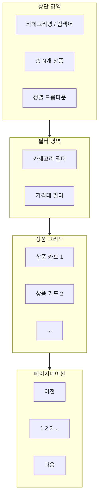
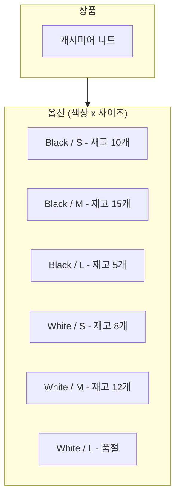
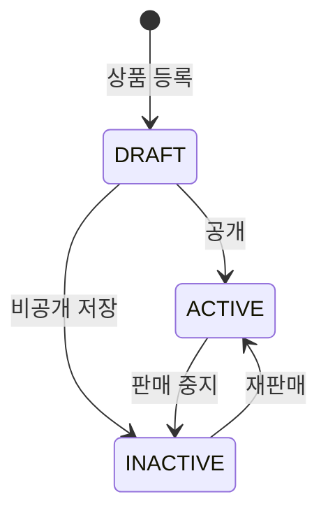
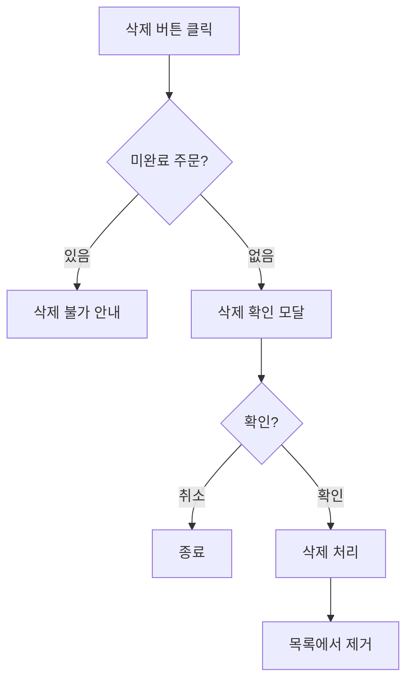
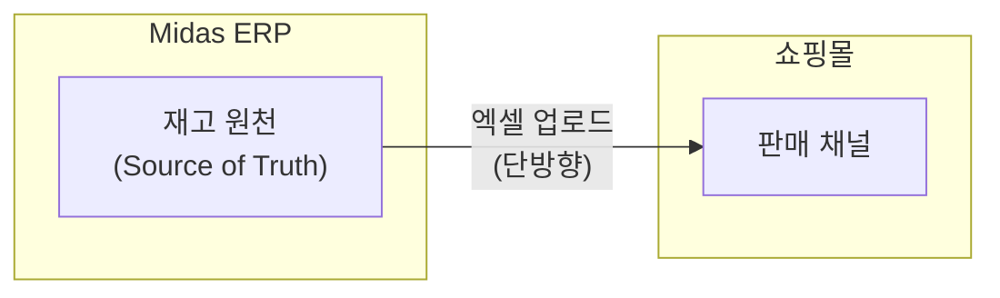
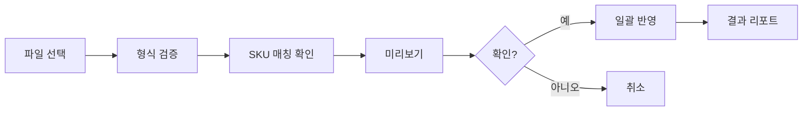

# 상품 관리 (Product Management)

**Version 1.0** | **2025-12-25** | **ko&clo Project**

---

## 목차

1. [개요](#1-개요)
2. [PRD-001 상품 목록 조회](#2-prd-001-상품-목록-조회)
3. [PRD-002 상품 상세 조회](#3-prd-002-상품-상세-조회)
4. [PRD-003 상품 등록](#4-prd-003-상품-등록)
5. [PRD-004 상품 수정](#5-prd-004-상품-수정)
6. [PRD-005 상품 삭제](#6-prd-005-상품-삭제)
7. [PRD-006 재고 관리](#7-prd-006-재고-관리)
8. [PRD-007 카테고리 관리](#8-prd-007-카테고리-관리)

---

## 1. 개요

> **하위 목차**
> - [1.1 기능 목록](#11-기능-목록)
> - [1.2 핵심 비즈니스 의사결정](#12-핵심-비즈니스-의사결정)

### 1.1 기능 목록

| 기능 ID | 기능명 | 사용자 | 우선순위 |
|---------|--------|--------|----------|
| PRD-001 | 상품 목록 조회 | Consumer | P0 (MVP) |
| PRD-002 | 상품 상세 조회 | Consumer | P0 (MVP) |
| PRD-003 | 상품 등록 | Admin | P0 (MVP) |
| PRD-004 | 상품 수정 | Admin | P0 (MVP) |
| PRD-005 | 상품 삭제 | Admin | P0 (MVP) |
| PRD-006 | 재고 관리 | Admin | P0 (MVP) |
| PRD-007 | 카테고리 관리 | Admin | P0 (MVP) |

### 1.2 핵심 비즈니스 의사결정

| # | 의사결정 | 최종 결정 |
|---|----------|-----------|
| 1 | 상품 목록과 검색 결과 통합 | MVP에서는 동일한 화면으로 처리 |
| 2 | 검색 범위 | 상품명, 간략 설명에서만 검색 |
| 3 | 상품 구조 | 옵션 방식 (색상/사이즈별 개별 재고) |
| 4 | 재고 원천 | Midas ERP에서 쇼핑몰로 단방향 동기화 |
| 5 | SKU 변경 | 변경 가능하나 ERP 동기화 주의 필요 |
| 6 | 할인가 입력 | 직접 입력 + 할인율 계산 모두 지원 |
| 7 | 상품 설명 에디터 | 기본 서식만 지원 (굵게, 기울임, 목록, 링크) |

---

## 2. PRD-001 상품 목록 조회

> **하위 목차**
> - [2.1 조회 유형](#21-조회-유형)
> - [2.2 정렬 옵션](#22-정렬-옵션)
> - [2.3 필터 옵션](#23-필터-옵션)
> - [2.4 UI 구성](#24-ui-구성)

| 항목 | 내용 |
|------|------|
| 기능 ID | PRD-001 |
| 기능명 | 상품 목록 조회 |
| 사용자 유형 | Consumer (비회원/회원) |
| 우선순위 | P0 (MVP 필수) |

### 2.1 조회 유형

| 유형 | 설명 |
|------|------|
| 전체 목록 | 모든 상품 조회 |
| 카테고리별 | 특정 카테고리 상품만 조회 |
| 검색 결과 | 키워드로 검색된 상품 조회 |
| 복합 조회 | 카테고리 + 검색 + 필터 조합 |

### 2.2 정렬 옵션

| 옵션 | 설명 | 기본값 |
|------|------|--------|
| 최신순 | 등록일 기준 최신순 | O (기본) |
| 낮은 가격순 | 판매가 기준 오름차순 | |
| 높은 가격순 | 판매가 기준 내림차순 | |
| 인기순 | 조회수 기준 (Post-MVP) | |

### 2.3 필터 옵션

| 필터 | 설명 |
|------|------|
| 카테고리 | 대분류/소분류 선택 |
| 가격대 | 최소~최대 가격 범위 |

### 2.4 UI 구성



#### 상품 카드 표시 정보

| 항목 | 설명 |
|------|------|
| 썸네일 이미지 | 대표 이미지 |
| 상품명 | 상품 이름 |
| 정가 | 원래 가격 (할인 시 취소선) |
| 판매가 | 실제 결제 금액 |
| 할인율 | % 표시 (할인 시에만) |
| 품절 표시 | 모든 옵션 품절 시 |
| NEW 뱃지 | 신상품 표시 |

---

## 3. PRD-002 상품 상세 조회

> **하위 목차**
> - [3.1 UI 구성](#31-ui-구성)
> - [3.2 옵션 선택](#32-옵션-선택)
> - [3.3 SEO 최적화](#33-seo-최적화)
> - [3.4 에러 처리](#34-에러-처리)

| 항목 | 내용 |
|------|------|
| 기능 ID | PRD-002 |
| 기능명 | 상품 상세 조회 |
| 사용자 유형 | Consumer (비회원/회원) |
| 우선순위 | P0 (MVP 필수) |

### 3.1 UI 구성

| 영역 | 구성 요소 |
|------|-----------|
| 이미지 갤러리 | 대표 이미지 + 썸네일 목록 + 이미지 확대 |
| 상품 정보 | 상품명, 가격(정가/할인가/할인율), 간략 설명 |
| 옵션 선택 | 색상 → 사이즈 순차 선택 |
| 재고/가격 표시 | 옵션별 재고 상태, 추가금액 표시 |
| 수량 선택 | +/- 버튼, 재고 이상 선택 불가 |
| 액션 버튼 | 장바구니 담기, 바로 구매 |
| 상세 설명 | 상품 상세 설명 내용 |

### 3.2 옵션 선택

#### 선택 흐름


#### 옵션 상태

| 상태 | 표시 |
|------|------|
| 선택 가능 | 일반 표시 |
| 품절 | 회색 처리 + "품절" 표시 |
| 선택됨 | 강조 표시 |

### 3.3 SEO 최적화

#### 요구사항

- 상품 상세 페이지는 검색 엔진에 최적화되어야 한다.
- 상품별로 고유한 URL을 가져야 한다.
- 메타 정보(제목, 설명, 이미지)가 포함되어야 한다.

### 3.4 에러 처리

| 상황 | 표시 |
|------|------|
| 상품 없음 | "상품을 찾을 수 없습니다" 페이지 |
| 삭제된 상품 | "삭제된 상품입니다" 메시지 |
| 비활성 상품 | "판매 중지된 상품입니다" 메시지 |

---

## 4. PRD-003 상품 등록

> **하위 목차**
> - [4.1 입력 정보](#41-입력-정보)
> - [4.2 이미지 관리](#42-이미지-관리)
> - [4.3 옵션 및 재고](#43-옵션-및-재고)
> - [4.4 가격 설정](#44-가격-설정)
> - [4.5 상품 상태](#45-상품-상태)

| 항목 | 내용 |
|------|------|
| 기능 ID | PRD-003 |
| 기능명 | 상품 등록 (Admin) |
| 사용자 유형 | Admin |
| 우선순위 | P0 (MVP 필수) |

### 4.1 입력 정보

#### 기본 정보

| 필드 | 필수 | 설명 |
|------|------|------|
| 상품명 | Y | 2~100자 |
| 카테고리 | Y | 대분류 → 소분류 선택 |
| 간략 설명 | N | 최대 200자, 목록에서 표시 |
| 상세 설명 | N | 에디터로 작성 (기본 서식만) |
| 상태 | Y | 임시저장/판매중/판매중지 |

#### SEO 정보

| 필드 | 필수 | 설명 |
|------|------|------|
| SEO 타이틀 | N | 최대 70자, 미입력 시 상품명 사용 |
| SEO 설명 | N | 최대 160자, 미입력 시 간략 설명 사용 |

### 4.2 이미지 관리

#### 요구사항

- 대표 이미지 1장은 필수이다.
- 추가 이미지는 최대 10장까지 등록 가능하다.
- 드래그로 이미지 순서를 변경할 수 있다.

#### 이미지 규격

| 항목 | 규격 |
|------|------|
| 파일 형식 | JPG, PNG, WebP |
| 파일 크기 | 최대 5MB |
| 권장 크기 | 1200x1200px |

### 4.3 옵션 및 재고

#### 요구사항

- 색상과 사이즈 조합으로 옵션을 생성한다.
- 각 옵션별로 재고 수량을 관리한다.
- 옵션별 추가금액을 설정할 수 있다.

#### 옵션 구조



### 4.4 가격 설정

| 필드 | 필수 | 설명 |
|------|------|------|
| 정가 | Y | 1,000원 이상 |
| 할인가 | N | 직접 입력 또는 할인율로 자동 계산 |
| 할인율 | N | 1~99%, 할인가 입력 시 자동 계산 |

#### 할인가 계산

- 할인율 입력 시 할인가 자동 계산
- 할인가 입력 시 할인율 자동 계산
- 5,000원 단위로 반올림

### 4.5 상품 상태



| 상태 | 설명 |
|------|------|
| 임시저장 (DRAFT) | 등록 중, 고객에게 미노출 |
| 판매중 (ACTIVE) | 정상 판매, 고객에게 노출 |
| 판매중지 (INACTIVE) | 판매 중단, 고객에게 미노출 |

---

## 5. PRD-004 상품 수정

> **하위 목차**
> - [5.1 수정 가능 항목](#51-수정-가능-항목)
> - [5.2 주의사항](#52-주의사항)

| 항목 | 내용 |
|------|------|
| 기능 ID | PRD-004 |
| 기능명 | 상품 수정 (Admin) |
| 사용자 유형 | Admin |
| 우선순위 | P0 (MVP 필수) |

### 5.1 수정 가능 항목

PRD-003(상품 등록)과 동일한 모든 필드 수정 가능:
- 기본 정보 (상품명, 카테고리, 설명, 상태)
- 이미지 (추가/삭제/순서변경)
- 옵션/재고 (색상, 사이즈, 재고, 추가금액)
- 가격 (정가, 할인가, 할인율)
- SEO (타이틀, 설명)

### 5.2 주의사항

#### SKU 변경

| 상황 | 처리 |
|------|------|
| SKU 변경 시 | 경고 메시지 표시 |
| 경고 내용 | "SKU 변경 시 Midas ERP 동기화에 문제가 발생할 수 있습니다" |

#### 옵션 삭제 제한

| 조건 | 처리 |
|------|------|
| 장바구니에 해당 옵션 존재 | 삭제 불가, 안내 메시지 |
| 미완료 주문에 해당 옵션 존재 | 삭제 불가, 안내 메시지 |
| 완료된 주문만 존재 | 삭제 가능 |

---

## 6. PRD-005 상품 삭제

> **하위 목차**
> - [6.1 삭제 정책](#61-삭제-정책)
> - [6.2 삭제 프로세스](#62-삭제-프로세스)
> - [6.3 삭제 후 처리](#63-삭제-후-처리)

| 항목 | 내용 |
|------|------|
| 기능 ID | PRD-005 |
| 기능명 | 상품 삭제 (Admin) |
| 사용자 유형 | Admin |
| 우선순위 | P0 (MVP 필수) |

### 6.1 삭제 정책

| 조건 | 삭제 가능 | 처리 |
|------|----------|------|
| 장바구니에 있는 상품 | 가능 | 장바구니에서 '품절' 표시 |
| 미완료 주문 존재 | 불가 | "미완료 주문이 있어 삭제할 수 없습니다" |
| 완료된 주문만 존재 | 가능 | 주문 내역에서 '삭제된 상품' 표시 |
| 주문 없음 | 가능 | 즉시 삭제 |

### 6.2 삭제 프로세스



### 6.3 삭제 후 처리

| 영역 | 처리 |
|------|------|
| 장바구니 | "품절" 또는 "판매 종료" 표시, 결제 불가 |
| 주문 내역 | 상품명 옆에 "(삭제됨)" 표시, 링크 비활성화 |
| 검색/목록 | 노출되지 않음 |
| 관리자 | 삭제 필터로 조회 가능, 복구 가능 |

---

## 7. PRD-006 재고 관리

> **하위 목차**
> - [7.1 재고 동기화](#71-재고-동기화)
> - [7.2 재고 조회](#72-재고-조회)
> - [7.3 재고 수정](#73-재고-수정)
> - [7.4 엑셀 업로드](#74-엑셀-업로드)

| 항목 | 내용 |
|------|------|
| 기능 ID | PRD-006 |
| 기능명 | 재고 관리 (Admin) |
| 사용자 유형 | Admin |
| 우선순위 | P0 (MVP 필수) |

### 7.1 재고 동기화



> **주의**: Midas ERP가 재고의 원천입니다. 쇼핑몰에서 개별 수정한 재고는 다음 Midas 동기화 시 덮어씌워집니다.

### 7.2 재고 조회

#### 표시 항목

| 컬럼 | 설명 |
|------|------|
| 상품명 | 상품명 + 썸네일 |
| SKU | 재고관리코드 |
| 색상/사이즈 | 옵션 정보 |
| 현재 재고 | 현재 재고 수량 |
| 상태 | 정상 / 저재고 / 품절 |
| 최종 수정 | 마지막 수정 일시 |

#### 필터/정렬 옵션

- 재고 상태 (전체 / 정상 / 저재고 / 품절)
- 카테고리별 필터
- 검색 (상품명, SKU)
- 재고 적은/많은 순 정렬

### 7.3 재고 수정

#### 요구사항

- 긴급 상황 시 개별 SKU 재고를 직접 수정할 수 있다.
- 수정 시 변경 사유를 기록한다.

### 7.4 엑셀 업로드

#### 업로드 흐름



#### 엑셀 형식

| SKU | 재고수량 | 비고 |
|-----|----------|------|
| KNC-BLK-M | 50 | |
| KNC-WHT-L | 30 | |
| KNC-NAV-S | 0 | 품절 |

---

## 8. PRD-007 카테고리 관리

> **하위 목차**
> - [8.1 카테고리 구조](#81-카테고리-구조)
> - [8.2 기능 목록](#82-기능-목록)
> - [8.3 삭제 정책](#83-삭제-정책)

| 항목 | 내용 |
|------|------|
| 기능 ID | PRD-007 |
| 기능명 | 카테고리 관리 (Admin) |
| 사용자 유형 | Admin |
| 우선순위 | P0 (MVP 필수) |

### 8.1 카테고리 구조

2단계 계층 구조 (대분류 → 소분류)

```
대분류 (Parent)
├── 소분류 1 (Child)
├── 소분류 2 (Child)
└── 소분류 3 (Child)
```

#### 구조 예시

| 대분류 | 소분류 |
|--------|--------|
| 아우터 | 코트, 자켓, 패딩 |
| 상의 | 니트, 셔츠, 티셔츠 |
| 하의 | 팬츠, 스커트, 청바지 |
| 원피스 | 미니, 미디, 롱 |

### 8.2 기능 목록

| 기능 | 설명 |
|------|------|
| 카테고리 목록 | 트리 구조로 전체 카테고리 표시 |
| 카테고리 추가 | 대분류/소분류 생성 |
| 카테고리 수정 | 이름, 상위 카테고리 변경 |
| 카테고리 삭제 | 하위/상품 없는 경우만 가능 |
| 순서 관리 | 드래그앤드롭으로 정렬 순서 변경 |

#### 카테고리 추가/수정

| 필드 | 필수 | 설명 |
|------|------|------|
| 카테고리명 | Y | 2~50자 |
| 상위 카테고리 | N | 없으면 대분류로 생성 |
| 활성화 | Y | 비활성 시 고객에게 미노출 |

### 8.3 삭제 정책

| 조건 | 삭제 가능 | 안내 메시지 |
|------|----------|-------------|
| 하위 카테고리 존재 | 불가 | "하위 카테고리를 먼저 삭제해주세요" |
| 연결된 상품 존재 | 불가 | "해당 카테고리에 N개 상품이 있습니다" |
| 빈 카테고리 | 가능 | 확인 후 삭제 |

---

## 변경 이력

| 버전 | 날짜 | 변경 내용 |
|------|------|-----------|
| 1.0 | 2025-12-25 | TDD 기반 초기 작성, 기술 명세 제외 |
