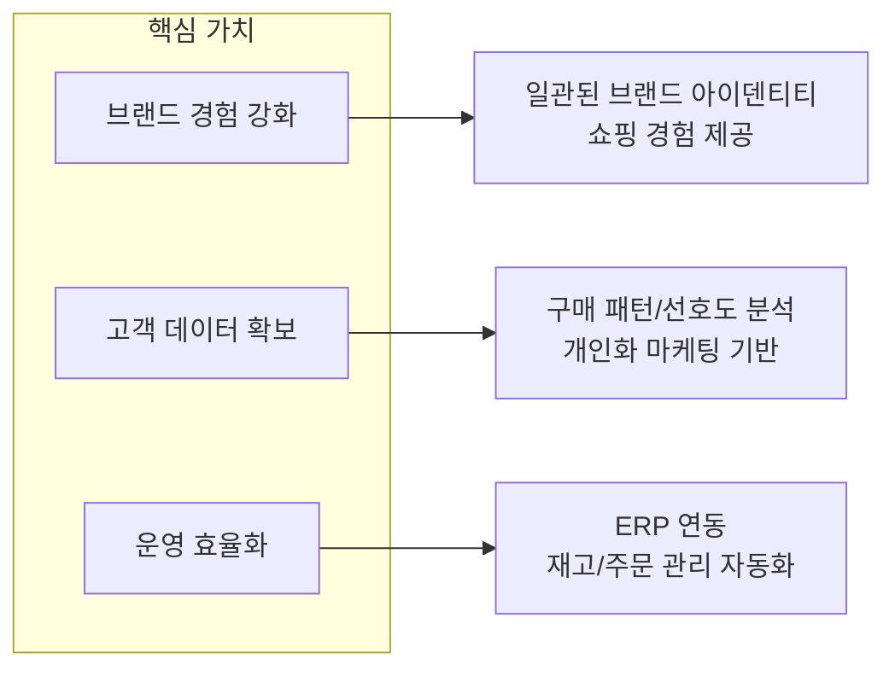
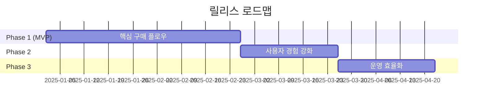

# ko&clo 쇼핑몰 제품 요구사항 정의서

**Version 2.0** | **2025-12-25** | **ko&clo Project**

---

## 목차

1. [문서 정보](#1-문서-정보)
2. [개요](#2-개요)
3. [비즈니스 목표 및 성공 지표](#3-비즈니스-목표-및-성공-지표)
4. [사용자 정의](#4-사용자-정의)
5. [기능 요구사항](#5-기능-요구사항)
6. [비기능 요구사항](#6-비기능-요구사항)
7. [제약사항 및 가정](#7-제약사항-및-가정)
8. [릴리스 로드맵](#8-릴리스-로드맵)

---

## 1. 문서 정보

> **하위 목차**
> - [1.1 문서 개요](#11-문서-개요)
> - [1.2 문서 구조](#12-문서-구조)

### 1.1 문서 개요

| 항목 | 내용 |
|------|------|
| 문서명 | ko&clo 쇼핑몰 제품 요구사항 정의서 (PRD) |
| 버전 | 2.0 |
| 작성일 | 2025-12-25 |
| 프로젝트명 | ko&clo 자사몰 구축 |

### 1.2 문서 구조

본 PRD는 아래와 같이 기능별로 상세 문서가 분리되어 있습니다.

```
PRD/
├── Shopping_Mall_PRD.md          # 본 문서 (개요)
├── MBR_회원관리.md                # 회원관리 (MBR-001~005)
├── PRD_상품관리.md                # 상품관리 (PRD-001~007)
├── CART_장바구니.md               # 장바구니
├── ORD_주문결제.md                # 주문/결제
├── SHP_배송.md                   # 배송
├── CS_고객센터.md                 # 고객센터/리뷰
└── PROMO_프로모션.md              # 프로모션/마케팅
```

---

## 2. 개요

> **하위 목차**
> - [2.1 프로젝트 배경](#21-프로젝트-배경)
> - [2.2 프로젝트 범위](#22-프로젝트-범위)
> - [2.3 핵심 가치 제안](#23-핵심-가치-제안)

### 2.1 프로젝트 배경

ko&clo는 자체 의류 브랜드로서, 기존 오픈마켓 및 플랫폼 의존도를 줄이고 브랜드 정체성을 강화하기 위해 자사 쇼핑몰 구축을 추진합니다. 고객과의 직접적인 접점을 확보하고, 데이터 기반의 마케팅 및 고객 관리를 가능하게 하는 것이 핵심 목표입니다.

### 2.2 프로젝트 범위

#### 포함 범위

- 소비자용 쇼핑몰 (회원가입, 상품조회, 주문/결제, 배송조회)
- 관리자용 백오피스 (상품/주문/회원/통계 관리)
- Midas ERP 연동 (재고/상품 동기화)

#### 제외 범위

- B2B 도매 기능
- 해외 배송 (MVP 제외)
- 다국어 지원 (MVP 제외)

### 2.3 핵심 가치 제안



---

## 3. 비즈니스 목표 및 성공 지표

> **하위 목차**
> - [3.1 비즈니스 목표](#31-비즈니스-목표)
> - [3.2 핵심 성과 지표 (KPI)](#32-핵심-성과-지표-kpi)

### 3.1 비즈니스 목표

| # | 목표 | 설명 |
|---|------|------|
| 1 | 자사몰 매출 채널 확보 | 플랫폼 수수료 절감 및 직접 판매 채널 구축 |
| 2 | 고객 데이터 자산화 | 고객 행동 데이터 수집 및 분석 기반 마련 |
| 3 | 브랜드 인지도 강화 | SEO 최적화를 통한 검색 노출 및 브랜드 이미지 구축 |
| 4 | 운영 비용 최적화 | 월 운영비 $10 이하의 저비용 인프라 구축 |

### 3.2 핵심 성과 지표 (KPI)

| 지표 | 목표 (6개월) | 목표 (12개월) |
|------|-------------|---------------|
| 월간 방문자 수 (MAU) | 5,000명 | 20,000명 |
| 회원 전환율 | 3% | 5% |
| 구매 전환율 | 1.5% | 2.5% |
| 재구매율 | 15% | 25% |
| 평균 주문 금액 (AOV) | 50,000원 | 60,000원 |

---

## 4. 사용자 정의

> **하위 목차**
> - [4.1 주요 사용자 유형](#41-주요-사용자-유형)
> - [4.2 소비자 페르소나](#42-소비자-페르소나)
> - [4.3 사용자 여정](#43-사용자-여정)

### 4.1 주요 사용자 유형

| 사용자 유형 | 설명 | 주요 니즈 |
|------------|------|-----------|
| 소비자 (Consumer) | 상품을 구매하는 일반 고객 | 편리한 탐색, 간편한 결제, 빠른 배송 |
| 관리자 (Admin) | 쇼핑몰을 운영하는 내부 직원 | 효율적인 상품/주문 관리, 매출 분석 |
| 비회원 (Guest) | 회원가입 없이 방문하는 고객 | 상품 조회, 간편한 회원가입 유도 |

### 4.2 소비자 페르소나

#### 페르소나 1: 트렌드에 민감한 2030 여성

| 항목 | 내용 |
|------|------|
| 연령/성별 | 25-35세 여성 |
| 특징 | SNS 활동 활발, 모바일 쇼핑 선호, 리뷰 중시 |
| 니즈 | 빠른 상품 탐색, 스타일링 참고 이미지, 간편한 결제 |
| Pain Point | 복잡한 회원가입, 느린 로딩, 부정확한 사이즈 정보 |

#### 페르소나 2: 실용적인 3040 직장인

| 항목 | 내용 |
|------|------|
| 연령/성별 | 30-45세 남녀 |
| 특징 | 시간 절약 중시, 재구매 패턴, 품질 중시 |
| 니즈 | 빠른 재주문, 정확한 배송 추적, 간편한 교환/반품 |
| Pain Point | 번거로운 CS 절차, 불명확한 배송 일정 |

### 4.3 사용자 여정


---

## 5. 기능 요구사항

> **하위 목차**
> - [5.1 기능 목록 개요](#51-기능-목록-개요)
> - [5.2 상세 문서 링크](#52-상세-문서-링크)

### 5.1 기능 목록 개요

| 영역 | 기능 | 우선순위 | 상태 | 상세 문서 |
|------|------|----------|------|-----------|
| 회원관리 | 회원가입, 로그인, 정보수정, 탈퇴 | P0 (MVP) | 정의됨 | [MBR_회원관리.md](./MBR_회원관리.md) |
| 상품 | 목록/상세 조회, 등록/수정/삭제, 재고, 카테고리 | P0 (MVP) | 정의됨 | [PRD_상품관리.md](./PRD_상품관리.md) |
| 장바구니 | 담기, 수정, 삭제, 비회원 장바구니 | P0 (MVP) | TBD | [CART_장바구니.md](./CART_장바구니.md) |
| 주문/결제 | 주문서 작성, 결제, 취소/환불 | P0 (MVP) | TBD | [ORD_주문결제.md](./ORD_주문결제.md) |
| 배송 | 배송지 관리, 배송 조회, 교환/반품 | P0 (MVP) | TBD | [SHP_배송.md](./SHP_배송.md) |
| 고객센터 | FAQ, 1:1 문의, 공지사항, 리뷰 | P1 | TBD | [CS_고객센터.md](./CS_고객센터.md) |
| 프로모션 | 쿠폰, 포인트, 기획전 | P1 | TBD | [PROMO_프로모션.md](./PROMO_프로모션.md) |
| 관리자 | 상품/주문/회원 관리, 통계 | P0~P2 | 부분 정의 | 각 기능 문서 내 Admin 섹션 |

### 5.2 상세 문서 링크

| 문서 | 상태 | 설명 |
|------|------|------|
| [MBR_회원관리.md](./MBR_회원관리.md) | 정의됨 | 회원가입, 로그인, 비밀번호 재설정, 회원정보 수정, 탈퇴 |
| [PRD_상품관리.md](./PRD_상품관리.md) | 정의됨 | 상품 목록/상세, 등록/수정/삭제, 재고, 카테고리 |
| [CART_장바구니.md](./CART_장바구니.md) | TBD | 장바구니 담기/수정/삭제, 비회원 장바구니 |
| [ORD_주문결제.md](./ORD_주문결제.md) | TBD | 주문서 작성, 결제, 주문 취소/환불 |
| [SHP_배송.md](./SHP_배송.md) | TBD | 배송지 관리, 배송 조회, 교환/반품 |
| [CS_고객센터.md](./CS_고객센터.md) | TBD | FAQ, 1:1 문의, 공지사항, 리뷰/평점 |
| [PROMO_프로모션.md](./PROMO_프로모션.md) | TBD | 쿠폰, 포인트, 기획전/이벤트 |

---

## 6. 비기능 요구사항

> **하위 목차**
> - [6.1 성능](#61-성능)
> - [6.2 보안](#62-보안)
> - [6.3 가용성](#63-가용성)
> - [6.4 확장성](#64-확장성)
> - [6.5 접근성/호환성](#65-접근성호환성)

### 6.1 성능

| 요구사항 | 목표 |
|----------|------|
| 페이지 로딩 시간 | 3초 이내 (첫 방문 기준) |
| 동시 접속자 처리 | 1,000명 이상 |
| 결제 처리 시간 | 5초 이내 |

### 6.2 보안

| 요구사항 | 설명 |
|----------|------|
| 통신 암호화 | 모든 통신 HTTPS 적용 |
| 개인정보 보호 | 개인정보보호법 및 정보통신망법 준수 |
| 비밀번호 저장 | 복호화 불가능한 일방향 암호화 |
| 결제 정보 | 자체 저장 안 함 (PG사 처리) |

### 6.3 가용성

| 요구사항 | 목표 |
|----------|------|
| 서비스 가용성 | 99.5% 이상 (월 기준) |
| 정기 점검 | 사전 공지 후 새벽 시간대 진행 |

### 6.4 확장성

| 요구사항 | 설명 |
|----------|------|
| 트래픽 대응 | 트래픽 증가 시 자동 확장 가능한 구조 |
| ERP 연동 | 향후 Midas ERP 연동 확장 고려 |

### 6.5 접근성/호환성

| 요구사항 | 설명 |
|----------|------|
| 반응형 디자인 | 모바일/태블릿/데스크톱 대응 |
| 브라우저 지원 | Chrome, Safari, Edge, Samsung Internet (최신 2개 버전) |
| SEO 최적화 | 검색 엔진 노출 필수 |

---

## 7. 제약사항 및 가정

> **하위 목차**
> - [7.1 제약사항](#71-제약사항)
> - [7.2 가정](#72-가정)
> - [7.3 외부 의존성](#73-외부-의존성)

### 7.1 제약사항

| 구분 | 내용 |
|------|------|
| 예산 | 월 운영비 $10 이하 목표 |
| 인력 | 개발자 1인 체제 |
| 외부 의존성 | Midas ERP 연동 API 제공 필요 |

### 7.2 가정

- 소셜 로그인 제공 업체(카카오, 네이버, 구글)의 서비스가 안정적으로 제공된다.
- PG사(PortOne) 연동이 원활하게 진행된다.
- Midas ERP의 상품/재고 데이터 연동이 MVP 이전에 준비된다.
- 초기 트래픽은 일 방문자 500명 이하로 예상된다.

### 7.3 외부 의존성

| 외부 시스템 | 용도 | 연동 시점 |
|------------|------|-----------|
| Midas ERP | 상품/재고 동기화 | MVP (P0) |
| PortOne (PG) | 결제 처리 | MVP (P0) |
| 택배사 API | 배송 조회 | Phase 2 (P1) |
| 카카오 알림톡 | 주문/배송 알림 | Phase 2 (P1) |

---

## 8. 릴리스 로드맵

> **하위 목차**
> - [8.1 Phase 개요](#81-phase-개요)
> - [8.2 Phase 1 (MVP)](#82-phase-1-mvp)
> - [8.3 Phase 2](#83-phase-2)
> - [8.4 Phase 3](#84-phase-3)

### 8.1 Phase 개요



| Phase | 주요 내용 |
|-------|----------|
| Phase 1 (MVP) | 회원가입/로그인, 상품조회, 장바구니, 주문/결제, 기본 배송 |
| Phase 2 | 리뷰/평점, 검색 고도화, 알림(알림톡), 프로모션(쿠폰/포인트) |
| Phase 3 | 통계/분석, 관리자 기능 고도화, 성능 최적화 |

### 8.2 Phase 1 (MVP)

**목표**: 핵심 구매 플로우 완성

| 기능 | 우선순위 | 범위 |
|------|----------|------|
| 회원 관리 | P0 | 소셜 로그인(카카오/네이버/구글), 회원정보, 탈퇴 |
| 상품 | P0 | 상품 목록/상세, 카테고리, Midas 동기화 |
| 장바구니 | P0 | 담기/수정/삭제, 품절 처리 |
| 주문/결제 | P0 | 주문서 작성, PG 결제, 주문 완료 |
| 배송 | P0 | 배송지 관리, 기본 배송 정책 |
| 관리자 | P0 | 상품/주문 관리 기본 기능 |

### 8.3 Phase 2

**목표**: 사용자 경험 강화 및 마케팅 기반 구축

| 기능 | 우선순위 | 범위 |
|------|----------|------|
| 리뷰/평점 | P1 | 리뷰 작성/조회, 포토리뷰, 리뷰 포인트 |
| 검색 | P1 | 통합 검색, 자동완성, 필터 고도화 |
| 알림 | P1 | 주문/배송 알림톡, 이메일 알림 |
| 프로모션 | P1 | 쿠폰 발급/사용, 포인트 적립/사용 |
| CS | P1 | FAQ, 1:1 문의, 공지사항 |

### 8.4 Phase 3

**목표**: 운영 효율화 및 데이터 기반 의사결정

| 기능 | 우선순위 | 범위 |
|------|----------|------|
| 통계/분석 | P2 | 매출 현황, 상품별 분석, 회원 분석 대시보드 |
| 관리자 고도화 | P2 | 권한 관리, 정산 기능, 알림 설정 |
| 성능 최적화 | P2 | 캐싱, 이미지 최적화, 검색 성능 개선 |

---

## 부록

> **하위 목차**
> - [A. 용어 정의](#a-용어-정의)
> - [B. 관련 문서](#b-관련-문서)

### A. 용어 정의

| 용어 | 정의 |
|------|------|
| MVP | Minimum Viable Product, 최소 기능 제품 |
| PG | Payment Gateway, 결제 대행사 |
| ERP | Enterprise Resource Planning, 전사적 자원 관리 |
| SEO | Search Engine Optimization, 검색 엔진 최적화 |
| MAU | Monthly Active Users, 월간 활성 사용자 |
| AOV | Average Order Value, 평균 주문 금액 |

### B. 관련 문서

| 문서 | 설명 |
|------|------|
| [Shopping_Mall_TDD.md](../TDD/Shopping_Mall_TDD.md) | 기술 설계 문서 (Technical Design Document) |
| [PRIVACY_개인정보처리명세.md](../TDD/PRIVACY_개인정보처리명세.md) | 개인정보 처리 정책 |
| [DATABASE_설계.md](../TDD/DATABASE_설계.md) | 데이터베이스 설계 |
| [INFRA_배포전략.md](../TDD/INFRA_배포전략.md) | 인프라 및 배포 전략 |

---

## 변경 이력

| 버전 | 날짜 | 변경 내용 |
|------|------|-----------|
| 1.0 | 2025-12-21 | 초기 버전 (docx) |
| 2.0 | 2025-12-25 | Markdown 전환, TDD와 sync, 문서 구조 개편 |
