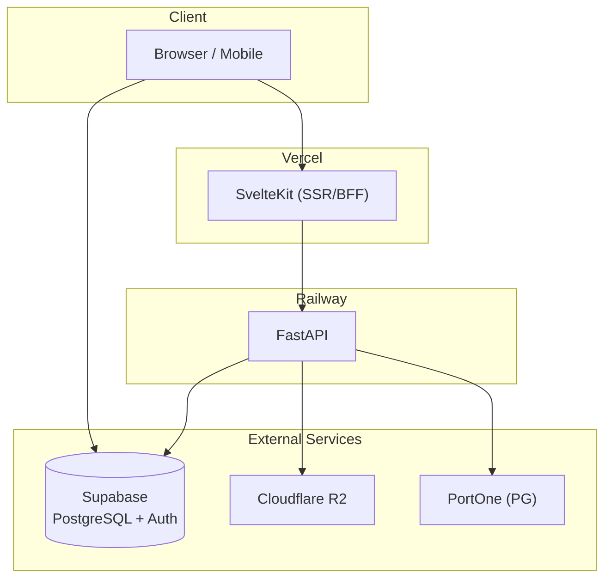
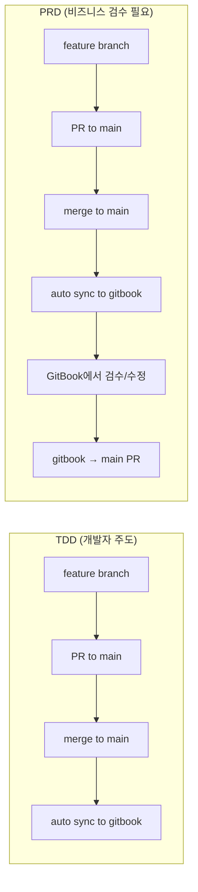

# ko&clo 쇼핑몰 기술 문서

**Version 2.2** | **2025-12-26**

---

## 폴더 구조

```
docs/shopping/
├── README.md                           # 본 문서
├── PRD/                                # Product Requirements Document
│   ├── Shopping_Mall_PRD.md            # 메인 PRD (개요)
│   ├── MBR_회원관리.md                  # 회원관리 요구사항
│   ├── PRD_상품관리.md                  # 상품관리 요구사항
│   ├── CART_장바구니.md                 # 장바구니 요구사항 (TBD)
│   ├── ORD_주문결제.md                  # 주문/결제 요구사항 (TBD)
│   ├── SHP_배송.md                     # 배송 요구사항 (TBD)
│   ├── CS_고객센터.md                   # 고객센터/리뷰 요구사항 (TBD)
│   └── PROMO_프로모션.md                # 프로모션 요구사항 (TBD)
└── TDD/                                # Technical Design Document
    ├── Shopping_Mall_TDD.md            # 메인 TDD (개요)
    ├── MBR_회원관리.md                  # 회원관리 기술 명세
    ├── PRD_상품관리.md                  # 상품관리 기술 명세
    ├── PRIVACY_개인정보처리명세.md      # 개인정보 처리 정책
    ├── AUTH_인증흐름.md                 # 인증/세션 관리
    ├── PAYMENT_결제흐름.md              # 결제 처리
    ├── DATABASE_설계.md                 # DB ERD 및 스키마
    └── INFRA_배포전략.md                # 인프라/CI/CD/비용
```

---

## 문서 목록

### PRD (Product Requirements Document)

| 문서 | 상태 | 설명 |
|------|------|------|
| [Shopping_Mall_PRD.md](PRD/Shopping_Mall_PRD.md) | 정의됨 | 전체 요구사항 개요, 비즈니스 목표, 로드맵 |
| [MBR_회원관리.md](PRD/MBR_회원관리.md) | 정의됨 | 회원가입/로그인/탈퇴 등 회원 기능 요구사항 |
| [PRD_상품관리.md](PRD/PRD_상품관리.md) | 정의됨 | 상품 목록/상세/등록/수정/삭제, 재고, 카테고리 |
| [CART_장바구니.md](PRD/CART_장바구니.md) | TBD | 장바구니 담기/수정/삭제, 비회원 장바구니 |
| [ORD_주문결제.md](PRD/ORD_주문결제.md) | TBD | 주문서 작성, 결제, 취소/환불 |
| [SHP_배송.md](PRD/SHP_배송.md) | TBD | 배송 정책, 배송 조회, 교환/반품 |
| [CS_고객센터.md](PRD/CS_고객센터.md) | TBD | FAQ, 1:1 문의, 공지사항, 리뷰/평점 |
| [PROMO_프로모션.md](PRD/PROMO_프로모션.md) | TBD | 쿠폰, 포인트, 기획전, 알림 |

### TDD (Technical Design Document)

| 문서 | 설명 |
|------|------|
| [Shopping_Mall_TDD.md](TDD/Shopping_Mall_TDD.md) | 전체 기술 설계 개요, 아키텍처, 기술 스택 |
| [MBR_회원관리.md](TDD/MBR_회원관리.md) | 회원가입/로그인/탈퇴 등 전체 회원 기능 |
| [PRD_상품관리.md](TDD/PRD_상품관리.md) | 상품 목록/상세/등록/수정/삭제, 재고, 카테고리 |
| [PRIVACY_개인정보처리명세.md](TDD/PRIVACY_개인정보처리명세.md) | 개인정보 분류, 삭제 정책, 법적 보관 |
| [AUTH_인증흐름.md](TDD/AUTH_인증흐름.md) | JWT 관리, 토큰 갱신, 권한 관리 |
| [PAYMENT_결제흐름.md](TDD/PAYMENT_결제흐름.md) | PortOne 연동, 결제/환불 흐름 |
| [DATABASE_설계.md](TDD/DATABASE_설계.md) | ERD, 테이블 DDL, RLS 정책 |
| [INFRA_배포전략.md](TDD/INFRA_배포전략.md) | CI/CD, 환경 구성, 비용 분석 |

---

## 핵심 비즈니스 의사결정

| # | 의사결정 | 최종 결정 |
|---|----------|-----------|
| 1 | PLP/SRP 통합 | MVP 통합, Post-MVP 분리 검토 |
| 2 | 검색 MVP 범위 | PostgreSQL ILIKE만 |
| 3 | URL 구조 | 단일 라우트 /products/[...slug] |
| 4 | SKU 변경 정책 | 변경 가능 (Midas 동기화 주의) |
| 5 | 재고 흐름 | Midas → 쇼핑몰 (단방향) |
| 6 | 에디터 범위 | TipTap 기본 서식만 |
| 7 | 할인가 입력 | 직접 + 할인율 모두 지원 |
| 8 | 상품 구조 | 옵션 방식 (ProductGroup 불필요) |

---

## 기술 스택

| 구분 | 기술 |
|------|------|
| Frontend | SvelteKit, TypeScript, Tailwind CSS, Zod |
| Backend | FastAPI, Python 3.11+, SQLAlchemy 2.0, Pydantic v2 |
| Database | Supabase (PostgreSQL) |
| Auth | Supabase Auth (OAuth, JWT) |
| Storage | Cloudflare R2 |
| Payment | PortOne |
| Hosting | Vercel (FE), Railway (BE) |

---

## 시스템 아키텍처



---

## GitBook 연동

본 문서는 GitBook을 통해 웹으로 제공됩니다.

### 브랜치 구조

| 브랜치 | 용도 |
|--------|------|
| `main` | 개발 브랜치 (PR 머지 대상) |
| `gitbook` | GitBook 연동 브랜치 (자동 동기화) |

### 문서 수정 워크플로우



**TDD 흐름**: PR → main 머지 → gitbook 자동 동기화

**PRD 흐름**:
1. PR → main 머지 → gitbook 자동 동기화
2. 비즈니스 담당자가 GitBook에서 직접 검수/수정
3. GitBook 수정사항은 gitbook 브랜치에 커밋됨
4. 필요 시 gitbook → main PR 생성하여 동기화

---

## 문서 작성 원칙

1. **모든 문서는 Markdown으로 작성**
2. **대-기능 단위로 파일 분리** (회원관리, 상품관리 등)
3. **중요 소주제는 별도 파일로 분리** (예: 개인정보처리)
4. **모든 다이어그램은 Mermaid로 작성**
   - 상태가 가정되는 경우 → StateDiagram
   - Race Condition 발생 가능 시 → StateDiagram

---

## 변경 이력

| 버전 | 날짜 | 변경 내용 |
|------|------|-----------|
| 1.0 | 2025-12-20 | 초기 버전 |
| 1.6 | 2025-12-21 | 회원 관리 상세 추가 |
| 1.8 | 2025-12-22 | 상품 관리 PRD 상세 추가 |
| 2.0 | 2025-12-25 | 문서 구조 전면 개편 - 기능별 분리, Mermaid 적용 |
| 2.1 | 2025-12-25 | PRD 폴더 추가, TDD와 분리 |
| 2.2 | 2025-12-26 | docs/ 폴더로 이동, GitBook 연동 설정 |

---

## 문의

- 프로젝트: ko&clo 쇼핑몰
- 담당: ko&clo 개발팀
