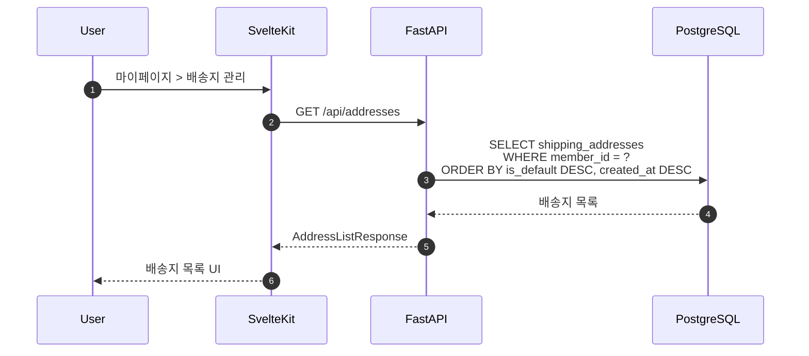
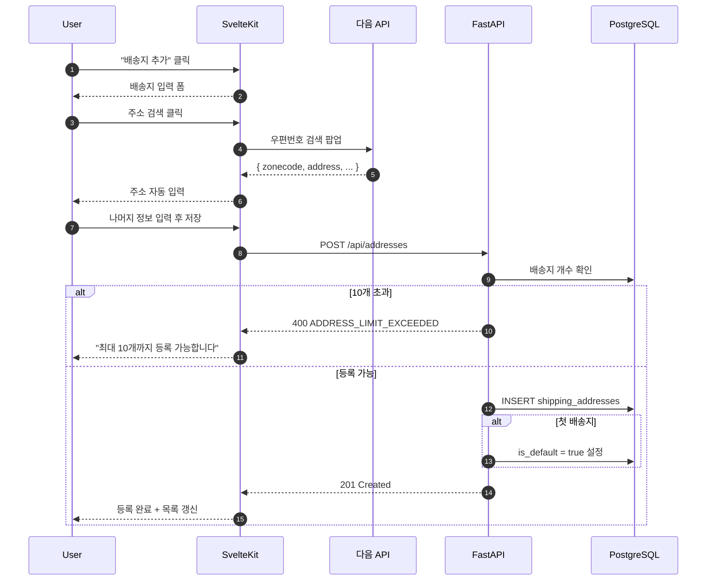
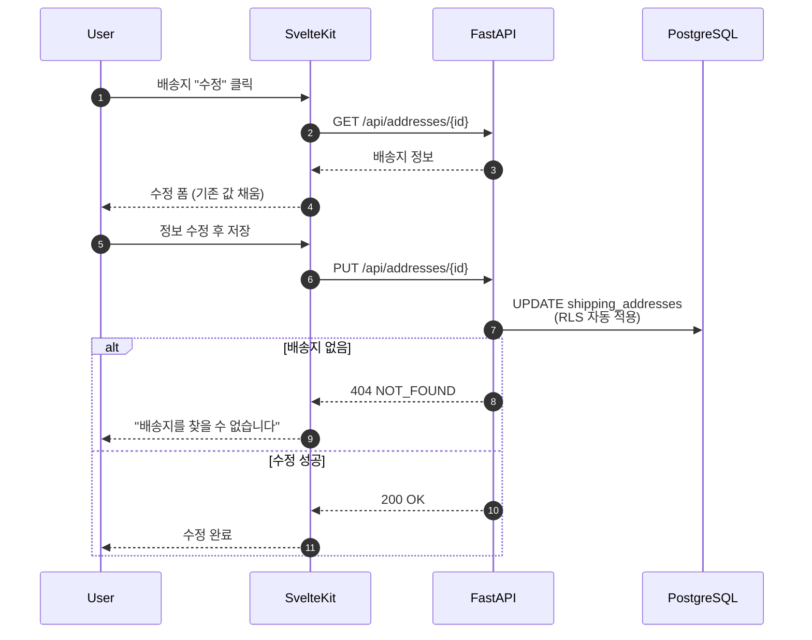
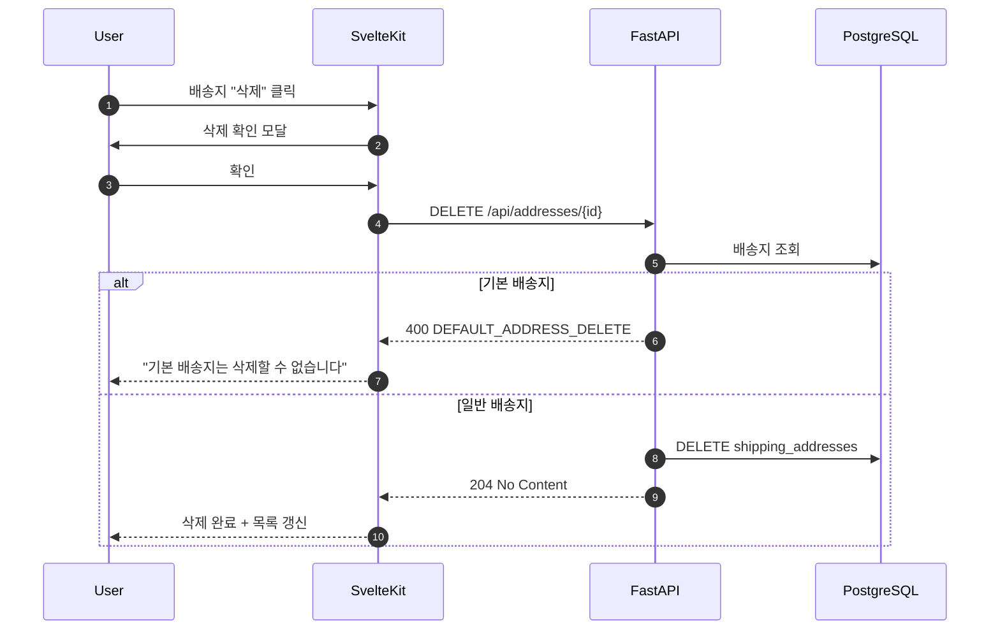
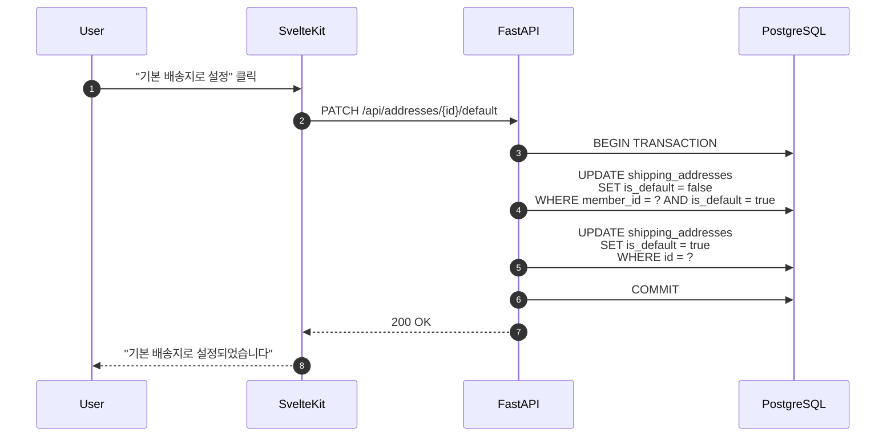
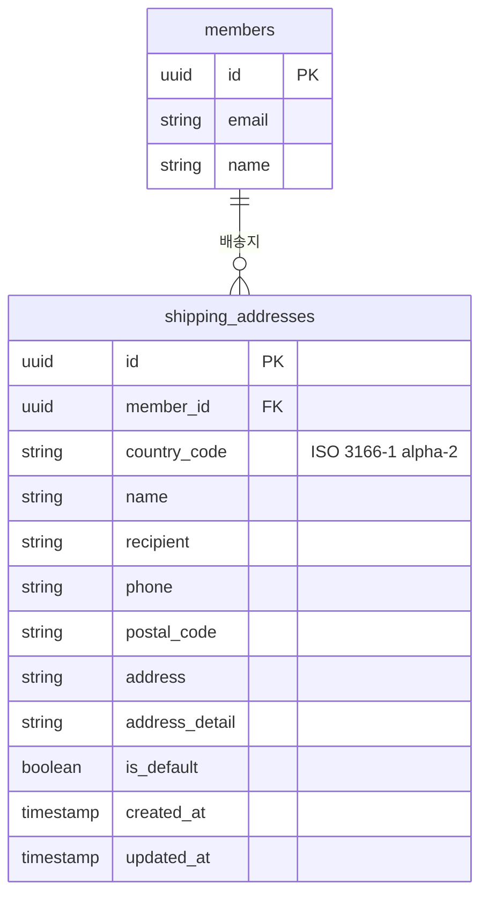

# 배송지 관리 (Shipping Address)

**Version 1.0** | **2025-12-27** | **ko&clo Project**

---

## 목차

1. [개요](#1-개요)
2. [ADDR-001 배송지 목록 조회](#2-addr-001-배송지-목록-조회)
3. [ADDR-002 배송지 등록](#3-addr-002-배송지-등록)
4. [ADDR-003 배송지 수정](#4-addr-003-배송지-수정)
5. [ADDR-004 배송지 삭제](#5-addr-004-배송지-삭제)
6. [ADDR-005 기본 배송지 설정](#6-addr-005-기본-배송지-설정)
7. [주소 검색](#7-주소-검색)
8. [데이터 모델](#8-데이터-모델)
9. [변경 이력](#변경-이력)

---

## 1. 개요

> **하위 목차**
> - [1.1 기능 목록](#11-기능-목록)
> - [1.2 배송지 운영 정책](#12-배송지-운영-정책)

### 1.1 기능 목록

| 기능 ID | 기능명 | 사용자 | 우선순위 | 설명 |
|---------|--------|--------|----------|------|
| ADDR-001 | 배송지 목록 조회 | Consumer | MVP | 등록된 배송지 목록, 기본 배송지 표시 |
| ADDR-002 | 배송지 등록 | Consumer | MVP | 수령인, 연락처, 주소 입력 |
| ADDR-003 | 배송지 수정 | Consumer | MVP | 등록된 배송지 정보 수정 |
| ADDR-004 | 배송지 삭제 | Consumer | MVP | 배송지 삭제 (기본 배송지 제외) |
| ADDR-005 | 기본 배송지 설정 | Consumer | MVP | 기본 배송지 지정/변경 |

### 1.2 배송지 운영 정책

| 항목 | 정책 |
|------|------|
| 최대 등록 개수 | 10개 |
| 기본 배송지 | 필수 1개 (첫 등록 시 자동 설정) |
| 기본 배송지 삭제 | 불가 (다른 배송지를 기본으로 변경 후 삭제) |
| 주소 검색 | 다음 우편번호 API 사용 |
| 비회원 | 배송지 저장 불가 (주문 시 직접 입력) |

---

## 2. ADDR-001 배송지 목록 조회

| 항목 | 내용 |
|------|------|
| 기능 ID | ADDR-001 |
| 기능명 | 배송지 목록 조회 (Address List) |
| 사용자 유형 | Consumer |
| 우선순위 | 필수 (MVP) |

> **하위 목차**
> - [2.1 Flow](#21-flow)
> - [2.2 API 명세](#22-api-명세)
> - [2.3 UI 구성](#23-ui-구성)

### 2.1 Flow



### 2.2 API 명세

#### GET /api/addresses

**Request**
```
Headers:
  Authorization: Bearer <JWT>
```

**Response (200 OK)**
```json
{
  "addresses": [
    {
      "id": "uuid",
      "name": "집",
      "recipient": "홍길동",
      "phone": "010-1234-5678",
      "postal_code": "06000",
      "address": "서울특별시 강남구 테헤란로 123",
      "address_detail": "456호",
      "is_default": true,
      "created_at": "2025-12-01T10:00:00Z"
    },
    {
      "id": "uuid",
      "name": "회사",
      "recipient": "홍길동",
      "phone": "010-1234-5678",
      "postal_code": "04524",
      "address": "서울특별시 중구 세종대로 110",
      "address_detail": "서울시청",
      "is_default": false,
      "created_at": "2025-12-15T14:00:00Z"
    }
  ],
  "count": 2,
  "max_count": 10
}
```

### 2.3 UI 구성

| 요소 | 설명 |
|------|------|
| 배송지 카드 | 배송지명, 수령인, 연락처, 주소 표시 |
| 기본 배송지 뱃지 | 기본 배송지에 표시 |
| 액션 버튼 | 수정, 삭제, 기본 배송지 설정 |
| 추가 버튼 | 새 배송지 등록 (최대 10개 제한) |

---

## 3. ADDR-002 배송지 등록

| 항목 | 내용 |
|------|------|
| 기능 ID | ADDR-002 |
| 기능명 | 배송지 등록 (Add Address) |
| 사용자 유형 | Consumer |
| 우선순위 | 필수 (MVP) |

> **하위 목차**
> - [3.1 Flow](#31-flow)
> - [3.2 입력 필드](#32-입력-필드)
> - [3.3 API 명세](#33-api-명세)
> - [3.4 검증 규칙](#34-검증-규칙)
> - [3.5 에러 코드](#35-에러-코드)

### 3.1 Flow



### 3.2 입력 필드

| 필드 | 필수 | 최대길이 | 설명 |
|------|------|----------|------|
| 배송지명 | N | 20 | 예: 집, 회사 (미입력 시 "배송지 N") |
| 수령인 | Y | 50 | 받으실 분 이름 |
| 연락처 | Y | 20 | 휴대폰 번호 |
| 우편번호 | Y | 10 | 다음 API에서 자동 입력 |
| 주소 | Y | 200 | 다음 API에서 자동 입력 |
| 상세주소 | N | 100 | 동/호수 등 직접 입력 |
| 기본 배송지 설정 | N | - | 체크박스 |

### 3.3 API 명세

#### POST /api/addresses

**Request**
```json
{
  "name": "집",
  "recipient": "홍길동",
  "phone": "010-1234-5678",
  "postal_code": "06000",
  "address": "서울특별시 강남구 테헤란로 123",
  "address_detail": "456호",
  "is_default": false
}
```

**Response (201 Created)**
```json
{
  "id": "uuid",
  "name": "집",
  "recipient": "홍길동",
  "phone": "010-1234-5678",
  "postal_code": "06000",
  "address": "서울특별시 강남구 테헤란로 123",
  "address_detail": "456호",
  "is_default": true,
  "created_at": "2025-12-27T10:00:00Z"
}
```

### 3.4 검증 규칙

| 규칙 | 조건 | 에러 |
|------|------|------|
| 개수 제한 | count < 10 | ADDRESS_LIMIT_EXCEEDED |
| 수령인 필수 | recipient not empty | RECIPIENT_REQUIRED |
| 연락처 필수 | phone not empty | PHONE_REQUIRED |
| 연락처 형식 | valid phone format | INVALID_PHONE |
| 주소 필수 | address not empty | ADDRESS_REQUIRED |

### 3.5 에러 코드

| HTTP | 에러 코드 | 설명 |
|------|-----------|------|
| 400 | ADDRESS_LIMIT_EXCEEDED | 배송지는 최대 10개까지 등록할 수 있습니다 |
| 400 | RECIPIENT_REQUIRED | 수령인을 입력해주세요 |
| 400 | PHONE_REQUIRED | 연락처를 입력해주세요 |
| 400 | INVALID_PHONE | 올바른 연락처 형식이 아닙니다 |
| 400 | ADDRESS_REQUIRED | 주소를 입력해주세요 |

---

## 4. ADDR-003 배송지 수정

| 항목 | 내용 |
|------|------|
| 기능 ID | ADDR-003 |
| 기능명 | 배송지 수정 (Update Address) |
| 사용자 유형 | Consumer |
| 우선순위 | 필수 (MVP) |

> **하위 목차**
> - [4.1 Flow](#41-flow)
> - [4.2 API 명세](#42-api-명세)

### 4.1 Flow



> **Note**: RLS 정책에 의해 본인 배송지만 조회/수정 가능하므로 별도 권한 검사 불필요

### 4.2 API 명세

#### PUT /api/addresses/{address_id}

**Request**
```json
{
  "name": "집 (신규)",
  "recipient": "홍길동",
  "phone": "010-9876-5432",
  "postal_code": "06000",
  "address": "서울특별시 강남구 테헤란로 123",
  "address_detail": "789호"
}
```

**Response (200 OK)**
```json
{
  "id": "uuid",
  "name": "집 (신규)",
  "recipient": "홍길동",
  "phone": "010-9876-5432",
  "postal_code": "06000",
  "address": "서울특별시 강남구 테헤란로 123",
  "address_detail": "789호",
  "is_default": true,
  "updated_at": "2025-12-27T11:00:00Z"
}
```

---

## 5. ADDR-004 배송지 삭제

| 항목 | 내용 |
|------|------|
| 기능 ID | ADDR-004 |
| 기능명 | 배송지 삭제 (Delete Address) |
| 사용자 유형 | Consumer |
| 우선순위 | 필수 (MVP) |

> **하위 목차**
> - [5.1 Flow](#51-flow)
> - [5.2 API 명세](#52-api-명세)
> - [5.3 삭제 제한](#53-삭제-제한)

### 5.1 Flow



### 5.2 API 명세

#### DELETE /api/addresses/{address_id}

**Response (204 No Content)**

성공 시 본문 없음

**Response (400 Bad Request)**
```json
{
  "error": "DEFAULT_ADDRESS_DELETE",
  "message": "기본 배송지는 삭제할 수 없습니다. 다른 배송지를 기본으로 설정한 후 삭제해주세요."
}
```

### 5.3 삭제 제한

| 조건 | 삭제 가능 | 안내 메시지 |
|------|----------|------------|
| 기본 배송지 | X | 다른 배송지를 기본으로 설정 후 삭제 |
| 일반 배송지 | O | - |
| 마지막 배송지 | X (기본 배송지이므로) | 위와 동일 |

---

## 6. ADDR-005 기본 배송지 설정

| 항목 | 내용 |
|------|------|
| 기능 ID | ADDR-005 |
| 기능명 | 기본 배송지 설정 (Set Default) |
| 사용자 유형 | Consumer |
| 우선순위 | 필수 (MVP) |

> **하위 목차**
> - [6.1 Flow](#61-flow)
> - [6.2 API 명세](#62-api-명세)

### 6.1 Flow



### 6.2 API 명세

#### PATCH /api/addresses/{address_id}/default

**Request**

본문 없음

**Response (200 OK)**
```json
{
  "id": "uuid",
  "is_default": true,
  "message": "기본 배송지로 설정되었습니다"
}
```

---

## 7. 주소 검색

> **하위 목차**
> - [7.1 국가별 주소 입력](#71-국가별-주소-입력)
> - [7.2 한국 주소 검색 API](#72-한국-주소-검색-api)
> - [7.3 반환 데이터 매핑](#73-반환-데이터-매핑)

### 7.1 국가별 주소 입력

| 국가 | 입력 방식 | 비고 |
|------|----------|------|
| KR (한국) | 주소 검색 API | MVP 지원 |
| 기타 | 직접 입력 | 향후 확장 |

> **Note**: MVP에서는 한국(KR)만 지원. `country_code` 필드로 향후 확장 대비.

### 7.2 한국 주소 검색 API

| 항목 | 옵션 A: 다음 우편번호 | 옵션 B: juso.go.kr |
|------|---------------------|-------------------|
| 제공 | 카카오 | 행정안전부 |
| API 키 | 불필요 | 필요 (신청) |
| 방식 | 팝업 기반 | REST API |
| 문서 | postcode.map.daum.net | juso.go.kr |

> **TODO**: 구현 시 API 선택 결정

**공통 인터페이스**:
```typescript
// $lib/utils/address-search.ts

interface AddressSearchResult {
  postalCode: string;   // 우편번호
  address: string;      // 기본 주소 (도로명)
}

export function openAddressSearch(countryCode: string): Promise<AddressSearchResult> {
  if (countryCode === 'KR') {
    return openKoreanAddressSearch();
  }
  throw new Error('Unsupported country');
}
```

### 7.3 반환 데이터 매핑

| API 응답 | 저장 필드 | 설명 |
|----------|----------|------|
| 우편번호 | postal_code | 5자리 |
| 도로명 주소 | address | 기본 주소 |
| - | address_detail | 사용자 직접 입력 |

---

## 8. 데이터 모델

> **하위 목차**
> - [8.1 테이블 관계](#81-테이블-관계)
> - [8.2 shipping_addresses 테이블](#82-shipping_addresses-테이블)

### 8.1 테이블 관계



### 8.2 shipping_addresses 테이블

```sql
CREATE TABLE shipping_addresses (
    id UUID PRIMARY KEY DEFAULT gen_random_uuid(),
    member_id UUID NOT NULL REFERENCES members(id) ON DELETE CASCADE,

    -- 국가 코드 (ISO 3166-1 alpha-2)
    country_code VARCHAR(2) NOT NULL DEFAULT 'KR',

    -- 배송지 정보
    name VARCHAR(20),
    recipient VARCHAR(50) NOT NULL,
    phone VARCHAR(20) NOT NULL,
    postal_code VARCHAR(10) NOT NULL,
    address VARCHAR(200) NOT NULL,
    address_detail VARCHAR(100),

    -- 기본 배송지 여부
    is_default BOOLEAN NOT NULL DEFAULT false,

    -- 타임스탬프
    created_at TIMESTAMPTZ DEFAULT NOW(),
    updated_at TIMESTAMPTZ DEFAULT NOW()
);

-- 인덱스
CREATE INDEX idx_shipping_addresses_member ON shipping_addresses(member_id);

-- 회원당 기본 배송지 1개 보장 (Partial Unique Index)
CREATE UNIQUE INDEX idx_shipping_addresses_default
    ON shipping_addresses(member_id)
    WHERE is_default = true;

-- RLS 정책
ALTER TABLE shipping_addresses ENABLE ROW LEVEL SECURITY;

CREATE POLICY "shipping_addresses_all_own"
    ON shipping_addresses FOR ALL
    USING (auth.uid() = member_id);
```

**설계 포인트**:
- `country_code DEFAULT 'KR'`: MVP는 한국만 지원, 향후 확장 대비
- `ON DELETE CASCADE`: 회원 탈퇴 시 배송지 자동 삭제
- Partial Unique Index: 회원당 기본 배송지 1개만 허용
- RLS: 본인 배송지만 접근 가능

---

## 변경 이력

| 버전 | 날짜 | 변경 내용 |
|------|------|-----------|
| 1.0 | 2025-12-27 | 초기 작성 - country_code 필드 추가, RLS 기반 권한 처리 |
