# 인증 흐름 (Authentication Flow)

**Version 1.0** | **2025-12-25** | **ko&clo Project**

---

## 목차

1. [개요](#1-개요)
2. [인증 아키텍처](#2-인증-아키텍처)
3. [JWT 토큰 관리](#3-jwt-토큰-관리)
4. [인증 흐름 상세](#4-인증-흐름-상세)
5. [권한 관리](#5-권한-관리)
6. [보안 고려사항](#6-보안-고려사항)

---

## 1. 개요

> **하위 목차**
> - [1.1 인증 방식](#11-인증-방식)
> - [1.2 인증 주체](#12-인증-주체)

### 1.1 인증 방식

| 방식 | 설명 | 우선순위 |
|------|------|----------|
| Supabase Auth | OAuth 및 이메일 인증 통합 | Primary |
| JWT | 토큰 기반 인증 | - |
| HttpOnly Cookie | 토큰 저장 | - |

### 1.2 인증 주체

| 주체 | 역할 | 인증 방식 |
|------|------|-----------|
| Consumer | 일반 고객 | 소셜/이메일 로그인 |
| Admin | 관리자 | 이메일 로그인 + Role 검증 |
| Service | 서버 간 통신 | Service Role Key |

---

## 2. 인증 아키텍처

> **하위 목차**
> - [2.1 전체 인증 흐름](#21-전체-인증-흐름)
> - [2.2 계층별 인증 책임](#22-계층별-인증-책임)

### 2.1 전체 인증 흐름

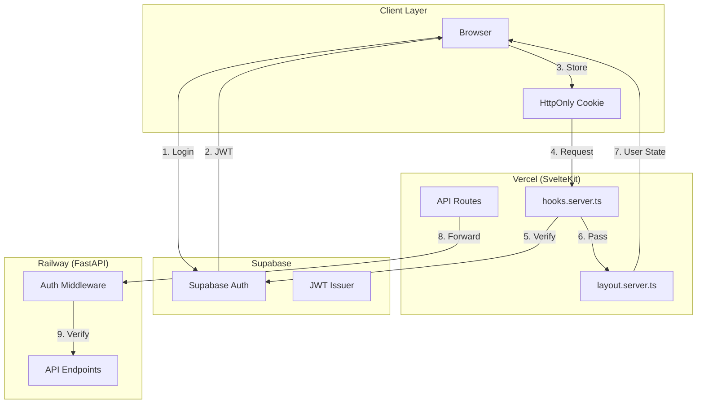

### 2.2 계층별 인증 책임

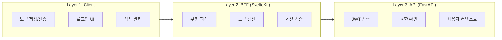

---

## 3. JWT 토큰 관리

> **하위 목차**
> - [3.1 토큰 구조](#31-토큰-구조)
> - [3.2 토큰 종류 및 저장](#32-토큰-종류-및-저장)
> - [3.3 토큰 생명주기 상태](#33-토큰-생명주기-상태)
> - [3.4 토큰 갱신 Flow](#34-토큰-갱신-flow)
> - [3.5 Race Condition 처리](#35-race-condition-처리)

### 3.1 토큰 구조

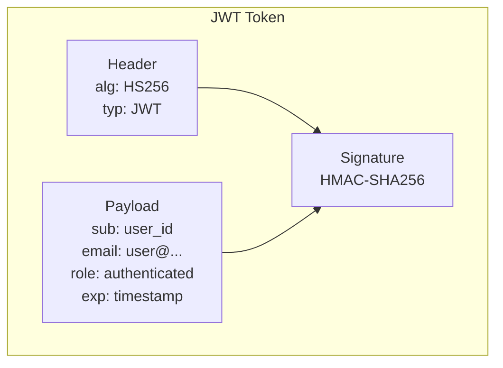

### 3.2 토큰 종류 및 저장

| 토큰 | 저장 위치 | 유효 기간 | 용도 |
|------|-----------|-----------|------|
| access_token | HttpOnly Cookie | 1시간 | API 인증 |
| refresh_token | HttpOnly Cookie | 30일 | 토큰 갱신 |

### 3.3 토큰 생명주기 상태

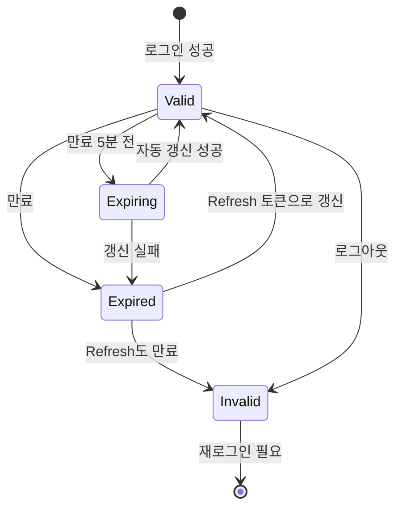

### 3.4 토큰 갱신 Flow

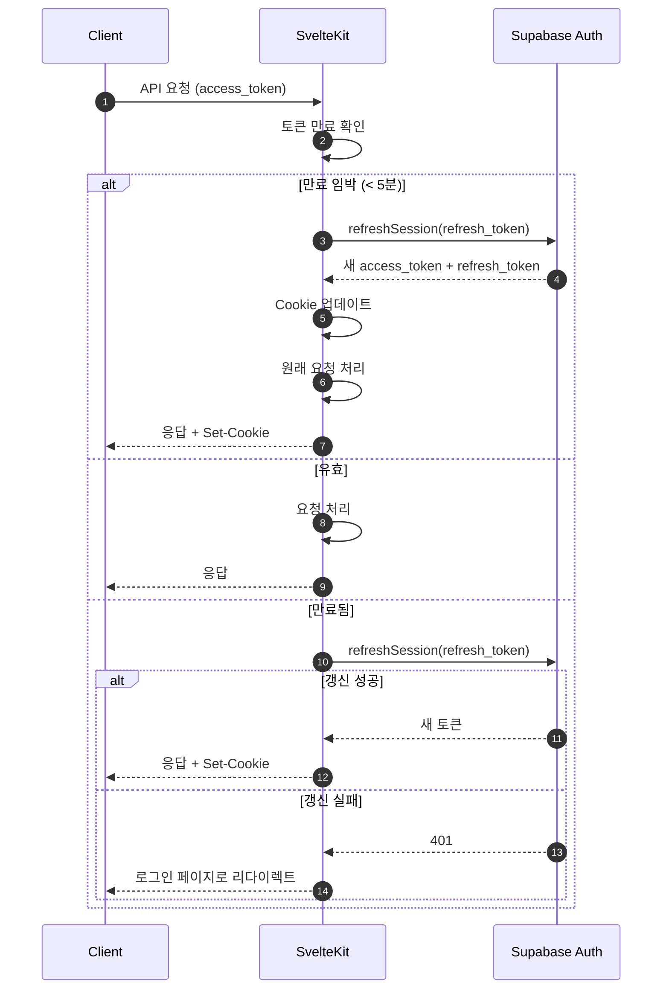

### 3.5 Race Condition 처리

동시에 여러 요청이 토큰 갱신을 시도할 때의 처리:

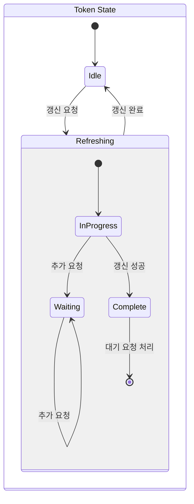

#### 구현 전략

```typescript
// src/lib/auth/tokenManager.ts
let refreshPromise: Promise<Session> | null = null;

async function refreshToken(): Promise<Session> {
  // 이미 갱신 중이면 기존 Promise 반환 (중복 요청 방지)
  if (refreshPromise) {
    return refreshPromise;
  }

  refreshPromise = supabase.auth.refreshSession()
    .then(({ data }) => {
      refreshPromise = null;
      return data.session;
    })
    .catch((error) => {
      refreshPromise = null;
      throw error;
    });

  return refreshPromise;
}
```

---

## 4. 인증 흐름 상세

> **하위 목차**
> - [4.1 전체 인증 시퀀스](#41-전체-인증-시퀀스)
> - [4.2 hooks.server.ts 처리](#42-hooksserverts-처리)
> - [4.3 보호된 라우트 접근](#43-보호된-라우트-접근)

### 4.1 전체 인증 시퀀스

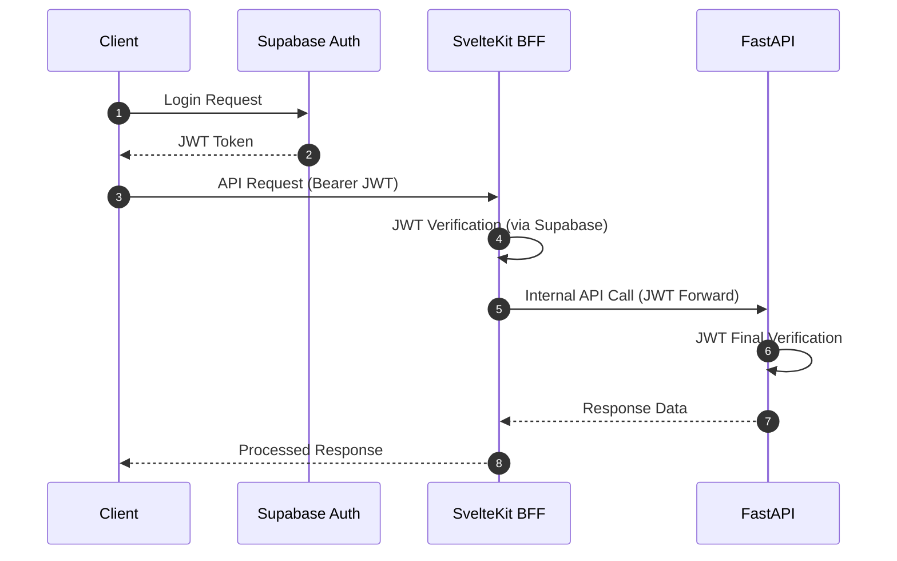

### 4.2 hooks.server.ts 처리

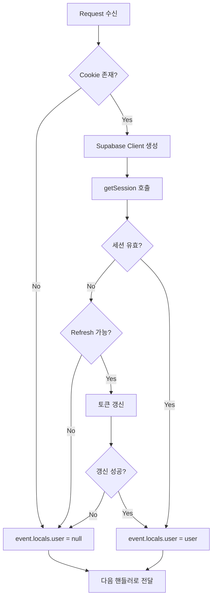

### 4.3 보호된 라우트 접근

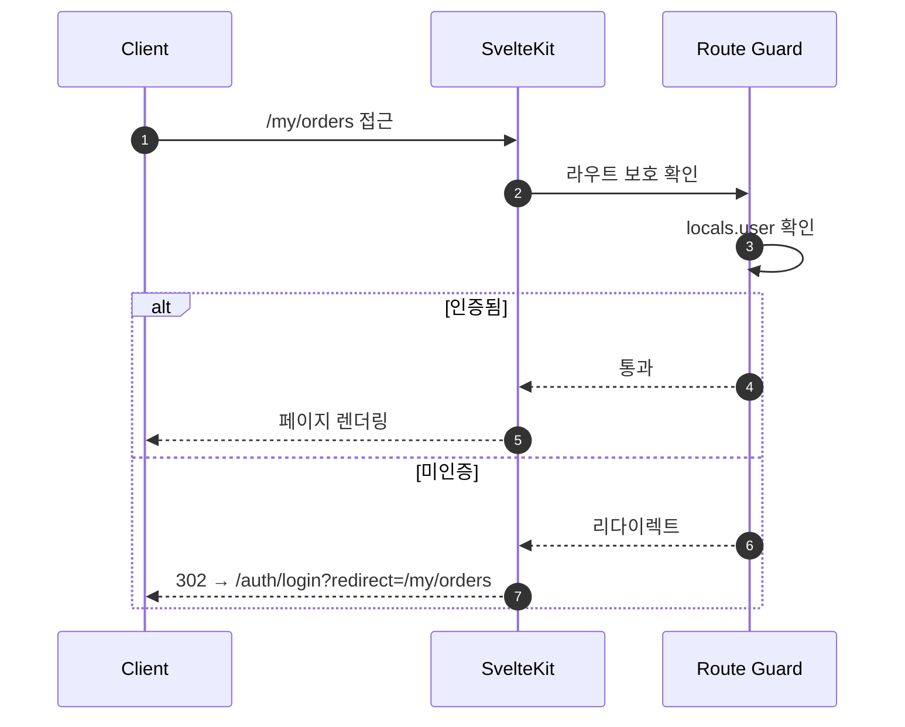

---

## 5. 권한 관리

> **하위 목차**
> - [5.1 역할 정의](#51-역할-정의)
> - [5.2 역할별 접근 권한](#52-역할별-접근-권한)
> - [5.3 권한 검증 Flow](#53-권한-검증-flow)
> - [5.4 Admin 인증 상태](#54-admin-인증-상태)

### 5.1 역할 정의

| 역할 | 설명 | 접근 범위 |
|------|------|-----------|
| anon | 비회원 | 공개 API만 |
| authenticated | 일반 회원 | 본인 데이터 + 공개 API |
| admin | 관리자 | 모든 API |
| service_role | 서버 | 제한 없음 |

### 5.2 역할별 접근 권한

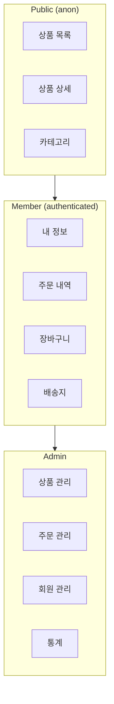

### 5.3 권한 검증 Flow

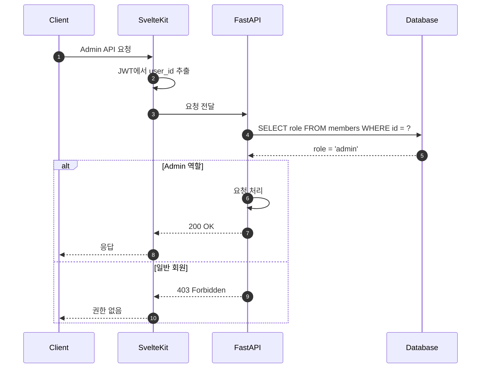

### 5.4 Admin 인증 상태

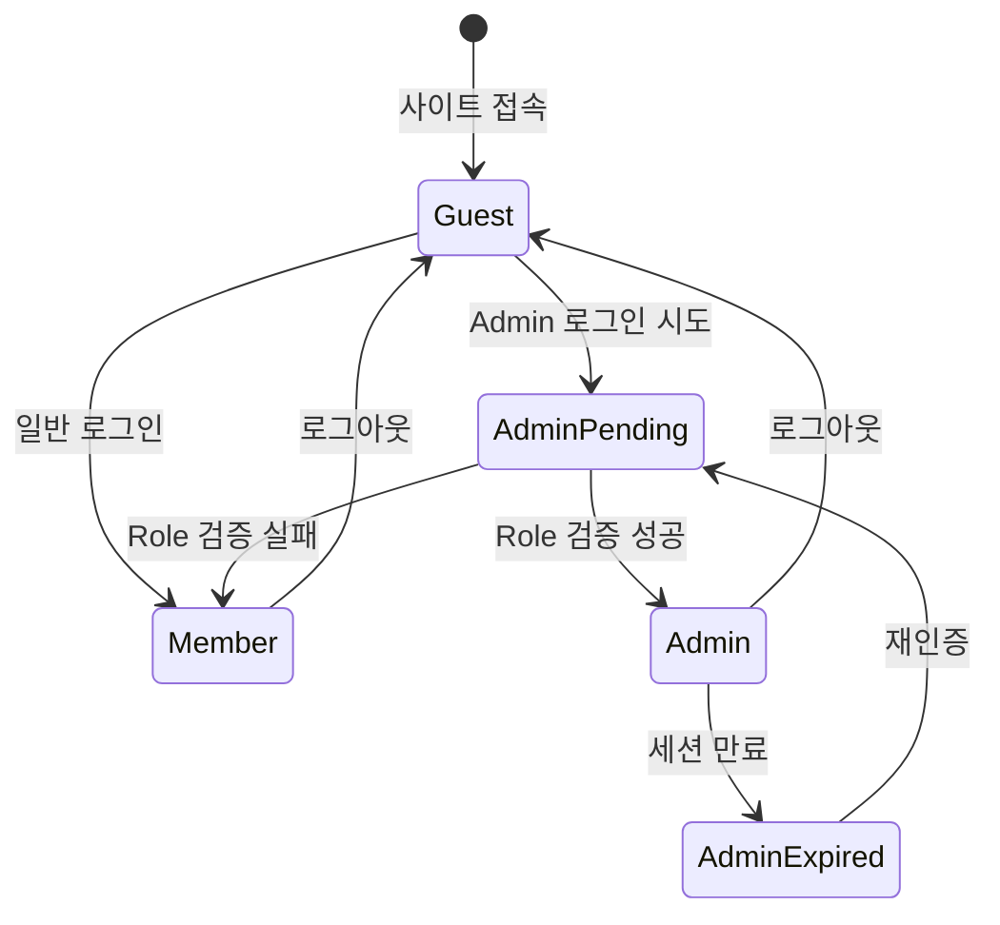

---

## 6. 보안 고려사항

> **하위 목차**
> - [6.1 CSRF 방지](#61-csrf-방지)
> - [6.2 XSS 방지](#62-xss-방지)
> - [6.3 Brute Force 방지](#63-brute-force-방지)
> - [6.4 토큰 보안](#64-토큰-보안)
> - [6.5 Supabase RLS 정책](#65-supabase-rls-정책)

### 6.1 CSRF 방지

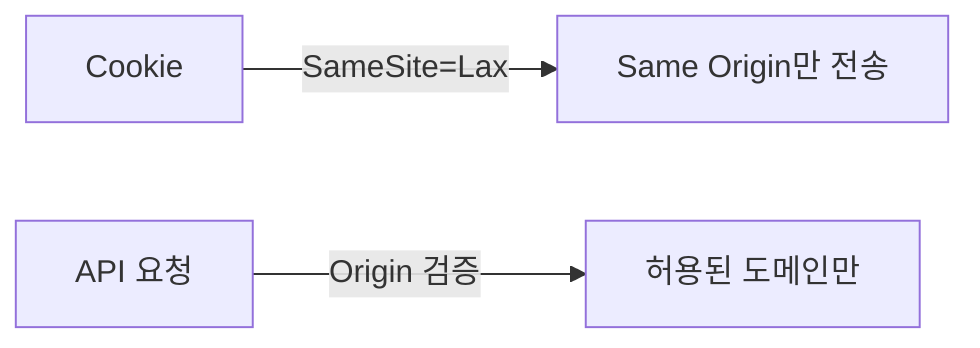

| 설정 | 값 | 목적 |
|------|-----|------|
| SameSite | Lax | Cross-site 요청 시 쿠키 미전송 |
| HttpOnly | true | JavaScript 접근 차단 |
| Secure | true | HTTPS만 전송 |

### 6.2 XSS 방지

| 대상 | 방어 수단 |
|------|-----------|
| 토큰 저장 | HttpOnly Cookie (JS 접근 불가) |
| 사용자 입력 | Svelte 자동 이스케이프 |
| API 응답 | Content-Type: application/json |

### 6.3 Brute Force 방지

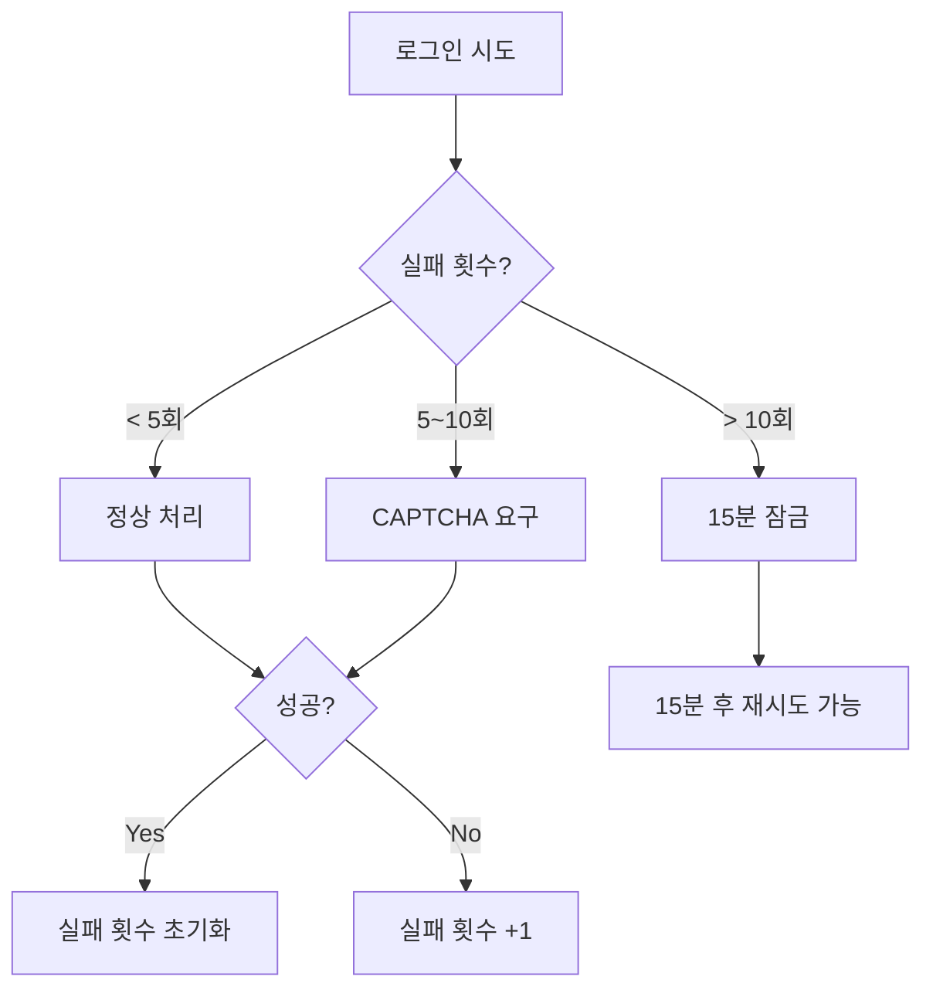

### 6.4 토큰 보안

| 위협 | 대응 |
|------|------|
| 토큰 탈취 | 짧은 만료 시간 (1시간) |
| Replay 공격 | 토큰 갱신 시 이전 토큰 무효화 |
| 세션 하이재킹 | IP/User-Agent 변경 감지 |

### 6.5 Supabase RLS 정책

```sql
-- 본인 데이터만 조회
CREATE POLICY "Users can view own data"
  ON members FOR SELECT
  USING (auth.uid() = id);

-- 본인 데이터만 수정
CREATE POLICY "Users can update own data"
  ON members FOR UPDATE
  USING (auth.uid() = id);

-- 본인 주문만 조회
CREATE POLICY "Users can view own orders"
  ON orders FOR SELECT
  USING (auth.uid() = member_id);
```

---

## 환경 변수

```bash
# Supabase
PUBLIC_SUPABASE_URL=https://xxx.supabase.co
PUBLIC_SUPABASE_ANON_KEY=eyJxxx...

# JWT (서버 전용)
SUPABASE_JWT_SECRET=your-jwt-secret
```

---

## 변경 이력

| 버전 | 날짜 | 변경 내용 |
|------|------|-----------|
| 1.0 | 2025-12-25 | TDD v1.6 내용 기반 초기 작성 |
