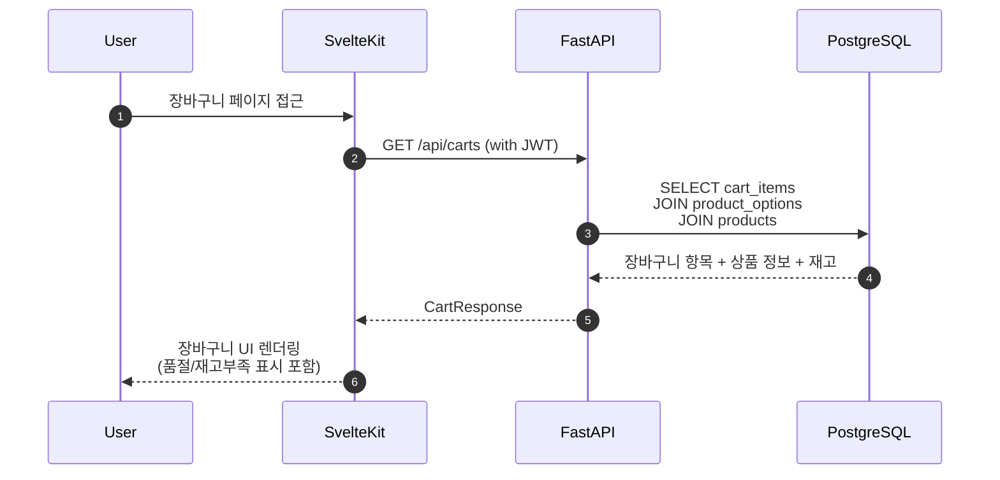
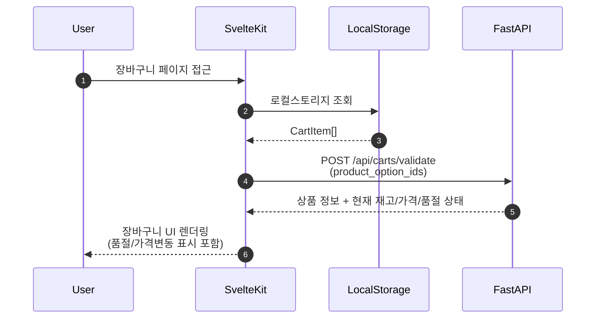
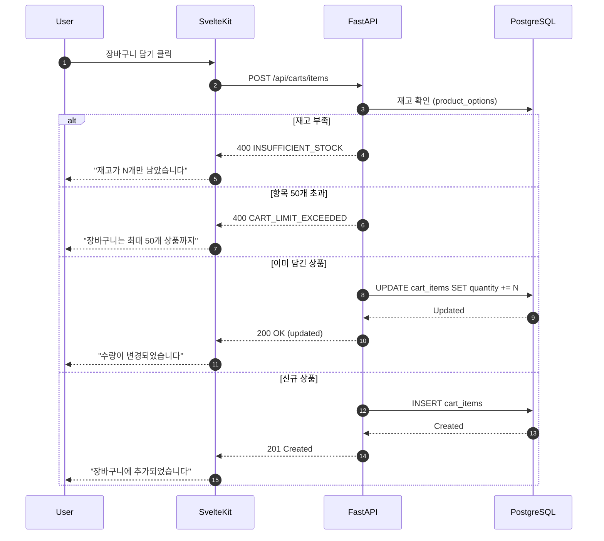
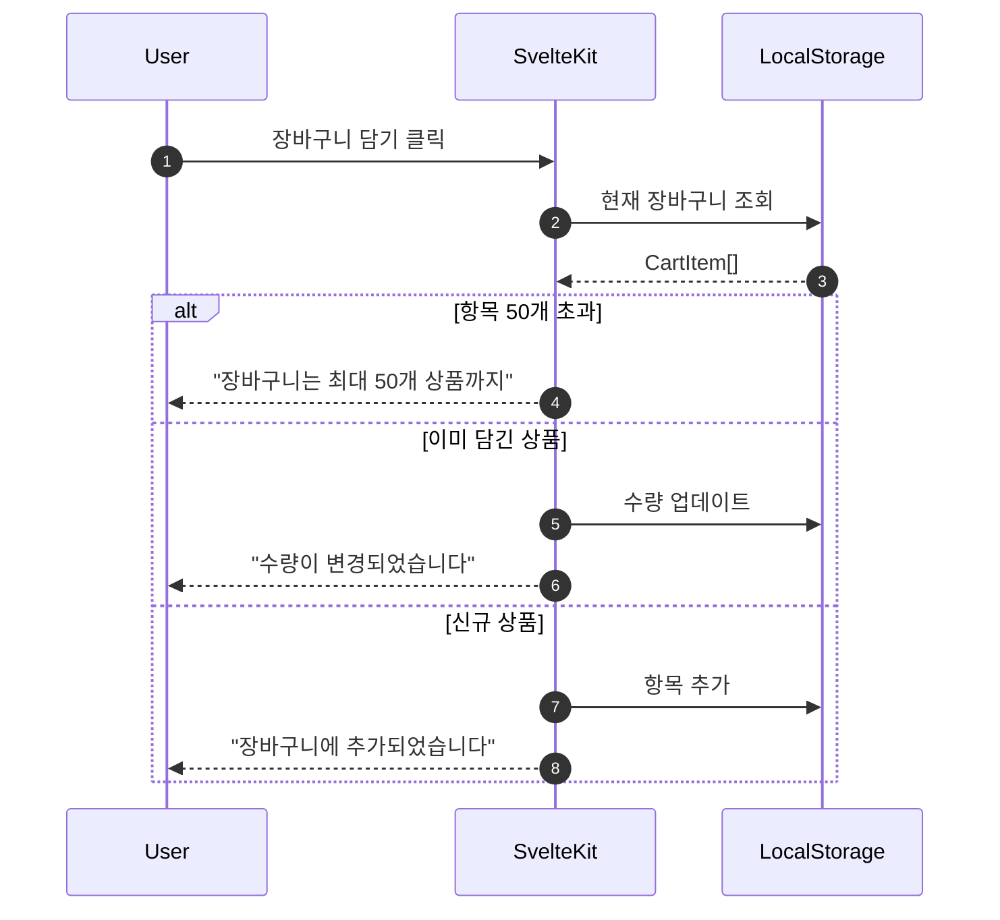
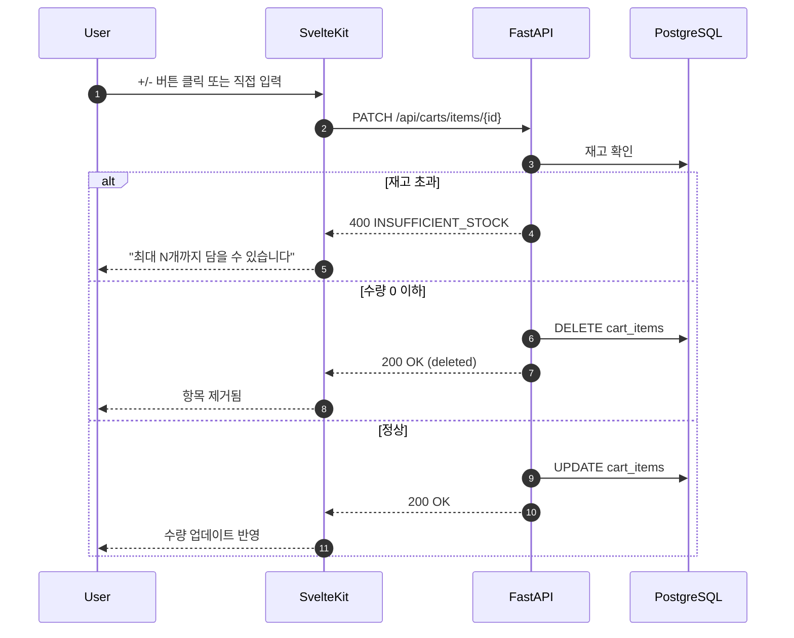
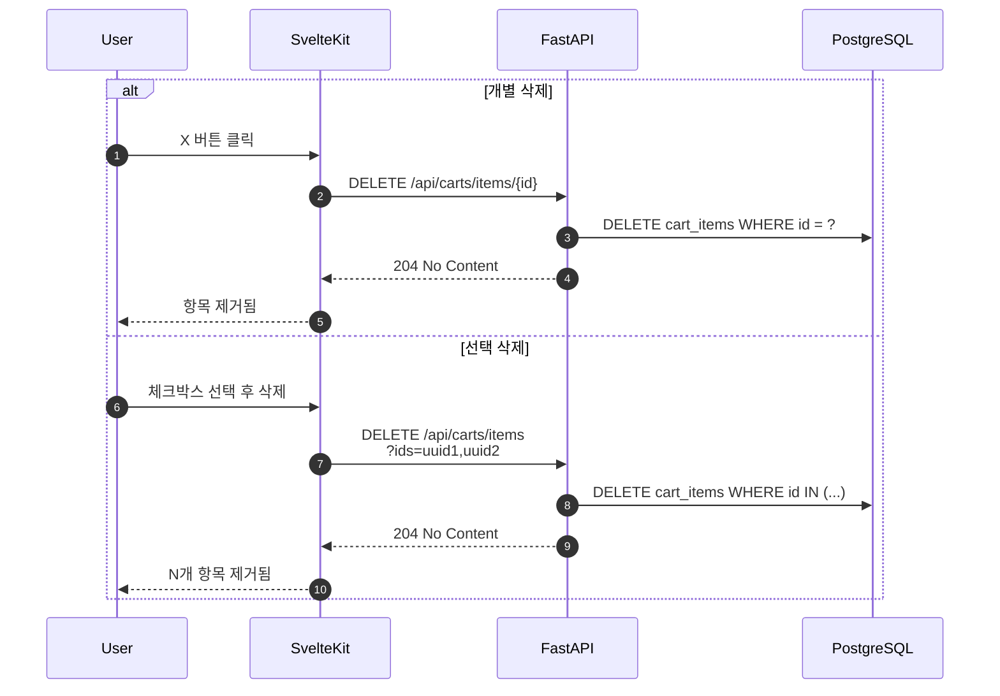
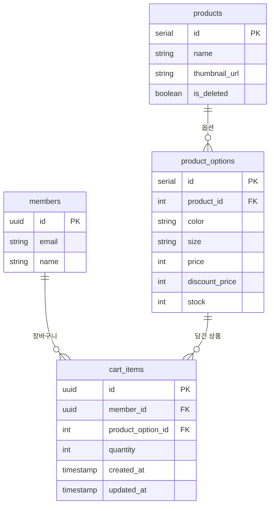

# 장바구니 (Shopping Cart)

**Version 1.1** | **2025-12-31** | **ko&clo Project**

---

## 목차

1. [개요](#1-개요)
2. [CART-001 장바구니 조회](#2-cart-001-장바구니-조회)
3. [CART-002 상품 추가](#3-cart-002-상품-추가)
4. [CART-003 수량 변경](#4-cart-003-수량-변경)
5. [CART-004 상품 제거](#5-cart-004-상품-제거)
6. [비회원 장바구니](#6-비회원-장바구니)
7. [데이터 모델](#7-데이터-모델)
8. [변경 이력](#변경-이력)

---

## 1. 개요

> **하위 목차**
> - [1.1 기능 목록](#11-기능-목록)
> - [1.2 장바구니 운영 정책](#12-장바구니-운영-정책)

### 1.1 기능 목록

| 기능 ID | 기능명 | 사용자 | 우선순위 | 설명 |
|---------|--------|--------|----------|------|
| CART-001 | 장바구니 조회 | Consumer | MVP | 담긴 상품 목록, 품절/가격 변동 표시 |
| CART-002 | 상품 추가 | Consumer | MVP | 상품/옵션/수량 추가 |
| CART-003 | 수량 변경 | Consumer | MVP | +/- 버튼으로 수량 조절 |
| CART-004 | 상품 제거 | Consumer | MVP | 개별/선택/품절 삭제 |

### 1.2 장바구니 운영 정책

| 항목 | 정책 |
|------|------|
| 비회원 장바구니 | 로컬스토리지만 사용 (서버 저장 X) |
| 병합 정책 | MVP에서는 별개 처리 (추후 고객 확인 필요) |
| 항목 수 제한 | 최대 50개 SKU |
| 수량 제한 (비회원) | 제한 없음 (로컬스토리지라 DB 상태 반영 어려움) |
| 수량 제한 (회원) | 재고 수량까지만 허용 (DB 조인으로 실시간 검증 가능) |
| 품절 처리 | 장바구니에 유지 + '품절' 표시 + 결제 제외 |
| 보존 기간 | 회원: 탈퇴 시까지 / 비회원: 브라우저 데이터 삭제 시 |

---

## 2. CART-001 장바구니 조회

| 항목 | 내용 |
|------|------|
| 기능 ID | CART-001 |
| 기능명 | 장바구니 조회 (View Cart) |
| 사용자 유형 | Consumer |
| 우선순위 | 필수 (MVP) |

> **하위 목차**
> - [2.1 회원 장바구니 조회 Flow](#21-회원-장바구니-조회-flow)
> - [2.2 비회원 장바구니 조회 Flow](#22-비회원-장바구니-조회-flow)
> - [2.3 API 명세](#23-api-명세)
> - [2.4 응답 데이터 구조](#24-응답-데이터-구조)

### 2.1 회원 장바구니 조회 Flow



### 2.2 비회원 장바구니 조회 Flow



### 2.3 API 명세

#### GET /api/carts (회원용)

**Request**
```
Headers:
  Authorization: Bearer <JWT>
```

**Response (200 OK)**
```json
{
  "items": [
    {
      "id": "uuid",
      "product_option_id": "uuid",
      "quantity": 2,
      "product": {
        "id": "uuid",
        "name": "베이직 티셔츠",
        "thumbnail_url": "https://...",
        "slug": "basic-tshirt"
      },
      "option": {
        "id": "uuid",
        "color": "블랙",
        "size": "M",
        "price": 29000,
        "discount_price": 25000,
        "stock": 10
      },
      "status": "available"
    }
  ],
  "summary": {
    "total_items": 3,
    "total_price": 75000,
    "available_count": 2,
    "unavailable_count": 1
  }
}
```

#### POST /api/carts/validate (비회원용)

**Request**
```json
{
  "items": [
    {
      "product_option_id": "uuid",
      "quantity": 2
    }
  ]
}
```

**Response (200 OK)**
```json
{
  "items": [
    {
      "product_option_id": "uuid",
      "quantity": 2,
      "product": { ... },
      "option": { ... },
      "status": "available",
      "price_changed": false,
      "original_price": 29000,
      "current_price": 29000
    }
  ],
  "summary": { ... }
}
```

### 2.4 응답 데이터 구조

#### 상품 상태 (status)

| 상태 | 설명 | UI 처리 |
|------|------|---------|
| `available` | 정상 구매 가능 | 기본 표시 |
| `out_of_stock` | 품절 | '품절' 뱃지, 결제 제외 |
| `insufficient_stock` | 재고 부족 (수량 > 재고) | 경고 표시, 수량 조절 안내 |
| `deleted` | 삭제된 상품 | '판매 종료' 표시, 결제 제외 |

---

## 3. CART-002 상품 추가

| 항목 | 내용 |
|------|------|
| 기능 ID | CART-002 |
| 기능명 | 장바구니 추가 (Add to Cart) |
| 사용자 유형 | Consumer |
| 우선순위 | 필수 (MVP) |

> **하위 목차**
> - [3.1 회원 상품 추가 Flow](#31-회원-상품-추가-flow)
> - [3.2 비회원 상품 추가 Flow](#32-비회원-상품-추가-flow)
> - [3.3 API 명세](#33-api-명세)
> - [3.4 검증 규칙](#34-검증-규칙)
> - [3.5 에러 코드](#35-에러-코드)

### 3.1 회원 상품 추가 Flow



### 3.2 비회원 상품 추가 Flow



### 3.3 API 명세

#### POST /api/carts/items

**Request**
```json
{
  "product_option_id": "uuid",
  "quantity": 1
}
```

**Response (201 Created / 200 OK)**
```json
{
  "id": "uuid",
  "product_option_id": "uuid",
  "quantity": 3,
  "created_at": "2025-12-26T10:00:00Z",
  "updated_at": "2025-12-26T10:00:00Z"
}
```

### 3.4 검증 규칙

| 규칙 | 조건 | 에러 |
|------|------|------|
| 수량 양수 | quantity > 0 | INVALID_QUANTITY |
| 재고 확인 (회원) | quantity <= stock | INSUFFICIENT_STOCK |
| 항목 수 제한 | cart_items.count < 50 | CART_LIMIT_EXCEEDED |
| 상품 존재 | product_option exists | PRODUCT_NOT_FOUND |
| 상품 상태 | product.is_deleted = false | PRODUCT_DELETED |

### 3.5 에러 코드

| HTTP | 에러 코드 | 설명 |
|------|-----------|------|
| 400 | INVALID_QUANTITY | 수량은 1 이상이어야 합니다 |
| 400 | INSUFFICIENT_STOCK | 재고가 부족합니다 (남은 재고: N개) |
| 400 | CART_LIMIT_EXCEEDED | 장바구니에는 최대 50개 상품까지 담을 수 있습니다 |
| 404 | PRODUCT_NOT_FOUND | 상품을 찾을 수 없습니다 |
| 410 | PRODUCT_DELETED | 판매 종료된 상품입니다 |

---

## 4. CART-003 수량 변경

| 항목 | 내용 |
|------|------|
| 기능 ID | CART-003 |
| 기능명 | 수량 변경 (Update Quantity) |
| 사용자 유형 | Consumer |
| 우선순위 | 필수 (MVP) |

> **하위 목차**
> - [4.1 회원 수량 변경 Flow](#41-회원-수량-변경-flow)
> - [4.2 API 명세](#42-api-명세)
> - [4.3 검증 규칙](#43-검증-규칙)

### 4.1 회원 수량 변경 Flow



### 4.2 API 명세

#### PATCH /api/carts/items/{id}

**Request**
```json
{
  "quantity": 3
}
```

**Response (200 OK)**
```json
{
  "id": "uuid",
  "product_option_id": "uuid",
  "quantity": 3,
  "updated_at": "2025-12-26T10:00:00Z"
}
```

### 4.3 검증 규칙

| 규칙 | 조건 | 처리 |
|------|------|------|
| 수량 0 | quantity = 0 | 항목 삭제 |
| 수량 음수 | quantity < 0 | INVALID_QUANTITY 에러 |
| 재고 초과 (회원) | quantity > stock | INSUFFICIENT_STOCK 에러 |
| 소유권 확인 | cart_item.member_id = user.id | FORBIDDEN 에러 |

---

## 5. CART-004 상품 제거

| 항목 | 내용 |
|------|------|
| 기능 ID | CART-004 |
| 기능명 | 상품 제거 (Remove from Cart) |
| 사용자 유형 | Consumer |
| 우선순위 | 필수 (MVP) |

> **하위 목차**
> - [5.1 Flow](#51-flow)
> - [5.2 API 명세](#52-api-명세)

### 5.1 Flow



### 5.2 API 명세

#### DELETE /api/carts/items/{id}

개별 삭제

**Response (204 No Content)**

#### DELETE /api/carts/items?ids=uuid1,uuid2

복수 삭제

**Response (204 No Content)**

---

## 6. 비회원 장바구니

> **하위 목차**
> - [6.1 로컬스토리지 구조](#61-로컬스토리지-구조)
> - [6.2 SvelteKit 클라이언트 로직](#62-sveltekit-클라이언트-로직)
> - [6.3 (향후) 병합 정책](#63-향후-병합-정책)

### 6.1 로컬스토리지 구조

**Key**: `koclo_cart`

**Value Schema**:
```typescript
interface GuestCartItem {
  product_option_id: string;
  quantity: number;
  added_at: string; // ISO 8601
}

// localStorage에 저장되는 형태
type GuestCart = GuestCartItem[];
```

**예시**:
```json
[
  {
    "product_option_id": "550e8400-e29b-41d4-a716-446655440000",
    "quantity": 2,
    "added_at": "2025-12-26T10:00:00Z"
  },
  {
    "product_option_id": "550e8400-e29b-41d4-a716-446655440001",
    "quantity": 1,
    "added_at": "2025-12-26T10:05:00Z"
  }
]
```

### 6.2 SvelteKit 클라이언트 로직

```typescript
// $lib/stores/guest-cart.ts (개념적 구조)

// 1. 장바구니 조회
function getGuestCart(): GuestCartItem[] {
  const raw = localStorage.getItem('koclo_cart');
  return raw ? JSON.parse(raw) : [];
}

// 2. 상품 추가
function addToGuestCart(productOptionId: string, quantity: number) {
  const cart = getGuestCart();

  // 항목 수 제한 (50개)
  if (cart.length >= 50) {
    throw new Error('CART_LIMIT_EXCEEDED');
  }

  const existing = cart.find(item => item.product_option_id === productOptionId);
  if (existing) {
    existing.quantity += quantity;
  } else {
    cart.push({
      product_option_id: productOptionId,
      quantity,
      added_at: new Date().toISOString()
    });
  }

  localStorage.setItem('koclo_cart', JSON.stringify(cart));
}

// 3. 수량 변경
function updateGuestCartQuantity(productOptionId: string, quantity: number) {
  const cart = getGuestCart();
  const item = cart.find(item => item.product_option_id === productOptionId);

  if (item) {
    if (quantity <= 0) {
      removeFromGuestCart(productOptionId);
    } else {
      item.quantity = quantity;
      localStorage.setItem('koclo_cart', JSON.stringify(cart));
    }
  }
}

// 4. 상품 제거
function removeFromGuestCart(productOptionId: string) {
  const cart = getGuestCart().filter(
    item => item.product_option_id !== productOptionId
  );
  localStorage.setItem('koclo_cart', JSON.stringify(cart));
}

// 5. 전체 삭제
function clearGuestCart() {
  localStorage.removeItem('koclo_cart');
}
```

### 6.3 (향후) 병합 정책

**MVP 범위**: 비회원 장바구니와 회원 장바구니는 별개로 운영

**향후 검토 필요 사항**:
- 로그인 시 비회원 장바구니를 회원 장바구니와 병합할지
- 병합 시 동일 상품 수량 처리 방식 (합산 vs 대체)
- 사용자에게 선택권을 줄지

> **TODO**: 고객 피드백 후 정책 결정

---

## 7. 데이터 모델

> **하위 목차**
> - [7.1 테이블 관계](#71-테이블-관계)
> - [7.2 cart_items 테이블](#72-cart_items-테이블)

### 7.1 테이블 관계



### 7.2 cart_items 테이블

> 참조: [DATABASE_설계.md](./DATABASE_설계.md) 섹션 5.5

```sql
CREATE TABLE cart_items (
    id UUID PRIMARY KEY DEFAULT gen_random_uuid(),
    member_id UUID NOT NULL REFERENCES members(id) ON DELETE CASCADE,
    product_option_id INTEGER NOT NULL REFERENCES product_options(id) ON DELETE CASCADE,
    quantity INTEGER NOT NULL DEFAULT 1 CHECK (quantity > 0),
    created_at TIMESTAMPTZ DEFAULT NOW(),
    updated_at TIMESTAMPTZ DEFAULT NOW(),
    UNIQUE (member_id, product_option_id)
);

-- 인덱스
CREATE INDEX idx_cart_items_member ON cart_items(member_id);

-- RLS 정책
ALTER TABLE cart_items ENABLE ROW LEVEL SECURITY;

CREATE POLICY "cart_items_all_own"
    ON cart_items FOR ALL
    USING (auth.uid() = member_id);
```

**설계 포인트**:
- `UNIQUE (member_id, product_option_id)`: 동일 상품 중복 방지, 수량으로 관리
- `ON DELETE CASCADE`: 회원 탈퇴 시 장바구니 자동 삭제
- `CHECK (quantity > 0)`: 음수 수량 방지
- RLS: 본인 장바구니만 접근 가능

---

## 변경 이력

| 버전 | 날짜 | 변경 내용 |
|------|------|-----------|
| 1.0 | 2025-12-26 | 초기 작성 |
| 1.1 | 2025-12-31 | CART-005 장바구니 비우기 기능 제거 |
