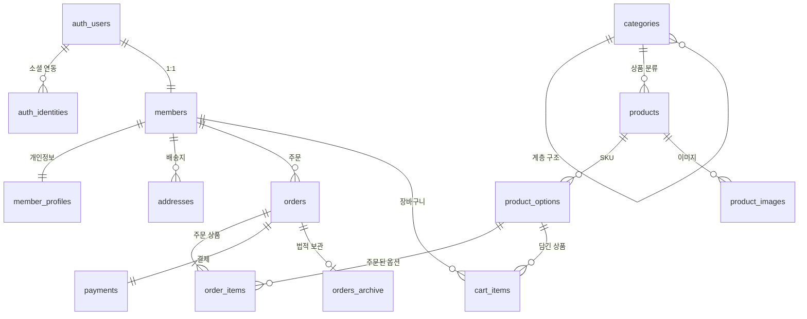
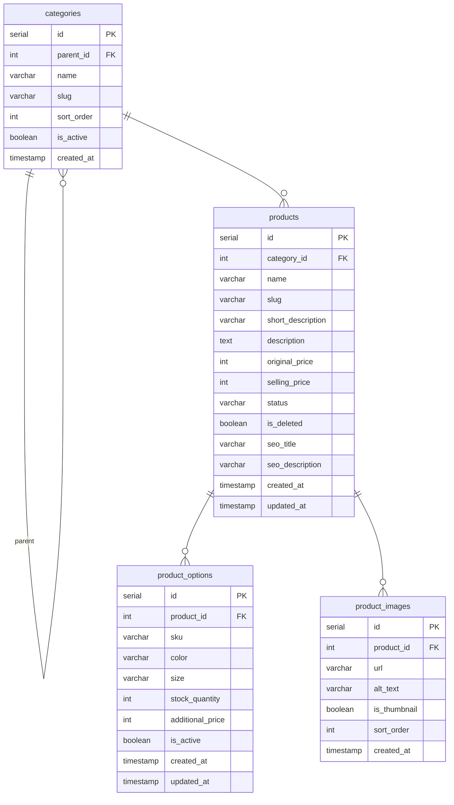
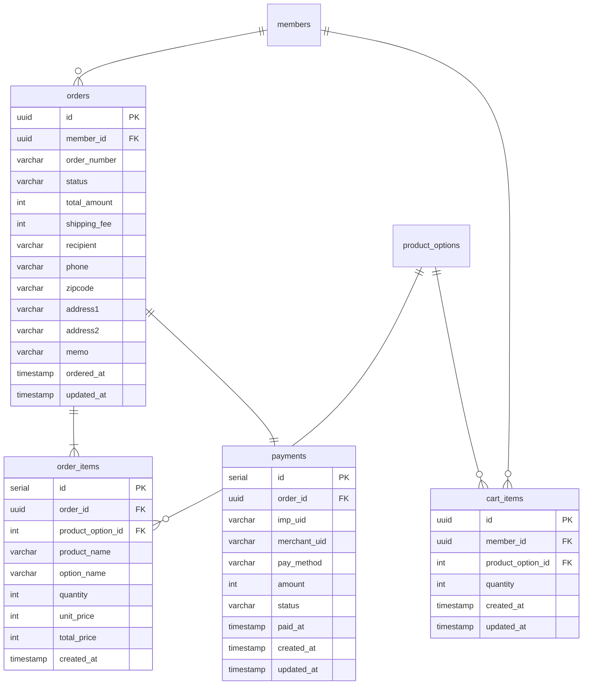

# 데이터베이스 설계 (Database Design)

**Version 1.0** | **2025-12-25** | **ko&clo Project**

---

## 목차

1. [개요](#1-개요)
2. [ERD 전체 구조](#2-erd-전체-구조)
3. [회원 도메인](#3-회원-도메인)
4. [상품 도메인](#4-상품-도메인)
5. [주문 도메인](#5-주문-도메인)
6. [인덱스 설계](#6-인덱스-설계)
7. [보안 정책 (RLS)](#7-보안-정책-rls)

---

## 1. 개요

> **하위 목차**
> - [1.1 데이터베이스 정보](#11-데이터베이스-정보)
> - [1.2 명명 규칙](#12-명명-규칙)

### 1.1 데이터베이스 정보

| 항목 | 내용 |
|------|------|
| DBMS | PostgreSQL 15+ |
| 호스팅 | Supabase |
| 인증 | Supabase Auth (auth.users) |
| 보안 | Row Level Security (RLS) |

### 1.2 명명 규칙

| 대상 | 규칙 | 예시 |
|------|------|------|
| 테이블 | snake_case, 복수형 | members, orders |
| 컬럼 | snake_case | created_at, order_status |
| PK | id (타입은 아래 참조) | id |
| FK | {table}_id | member_id, product_id |
| 인덱스 | idx_{table}_{columns} | idx_orders_member_id |

### 1.3 PK 타입 정책

| 조건 | PK 타입 | 대상 테이블 |
|------|---------|-------------|
| 개인정보 보호 필요 (URL 노출 시 타인 정보 접근 방지) | UUID | members, addresses, orders, cart_items |
| 공개 정보 또는 내부용 | SERIAL | categories, products, product_options, product_images, order_items, payments |

---

## 2. ERD 전체 구조

> **하위 목차**
> - [2.1 도메인별 ERD](#21-도메인별-erd)
> - [2.2 테이블 목록](#22-테이블-목록)

### 2.1 도메인별 ERD



### 2.2 테이블 목록

| 도메인 | 테이블 | 설명 |
|--------|--------|------|
| 회원 | members | 회원 운영정보 |
| 회원 | member_profiles | 회원 개인정보 |
| 회원 | addresses | 배송지 |
| 상품 | categories | 카테고리 |
| 상품 | products | 상품 |
| 상품 | product_options | 상품 옵션 (SKU) |
| 상품 | product_images | 상품 이미지 |
| 주문 | orders | 주문 |
| 주문 | order_items | 주문 상품 |
| 주문 | payments | 결제 |
| 장바구니 | cart_items | 장바구니 |
| 보관 | orders_archive | 주문 아카이브 |

---

## 3. 회원 도메인

> **하위 목차**
> - [3.1 회원 ERD](#31-회원-erd)
> - [3.2 members 테이블](#32-members-테이블)
> - [3.3 member_profiles 테이블](#33-member_profiles-테이블)
> - [3.4 addresses 테이블](#34-addresses-테이블)

### 3.1 회원 ERD

```mermaid
erDiagram
    auth_users {
        uuid id PK
        varchar email
        timestamp created_at
    }

    members {
        uuid id PK_FK
        varchar status
        boolean marketing_agreed
        timestamp terms_agreed_at
        timestamp privacy_agreed_at
        timestamp last_login_at
        timestamp withdrawn_at
        varchar withdrawal_reason
        boolean personal_info_deleted
        timestamp created_at
        timestamp updated_at
    }

    member_profiles {
        uuid member_id PK_FK
        varchar email
        varchar name
        varchar phone
        varchar profile_image
        timestamp created_at
        timestamp updated_at
    }

    addresses {
        uuid id PK
        uuid member_id FK
        varchar label
        varchar recipient
        varchar phone
        varchar zipcode
        varchar address1
        varchar address2
        boolean is_default
        timestamp created_at
    }

    auth_users ||--|| members : ""
    members ||--|| member_profiles : ""
    members ||--o{ addresses : ""
```

### 3.2 members 테이블

```sql
CREATE TABLE members (
    id UUID PRIMARY KEY REFERENCES auth.users(id) ON DELETE CASCADE,
    status VARCHAR(20) NOT NULL DEFAULT 'ACTIVE'
        CHECK (status IN ('PENDING', 'ACTIVE', 'DORMANT', 'SUSPENDED', 'WITHDRAWN')),
    marketing_agreed BOOLEAN DEFAULT FALSE,
    terms_agreed_at TIMESTAMPTZ NOT NULL,
    privacy_agreed_at TIMESTAMPTZ NOT NULL,
    last_login_at TIMESTAMPTZ,
    withdrawn_at TIMESTAMPTZ,
    withdrawal_reason VARCHAR(20),
    personal_info_deleted BOOLEAN DEFAULT FALSE,
    created_at TIMESTAMPTZ DEFAULT NOW(),
    updated_at TIMESTAMPTZ DEFAULT NOW()
);

-- 인덱스
CREATE INDEX idx_members_status ON members(status);
CREATE INDEX idx_members_last_login ON members(last_login_at);
```

### 3.3 member_profiles 테이블

```sql
CREATE TABLE member_profiles (
    member_id UUID PRIMARY KEY REFERENCES members(id) ON DELETE CASCADE,
    email VARCHAR(255) NOT NULL,
    name VARCHAR(50) NOT NULL,
    phone VARCHAR(20),
    profile_image VARCHAR(500),
    created_at TIMESTAMPTZ DEFAULT NOW(),
    updated_at TIMESTAMPTZ DEFAULT NOW()
);

-- 인덱스
CREATE INDEX idx_member_profiles_email ON member_profiles(email);
```

### 3.4 addresses 테이블

```sql
CREATE TABLE addresses (
    id UUID PRIMARY KEY DEFAULT gen_random_uuid(),
    member_id UUID NOT NULL REFERENCES members(id) ON DELETE CASCADE,
    label VARCHAR(50),
    recipient VARCHAR(50) NOT NULL,
    phone VARCHAR(20) NOT NULL,
    zipcode VARCHAR(10) NOT NULL,
    address1 VARCHAR(200) NOT NULL,
    address2 VARCHAR(200),
    is_default BOOLEAN DEFAULT FALSE,
    created_at TIMESTAMPTZ DEFAULT NOW()
);

-- 인덱스
CREATE INDEX idx_addresses_member ON addresses(member_id);
CREATE INDEX idx_addresses_default ON addresses(member_id, is_default) WHERE is_default = true;
```

---

## 4. 상품 도메인

> **하위 목차**
> - [4.1 상품 ERD](#41-상품-erd)
> - [4.2 categories 테이블](#42-categories-테이블)
> - [4.3 products 테이블](#43-products-테이블)
> - [4.4 product_options 테이블](#44-product_options-테이블)
> - [4.5 product_images 테이블](#45-product_images-테이블)

### 4.1 상품 ERD



### 4.2 categories 테이블

```sql
CREATE TABLE categories (
    id SERIAL PRIMARY KEY,
    parent_id INTEGER REFERENCES categories(id) ON DELETE SET NULL,
    name VARCHAR(50) NOT NULL,
    slug VARCHAR(100) NOT NULL UNIQUE,
    sort_order INTEGER DEFAULT 0,
    is_active BOOLEAN DEFAULT TRUE,
    created_at TIMESTAMPTZ DEFAULT NOW()
);

-- 인덱스
CREATE INDEX idx_categories_parent ON categories(parent_id);
CREATE INDEX idx_categories_slug ON categories(slug);
CREATE INDEX idx_categories_active ON categories(is_active) WHERE is_active = true;
```

### 4.3 products 테이블

```sql
CREATE TABLE products (
    id SERIAL PRIMARY KEY,
    category_id INTEGER REFERENCES categories(id) ON DELETE SET NULL,
    name VARCHAR(100) NOT NULL,
    slug VARCHAR(150) NOT NULL UNIQUE,
    short_description VARCHAR(200),
    description TEXT,
    original_price INTEGER NOT NULL CHECK (original_price >= 1000),
    selling_price INTEGER,
    status VARCHAR(20) NOT NULL DEFAULT 'DRAFT'
        CHECK (status IN ('DRAFT', 'ACTIVE', 'INACTIVE')),
    is_deleted BOOLEAN DEFAULT FALSE,
    seo_title VARCHAR(70),
    seo_description VARCHAR(160),
    created_at TIMESTAMPTZ DEFAULT NOW(),
    updated_at TIMESTAMPTZ DEFAULT NOW()
);

-- 인덱스
CREATE INDEX idx_products_category ON products(category_id);
CREATE INDEX idx_products_slug ON products(slug);
CREATE INDEX idx_products_status ON products(status) WHERE is_deleted = false;
CREATE INDEX idx_products_active ON products(status, is_deleted)
    WHERE status = 'ACTIVE' AND is_deleted = false;
CREATE INDEX idx_products_price ON products(selling_price, original_price);
CREATE INDEX idx_products_created ON products(created_at DESC);
```

### 4.4 product_options 테이블

```sql
CREATE TABLE product_options (
    id SERIAL PRIMARY KEY,
    product_id INTEGER NOT NULL REFERENCES products(id) ON DELETE CASCADE,
    sku VARCHAR(50) NOT NULL UNIQUE,
    color VARCHAR(30) NOT NULL,
    size VARCHAR(20) NOT NULL,
    stock_quantity INTEGER NOT NULL DEFAULT 0 CHECK (stock_quantity >= 0),
    additional_price INTEGER DEFAULT 0,
    is_active BOOLEAN DEFAULT TRUE,
    created_at TIMESTAMPTZ DEFAULT NOW(),
    updated_at TIMESTAMPTZ DEFAULT NOW()
);

-- 인덱스
CREATE INDEX idx_product_options_product ON product_options(product_id);
CREATE INDEX idx_product_options_sku ON product_options(sku);
CREATE INDEX idx_product_options_stock ON product_options(product_id, stock_quantity)
    WHERE is_active = true;
```

### 4.5 product_images 테이블

```sql
CREATE TABLE product_images (
    id SERIAL PRIMARY KEY,
    product_id INTEGER NOT NULL REFERENCES products(id) ON DELETE CASCADE,
    url VARCHAR(500) NOT NULL,
    alt_text VARCHAR(200),
    is_thumbnail BOOLEAN DEFAULT FALSE,
    sort_order INTEGER DEFAULT 0,
    created_at TIMESTAMPTZ DEFAULT NOW()
);

-- 인덱스
CREATE INDEX idx_product_images_product ON product_images(product_id);
CREATE INDEX idx_product_images_thumbnail ON product_images(product_id, is_thumbnail)
    WHERE is_thumbnail = true;
```

---

## 5. 주문 도메인

> **하위 목차**
> - [5.1 주문 ERD](#51-주문-erd)
> - [5.2 orders 테이블](#52-orders-테이블)
> - [5.3 order_items 테이블](#53-order_items-테이블)
> - [5.4 payments 테이블](#54-payments-테이블)
> - [5.5 cart_items 테이블](#55-cart_items-테이블)
> - [5.6 orders_archive 테이블](#56-orders_archive-테이블)

### 5.1 주문 ERD



### 5.2 orders 테이블

```sql
CREATE TABLE orders (
    id UUID PRIMARY KEY DEFAULT gen_random_uuid(),
    member_id UUID NOT NULL REFERENCES members(id),
    order_number VARCHAR(50) NOT NULL UNIQUE,
    status VARCHAR(20) NOT NULL DEFAULT 'PENDING'
        CHECK (status IN ('PENDING', 'PAID', 'PREPARING', 'SHIPPING',
                          'DELIVERED', 'CONFIRMED', 'REFUND_REQUESTED',
                          'REFUNDED', 'FAILED', 'CANCELLED')),
    total_amount INTEGER NOT NULL CHECK (total_amount >= 0),
    shipping_fee INTEGER DEFAULT 0,
    recipient VARCHAR(50) NOT NULL,
    phone VARCHAR(20) NOT NULL,
    zipcode VARCHAR(10) NOT NULL,
    address1 VARCHAR(200) NOT NULL,
    address2 VARCHAR(200),
    memo VARCHAR(500),
    ordered_at TIMESTAMPTZ DEFAULT NOW(),
    updated_at TIMESTAMPTZ DEFAULT NOW()
);

-- 인덱스
CREATE INDEX idx_orders_member ON orders(member_id);
CREATE INDEX idx_orders_number ON orders(order_number);
CREATE INDEX idx_orders_status ON orders(status);
CREATE INDEX idx_orders_date ON orders(ordered_at DESC);
```

### 5.3 order_items 테이블

```sql
CREATE TABLE order_items (
    id SERIAL PRIMARY KEY,
    order_id UUID NOT NULL REFERENCES orders(id) ON DELETE CASCADE,
    product_option_id INTEGER REFERENCES product_options(id) ON DELETE SET NULL,
    product_name VARCHAR(100) NOT NULL,
    option_name VARCHAR(100) NOT NULL,
    quantity INTEGER NOT NULL CHECK (quantity > 0),
    unit_price INTEGER NOT NULL CHECK (unit_price >= 0),
    total_price INTEGER NOT NULL CHECK (total_price >= 0),
    created_at TIMESTAMPTZ DEFAULT NOW()
);

-- 인덱스
CREATE INDEX idx_order_items_order ON order_items(order_id);
```

### 5.4 payments 테이블

```sql
CREATE TABLE payments (
    id SERIAL PRIMARY KEY,
    order_id UUID NOT NULL UNIQUE REFERENCES orders(id),
    imp_uid VARCHAR(100) UNIQUE,
    merchant_uid VARCHAR(100) NOT NULL UNIQUE,
    pay_method VARCHAR(20),
    amount INTEGER NOT NULL CHECK (amount >= 0),
    status VARCHAR(20) NOT NULL DEFAULT 'READY'
        CHECK (status IN ('READY', 'PAID', 'CANCELLED', 'PARTIAL_CANCELLED', 'FAILED')),
    paid_at TIMESTAMPTZ,
    created_at TIMESTAMPTZ DEFAULT NOW(),
    updated_at TIMESTAMPTZ DEFAULT NOW()
);

-- 인덱스
CREATE INDEX idx_payments_order ON payments(order_id);
CREATE INDEX idx_payments_imp ON payments(imp_uid);
CREATE INDEX idx_payments_merchant ON payments(merchant_uid);
```

### 5.5 cart_items 테이블

```sql
CREATE TABLE cart_items (
    id UUID PRIMARY KEY DEFAULT gen_random_uuid(),
    member_id UUID NOT NULL REFERENCES members(id) ON DELETE CASCADE,
    product_option_id INTEGER NOT NULL REFERENCES product_options(id) ON DELETE CASCADE,
    quantity INTEGER NOT NULL DEFAULT 1 CHECK (quantity > 0),
    created_at TIMESTAMPTZ DEFAULT NOW(),
    updated_at TIMESTAMPTZ DEFAULT NOW(),
    UNIQUE (member_id, product_option_id)
);

-- 인덱스
CREATE INDEX idx_cart_items_member ON cart_items(member_id);
```

### 5.6 orders_archive 테이블

```sql
CREATE TABLE orders_archive (
    id UUID PRIMARY KEY,
    member_id_hash VARCHAR(64),
    order_number VARCHAR(50) NOT NULL UNIQUE,
    order_date TIMESTAMPTZ NOT NULL,
    total_amount DECIMAL(12,2) NOT NULL,
    order_status VARCHAR(20) NOT NULL,
    shipping_region VARCHAR(50),
    payment_method VARCHAR(20),
    archived_at TIMESTAMPTZ DEFAULT NOW(),
    archived_reason VARCHAR(20) NOT NULL,
    retention_until TIMESTAMPTZ NOT NULL
);

-- 서비스 앱 접근 차단
REVOKE ALL ON orders_archive FROM authenticated, anon;
GRANT SELECT ON orders_archive TO service_role;
```

---

## 6. 인덱스 설계

> **하위 목차**
> - [6.1 인덱스 전략](#61-인덱스-전략)
> - [6.2 주요 쿼리별 인덱스](#62-주요-쿼리별-인덱스)

### 6.1 인덱스 전략

| 유형 | 용도 | 예시 |
|------|------|------|
| B-tree (기본) | 등호/범위 검색 | status, created_at |
| Partial Index | 조건부 검색 최적화 | is_deleted = false |
| Composite | 복합 조건 검색 | (category_id, status) |
| Unique | 중복 방지 | slug, sku, order_number |

### 6.2 주요 쿼리별 인덱스

| 쿼리 | 인덱스 |
|------|--------|
| 활성 상품 목록 | `idx_products_active` |
| 카테고리별 상품 | `idx_products_category` |
| 회원 주문 내역 | `idx_orders_member` + `idx_orders_date` |
| 재고 확인 | `idx_product_options_stock` |

---

## 7. 보안 정책 (RLS)

> **하위 목차**
> - [7.1 RLS 활성화](#71-rls-활성화)
> - [7.2 회원 정책](#72-회원-정책)
> - [7.3 주문/장바구니 정책](#73-주문장바구니-정책)
> - [7.4 상품 정책 (공개)](#74-상품-정책-공개)

### 7.1 RLS 활성화

```sql
-- 모든 테이블에 RLS 활성화
ALTER TABLE members ENABLE ROW LEVEL SECURITY;
ALTER TABLE member_profiles ENABLE ROW LEVEL SECURITY;
ALTER TABLE addresses ENABLE ROW LEVEL SECURITY;
ALTER TABLE orders ENABLE ROW LEVEL SECURITY;
ALTER TABLE cart_items ENABLE ROW LEVEL SECURITY;
```

### 7.2 회원 정책

```sql
-- 본인 데이터만 조회
CREATE POLICY "members_select_own"
    ON members FOR SELECT
    USING (auth.uid() = id);

-- 본인 데이터만 수정
CREATE POLICY "members_update_own"
    ON members FOR UPDATE
    USING (auth.uid() = id);

-- member_profiles: 본인만
CREATE POLICY "member_profiles_all_own"
    ON member_profiles FOR ALL
    USING (auth.uid() = member_id);

-- addresses: 본인만
CREATE POLICY "addresses_all_own"
    ON addresses FOR ALL
    USING (auth.uid() = member_id);
```

### 7.3 주문/장바구니 정책

```sql
-- 본인 주문만 조회
CREATE POLICY "orders_select_own"
    ON orders FOR SELECT
    USING (auth.uid() = member_id);

-- 본인 장바구니만
CREATE POLICY "cart_items_all_own"
    ON cart_items FOR ALL
    USING (auth.uid() = member_id);
```

### 7.4 상품 정책 (공개)

```sql
-- 상품: 모두 조회 가능 (활성 상품만)
CREATE POLICY "products_select_active"
    ON products FOR SELECT
    USING (status = 'ACTIVE' AND is_deleted = false);

-- 카테고리: 모두 조회 가능
CREATE POLICY "categories_select_active"
    ON categories FOR SELECT
    USING (is_active = true);
```

---

## 변경 이력

| 버전 | 날짜 | 변경 내용 |
|------|------|-----------|
| 1.0 | 2025-12-25 | TDD v1.6 내용 기반 초기 작성 |
| 1.1 | 2025-12-29 | PK 타입 정책 추가 (UUID vs SERIAL), 상품/주문 도메인 PK 타입 변경 |
