# 회원 관리 (Member Management)

**Version 1.0** | **2025-12-25** | **ko&clo Project**

---

## 목차

1. [개요](#1-개요)
2. [MBR-001 회원가입](#2-mbr-001-회원가입)
3. [MBR-002 로그인/로그아웃](#3-mbr-002-로그인로그아웃)
4. [MBR-003 비밀번호 재설정](#4-mbr-003-비밀번호-재설정)
5. [MBR-004 회원정보 수정](#5-mbr-004-회원정보-수정)
6. [MBR-005 회원 탈퇴](#6-mbr-005-회원-탈퇴)
7. [회원 상태 관리](#7-회원-상태-관리)
8. [데이터 모델](#8-데이터-모델)
9. [테스트 케이스](#9-테스트-케이스)

---

## 1. 개요

> **하위 목차**
> - [1.1 기능 목록](#11-기능-목록)
> - [1.2 가입 방식 우선순위](#12-가입-방식-우선순위)

### 1.1 기능 목록

| 기능 ID | 기능명 | 유형 | 상세 설명 |
|---------|--------|------|-----------|
| MBR-001 | 회원가입 | Consumer | 소셜 로그인 (카카오/네이버/구글), 이메일 가입 |
| MBR-002 | 로그인/로그아웃 | Consumer | JWT 기반 인증, 자동 로그인 |
| MBR-003 | 비밀번호 재설정 | Consumer | 이메일 인증 링크 발송, 비밀번호 변경 |
| MBR-004 | 회원정보 수정 | Consumer | 이름, 연락처, 기본 배송지 관리 |
| MBR-005 | 회원 탈퇴 | Consumer | 개인정보 삭제, 주문내역 익명화 처리 |
| - | 회원 목록 조회 | Admin | 검색, 필터링, 페이지네이션 |
| - | 회원 상태 관리 | Admin | 활성/휴면/정지 상태 변경 |

### 1.2 가입 방식 우선순위

| 순위 | 방식 | 설명 |
|------|------|------|
| 1 | 소셜 로그인 (권장) | 카카오, 네이버, 구글 OAuth |
| 2 | 이메일 가입 | 이메일/비밀번호 + 이메일 인증 |

---

## 2. MBR-001 회원가입

> **하위 목차**
> - [2.1 소셜 로그인 Flow (우선)](#21-소셜-로그인-flow-우선)
> - [2.2 이메일 가입 Flow (보조)](#22-이메일-가입-flow-보조)

| 항목 | 내용 |
|------|------|
| 기능 ID | MBR-001 |
| 기능명 | 회원가입 (Sign Up) |
| 사용자 유형 | Consumer (비회원) |
| 우선순위 | 필수 (MVP) |

### 2.1 소셜 로그인 Flow (우선)

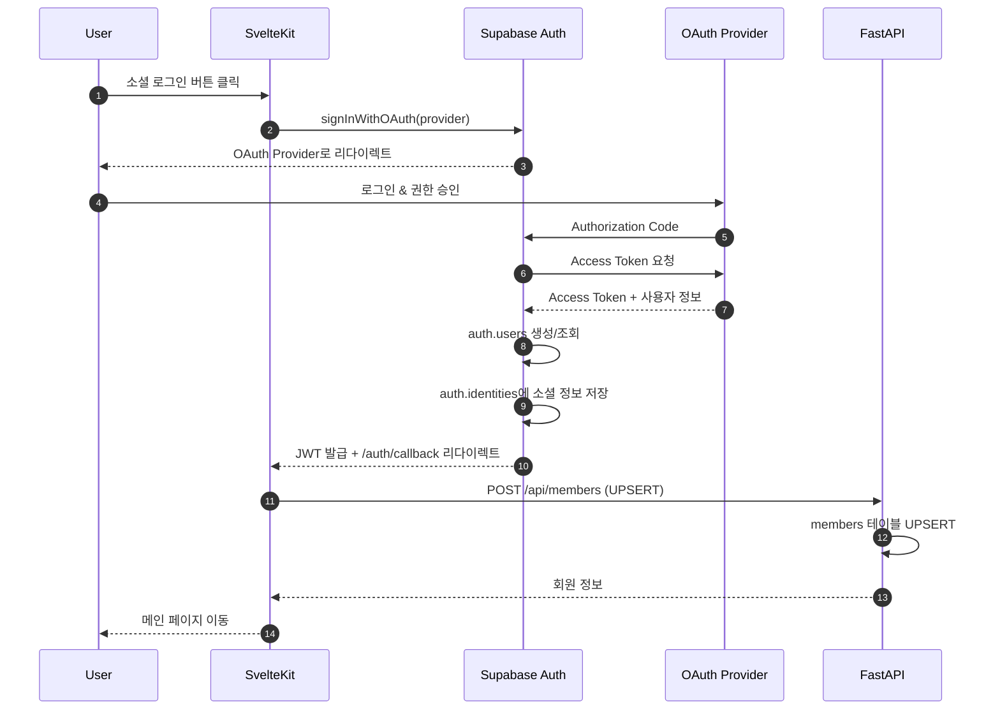

#### OAuth Provider 설정

| Provider | 개발자 콘솔 | 필수 동의항목 |
|----------|-------------|---------------|
| 카카오 | https://developers.kakao.com | 닉네임, 이메일 |
| 네이버 | https://developers.naver.com | 이름, 이메일 |
| 구글 | https://console.cloud.google.com | 이름, 이메일 |

#### SvelteKit 구현 예시

```typescript
// src/routes/auth/login/+page.svelte
<script lang="ts">
  import { supabase } from '$lib/supabase';

  async function signInWithSocial(provider: 'kakao' | 'naver' | 'google') {
    await supabase.auth.signInWithOAuth({
      provider,
      options: { redirectTo: `${location.origin}/auth/callback` }
    });
  }
</script>

<button on:click={() => signInWithSocial('kakao')}>카카오로 시작하기</button>
```

### 2.2 이메일 가입 Flow (보조)

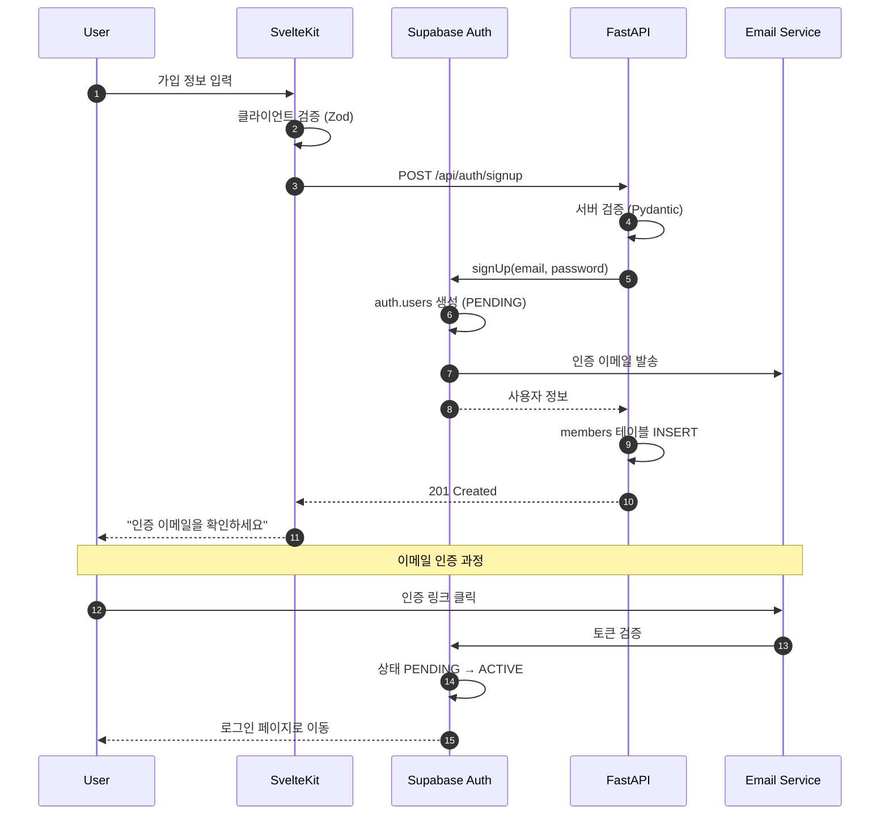

#### API 명세

```
POST /api/auth/signup
Content-Type: application/json

{
  "email": "user@example.com",
  "password": "SecureP@ss123",
  "passwordConfirm": "SecureP@ss123",
  "name": "홍길동",
  "phone": "+821012345678",
  "agreements": { "terms": true, "privacy": true, "marketing": false }
}
```

#### 필드 검증 규칙

| 필드 | 필수 | 검증 규칙 |
|------|------|-----------|
| email | Y | 이메일 형식, 최대 255자, 중복 불가 |
| password | Y | 8~20자, 영문+숫자+특수문자 조합 필수 |
| name | Y | 2~50자, 한글 또는 영문 |
| phone | N | E.164 형식 (+821012345678), 선택적 |
| agreements.terms | Y | true 필수 (이용약관) |
| agreements.privacy | Y | true 필수 (개인정보처리방침) |

#### 에러 코드

| HTTP | 코드 | 설명 |
|------|------|------|
| 400 | VALIDATION_ERROR | 입력값 검증 실패 |
| 400 | EMAIL_ALREADY_EXISTS | 이미 가입된 이메일 |
| 400 | PASSWORD_MISMATCH | 비밀번호 확인 불일치 |
| 400 | TERMS_NOT_AGREED | 필수 약관 미동의 |

---

## 3. MBR-002 로그인/로그아웃

> **하위 목차**
> - [3.1 소셜 로그인 Flow](#31-소셜-로그인-flow)
> - [3.2 이메일 로그인 Flow](#32-이메일-로그인-flow)
> - [3.3 로그아웃 Flow](#33-로그아웃-flow)
> - [3.4 세션 관리 (JWT)](#34-세션-관리-jwt)
> - [3.5 클라이언트 토큰 관리 전략](#35-클라이언트-토큰-관리-전략)
> - [3.6 토큰 갱신 Flow](#36-토큰-갱신-flow)

| 항목 | 내용 |
|------|------|
| 기능 ID | MBR-002 |
| 기능명 | 로그인/로그아웃 (Sign In / Sign Out) |
| 사용자 유형 | Consumer |
| 우선순위 | 필수 (MVP) |

### 3.1 소셜 로그인 Flow

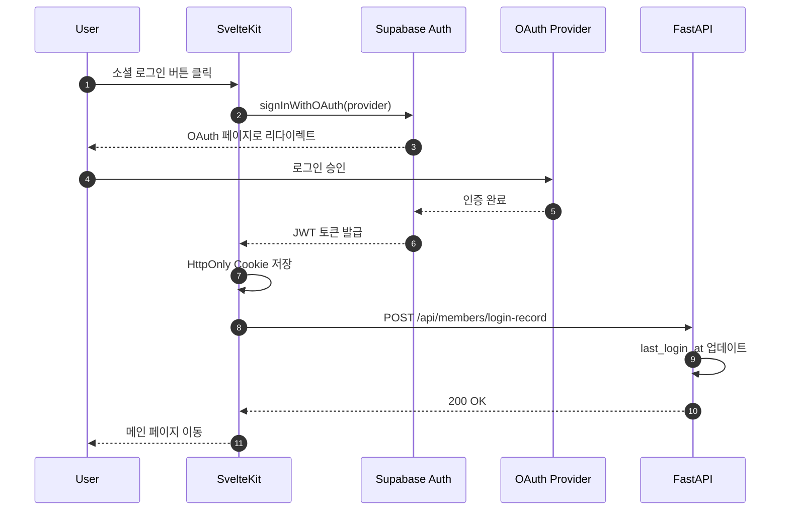

### 3.2 이메일 로그인 Flow

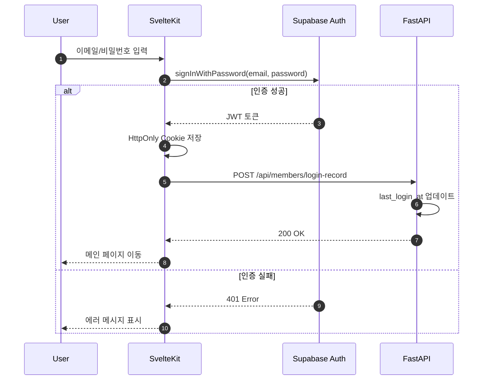

#### API 명세

```
POST /api/auth/login
Content-Type: application/json

{
  "email": "user@example.com",
  "password": "SecureP@ss123",
  "rememberMe": true
}
```

#### 에러 코드

| HTTP | 코드 | 설명 |
|------|------|------|
| 401 | INVALID_CREDENTIALS | 이메일 또는 비밀번호 불일치 |
| 401 | EMAIL_NOT_CONFIRMED | 이메일 미인증 계정 |
| 403 | ACCOUNT_SUSPENDED | 정지된 계정 |
| 403 | ACCOUNT_WITHDRAWN | 탈퇴한 계정 |

### 3.3 로그아웃 Flow

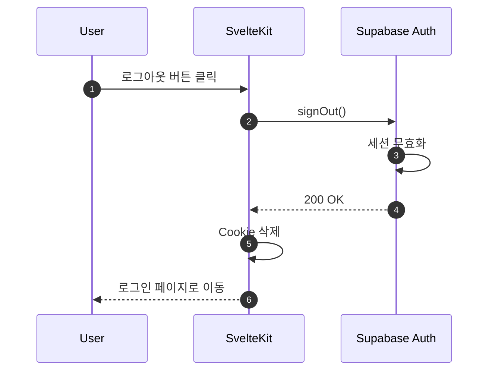

### 3.4 세션 관리 (JWT)

| 토큰 | 저장 위치 | 유효 기간 | 용도 |
|------|-----------|-----------|------|
| access_token | HttpOnly Cookie | 1일 / 30일 | API 인증 |
| refresh_token | HttpOnly Cookie | 30일 | 토큰 갱신 |

### 3.5 클라이언트 토큰 관리 전략

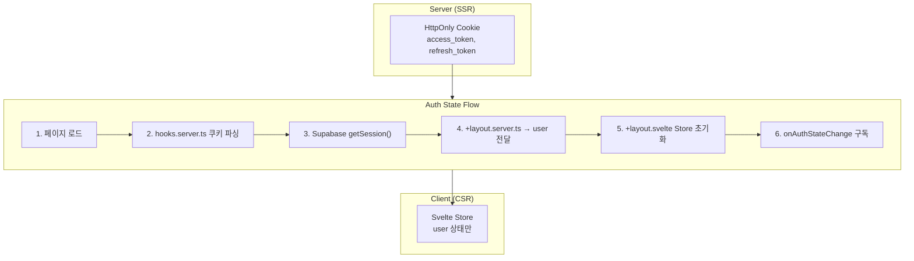

#### 토큰 상태별 처리

| 상태 | 감지 방법 | 처리 |
|------|-----------|------|
| 토큰 없음 | !session | 로그인 페이지 리다이렉트 |
| 토큰 유효 | expires_at > now | 정상 진행 |
| 만료 임박 | expires_at - now < 5min | Supabase 자동 갱신 |
| 토큰 만료 | API 401 응답 | refresh_token으로 갱신 시도 |
| Refresh 만료 | 갱신 실패 | 로그아웃 + 재로그인 안내 |

### 3.6 토큰 갱신 Flow

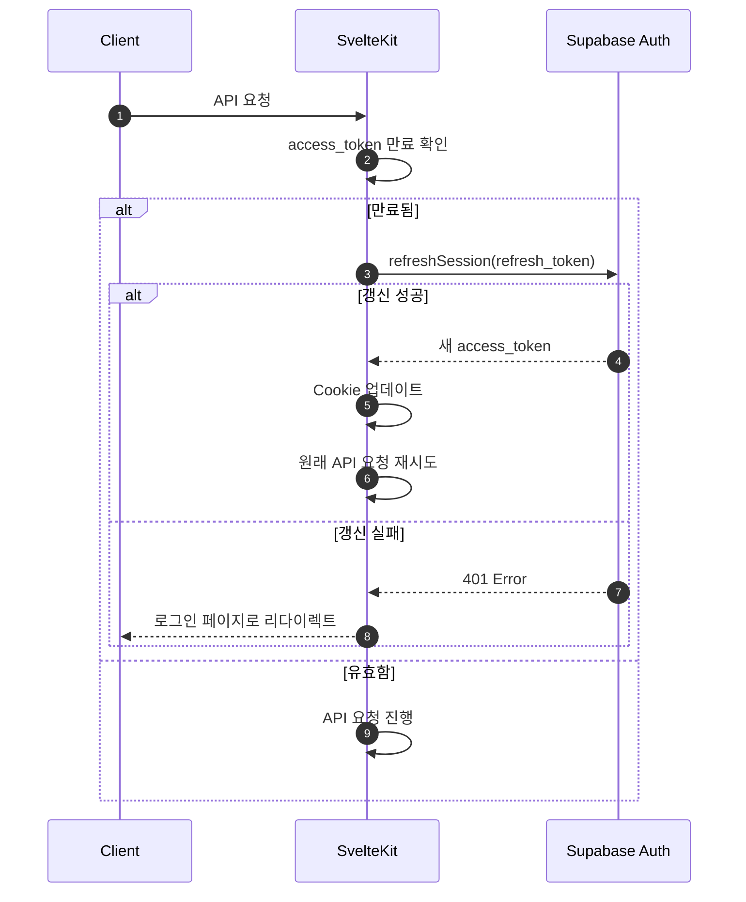

#### 핵심 구현 파일

| 파일 | 역할 |
|------|------|
| src/lib/stores/auth.ts | Auth Store - user, loading, initialized 상태 관리 |
| src/hooks.server.ts | 모든 요청에서 쿠키 파싱, 세션 검증, 토큰 갱신 |
| src/routes/+layout.server.ts | 서버에서 클라이언트로 user 전달 |
| src/routes/+layout.svelte | Store 초기화, onAuthStateChange 구독 |
| src/lib/api.ts | API Wrapper - 401 처리, credentials 설정 |

---

## 4. MBR-003 비밀번호 재설정

> **하위 목차**
> - [4.1 적용 대상](#41-적용-대상)
> - [4.2 비밀번호 재설정 Flow](#42-비밀번호-재설정-flow)
> - [4.3 보안 고려사항](#43-보안-고려사항)

| 항목 | 내용 |
|------|------|
| 기능 ID | MBR-003 |
| 기능명 | 비밀번호 재설정 (Password Reset) |
| 사용자 유형 | Consumer (이메일 가입 회원만) |
| 우선순위 | 필수 (MVP) |

### 4.1 적용 대상

| 가입 방식 | 비밀번호 재설정 |
|-----------|-----------------|
| 이메일 가입 | ✅ 가능 |
| 소셜 로그인 | ❌ 불가 (소셜 Provider에서 관리) |

### 4.2 비밀번호 재설정 Flow

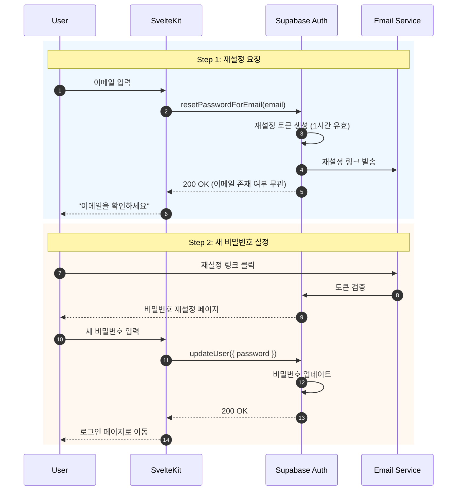

#### API 명세

```
POST /api/auth/password/reset-request
{ "email": "user@example.com" }
→ 200 OK (이메일 존재 여부 무관)

POST /api/auth/password/reset
{ "password": "NewSecureP@ss123", "passwordConfirm": "NewSecureP@ss123" }
→ 200 OK (세션 필요)
```

#### 에러 코드

| HTTP | 코드 | 설명 |
|------|------|------|
| 400 | VALIDATION_ERROR | 비밀번호 형식 오류 (8~20자, 영문+숫자+특수문자) |
| 400 | PASSWORD_MISMATCH | 비밀번호 확인 불일치 |
| 400 | SAME_PASSWORD | 기존 비밀번호와 동일 |
| 401 | TOKEN_EXPIRED | 토큰 만료 (1시간) |

### 4.3 보안 고려사항

| 항목 | 대응 방안 |
|------|-----------|
| 이메일 열거 공격 | 이메일 존재 여부 무관하게 동일 응답 |
| 토큰 유효 기간 | 1시간 (Supabase 기본값) |
| 토큰 일회성 | 사용 후 즉시 무효화 |
| Rate Limiting | 동일 IP/이메일 요청 제한 |

---

## 5. MBR-004 회원정보 수정

> **하위 목차**
> - [5.1 수정 가능 항목](#51-수정-가능-항목)
> - [5.2 프로필 수정 Flow](#52-프로필-수정-flow)
> - [5.3 프로필 이미지 업로드](#53-프로필-이미지-업로드)
> - [5.4 비밀번호 변경 (이메일 가입만)](#54-비밀번호-변경-이메일-가입만)
> - [5.5 배송지 관리](#55-배송지-관리)

| 항목 | 내용 |
|------|------|
| 기능 ID | MBR-004 |
| 기능명 | 회원정보 수정 (Edit Profile) |
| 사용자 유형 | Consumer (로그인 회원) |
| 우선순위 | 필수 (MVP) |

### 5.1 수정 가능 항목

| 항목 | 이메일 가입 | 소셜 로그인 | 비고 |
|------|-------------|-------------|------|
| 이름 | ✅ | ✅ | 2~50자 |
| 전화번호 | ✅ | ✅ | E.164 형식 |
| 프로필 이미지 | ✅ | ✅ | R2 업로드 |
| 비밀번호 변경 | ✅ | ❌ | 현재 비밀번호 확인 |
| 마케팅 수신 동의 | ✅ | ✅ | |
| 배송지 관리 | ✅ | ✅ | 최대 10개 |

### 5.2 프로필 수정 Flow

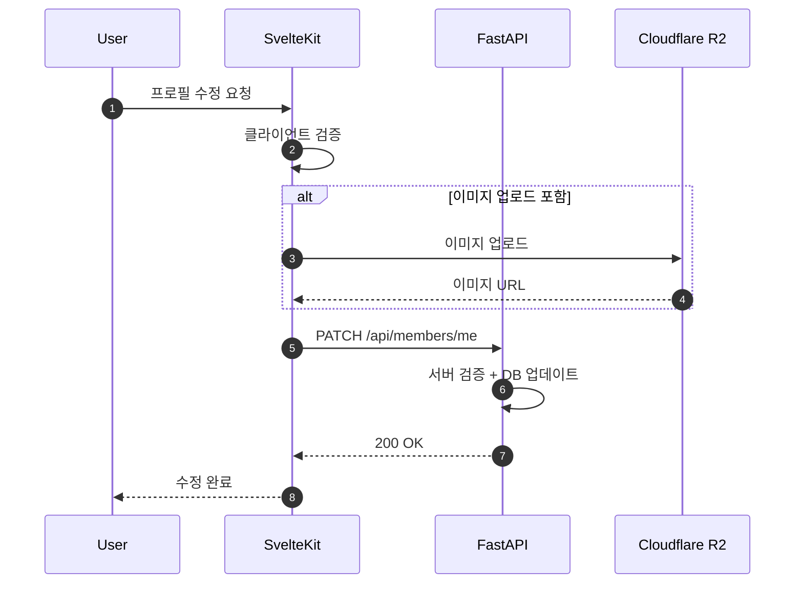

#### API 명세

```
GET  /api/members/me              # 프로필 조회
PATCH /api/members/me             # 프로필 수정
POST /api/members/me/profile-image # 이미지 업로드
POST /api/members/me/password     # 비밀번호 변경
```

### 5.3 프로필 이미지 업로드

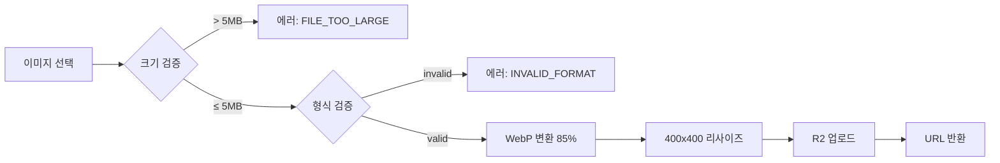

#### 이미지 처리 규칙

| 항목 | 규칙 |
|------|------|
| 파일 크기 | 최대 5MB |
| 허용 형식 | jpg, jpeg, png, webp |
| 저장 형식 | WebP 자동 변환 (품질 85%) |
| 이미지 크기 | 400x400 리사이즈 |
| 저장소 | Cloudflare R2 |

### 5.4 비밀번호 변경 (이메일 가입만)

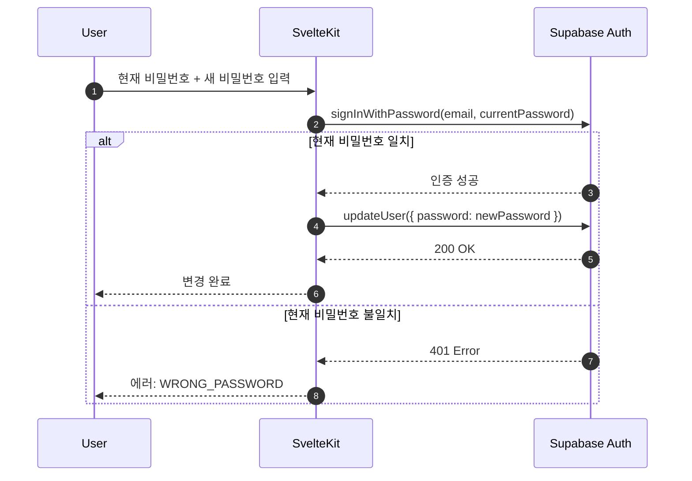

### 5.5 배송지 관리

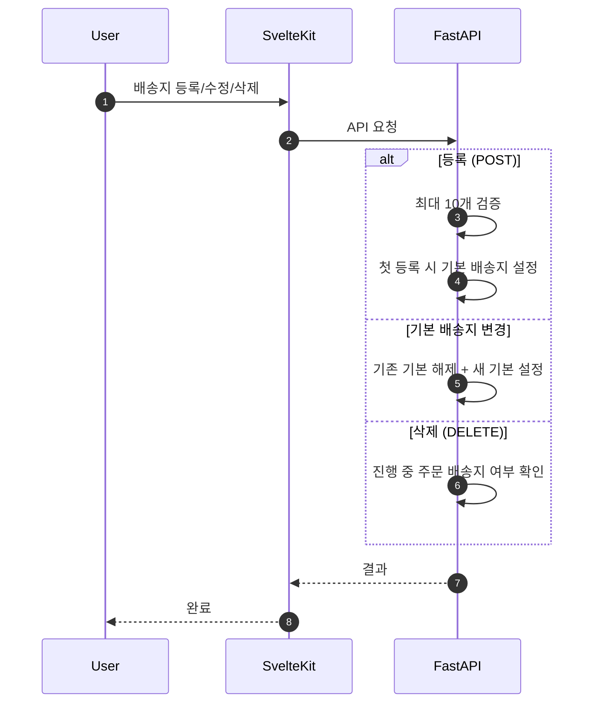

#### 배송지 API

```
GET    /api/members/me/addresses              # 목록 조회
POST   /api/members/me/addresses              # 등록
PATCH  /api/members/me/addresses/{id}         # 수정
DELETE /api/members/me/addresses/{id}         # 삭제
POST   /api/members/me/addresses/{id}/default # 기본 설정
```

#### 배송지 비즈니스 규칙

- 회원당 최대 10개
- 첫 등록 시 자동으로 기본 배송지 설정
- 새 기본 배송지 설정 시 기존 기본 해제
- 진행 중인 주문 배송지는 삭제 불가

---

## 6. MBR-005 회원 탈퇴

> **하위 목차**
> - [6.1 탈퇴 정책](#61-탈퇴-정책)
> - [6.2 탈퇴 차단 조건](#62-탈퇴-차단-조건)
> - [6.3 탈퇴 경고 조건 (탈퇴 가능, 안내 필요)](#63-탈퇴-경고-조건-탈퇴-가능-안내-필요)
> - [6.4 회원 탈퇴 Flow](#64-회원-탈퇴-flow)
> - [6.5 데이터 삭제 배치 (탈퇴 후 5일)](#65-데이터-삭제-배치-탈퇴-후-5일)

| 항목 | 내용 |
|------|------|
| 기능 ID | MBR-005 |
| 기능명 | 회원 탈퇴 (Withdraw / Delete Account) |
| 사용자 유형 | Consumer (로그인 회원) |
| 우선순위 | 필수 (MVP) |

### 6.1 탈퇴 정책

| 항목 | 정책 |
|------|------|
| 탈퇴 방식 | Soft Delete (상태 변경) |
| 개인정보 삭제 | 5일 내 삭제 (개인정보보호법) |
| 주문기록 보관 | 분리 보관 5년 (전자상거래법) |
| 재가입 | 탈퇴 후 즉시 가능 (동일 이메일) |

> 📌 상세 개인정보 처리 정책은 [PRIVACY_개인정보처리명세.md](./PRIVACY_개인정보처리명세.md) 참조

### 6.2 탈퇴 차단 조건

| 조건 | 설명 | 해결 방법 |
|------|------|-----------|
| 진행 중 주문 | 결제완료/배송중 상태 | 배송 완료 대기 |
| 환불 진행 중 | 환불 처리 미완료 | 환불 완료 대기 |

### 6.3 탈퇴 경고 조건 (탈퇴 가능, 안내 필요)

- 미사용 포인트 → 즉시 소멸
- 미사용 쿠폰 → 즉시 소멸
- 작성한 리뷰 → 익명화 처리

### 6.4 회원 탈퇴 Flow

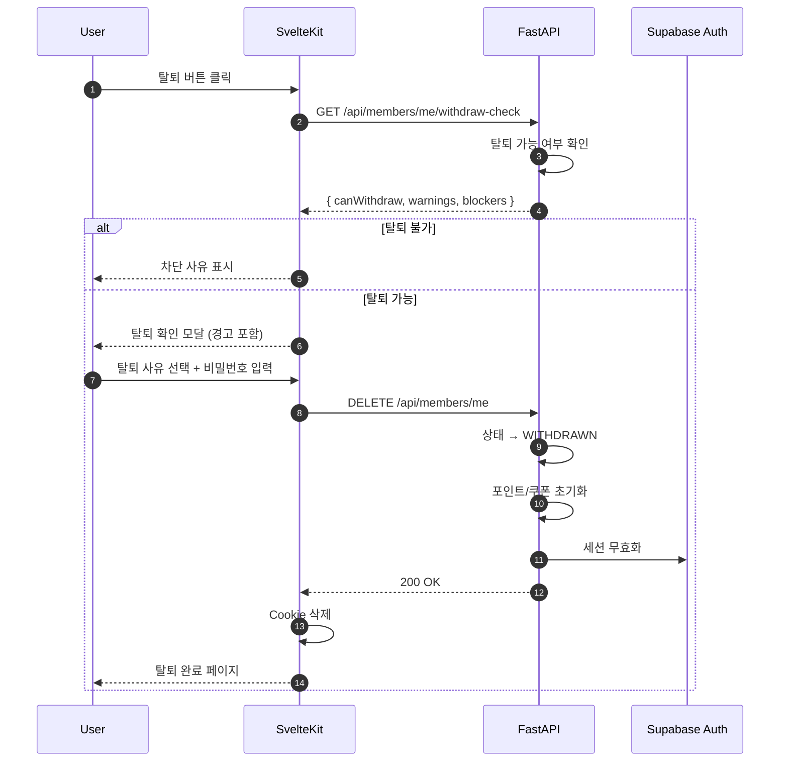

#### API 명세

```
GET    /api/members/me/withdraw-check  # 탈퇴 가능 여부 확인
DELETE /api/members/me                 # 탈퇴 요청

Request: { "reason": "SERVICE_UNSATISFIED", "password": "..." }
```

#### 탈퇴 사유 코드

| 코드 | 설명 |
|------|------|
| SERVICE_UNSATISFIED | 서비스 불만족 |
| RARELY_USED | 이용 빈도 낮음 |
| FOUND_ALTERNATIVE | 다른 서비스 이용 |
| PRIVACY_CONCERN | 개인정보 우려 |
| OTHER | 기타 |

### 6.5 데이터 삭제 배치 (탈퇴 후 5일)

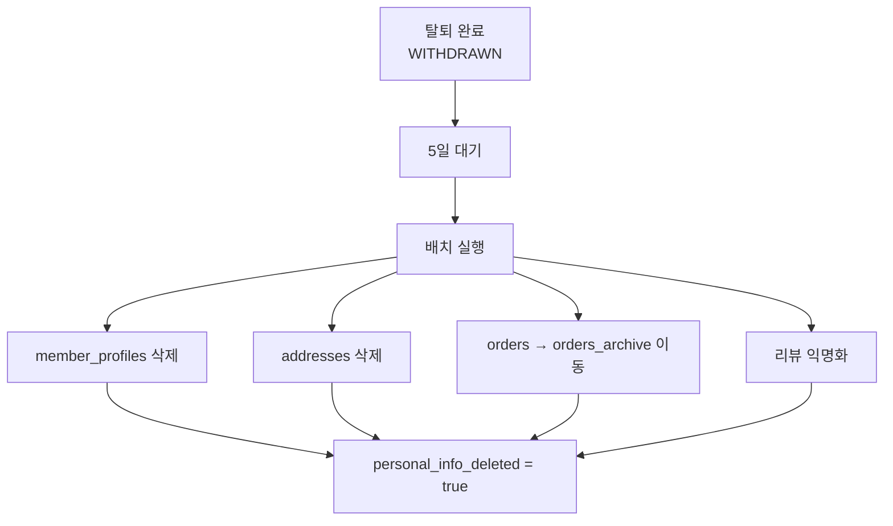

#### 데이터 처리 정책

| 시점 | 데이터 | 처리 |
|------|--------|------|
| 탈퇴 즉시 | 회원 상태 | WITHDRAWN으로 변경 |
| 탈퇴 즉시 | 포인트/쿠폰 | 0으로 초기화, Soft Delete |
| 5일 후 | member_profiles | Hard Delete |
| 5일 후 | addresses | Hard Delete |
| 5일 후 | 주문기록 | orders_archive로 분리 보관 (5년) |
| 5일 후 | 리뷰 | 익명화 (작성자 정보 삭제) |

---

## 7. 회원 상태 관리

> **하위 목차**
> - [7.1 회원 상태 전이 다이어그램](#71-회원-상태-전이-다이어그램)
> - [7.2 상태 설명](#72-상태-설명)
> - [7.3 휴면 계정 처리 Flow](#73-휴면-계정-처리-flow)

### 7.1 회원 상태 전이 다이어그램

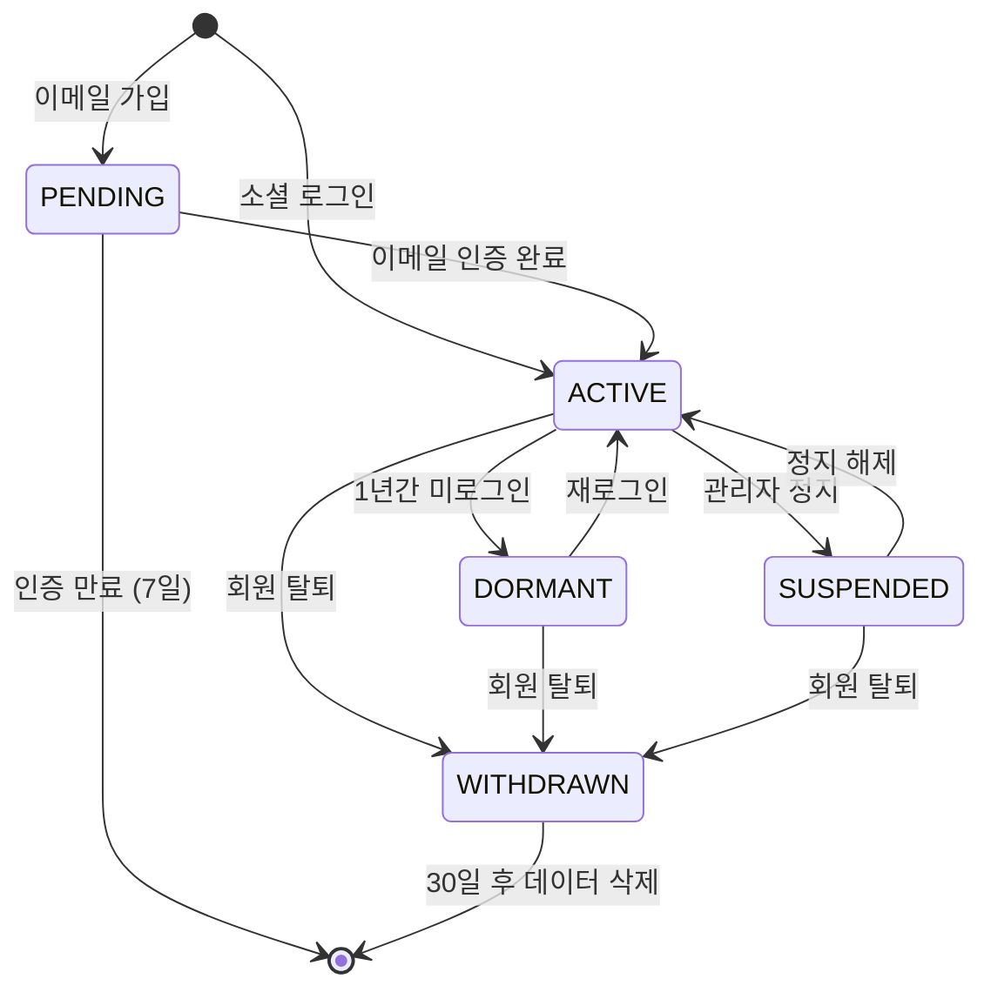

### 7.2 상태 설명

| 상태 | 설명 | 전이 조건 |
|------|------|-----------|
| PENDING | 이메일 인증 대기 | 이메일 가입 시 |
| ACTIVE | 활성 | 이메일 인증 완료 / 소셜 로그인 / 재로그인 / 정지 해제 |
| DORMANT | 휴면 | 1년간 미로그인 |
| SUSPENDED | 정지 | 관리자 정지 처리 |
| WITHDRAWN | 탈퇴 | 회원 탈퇴 요청 |

### 7.3 휴면 계정 처리 Flow

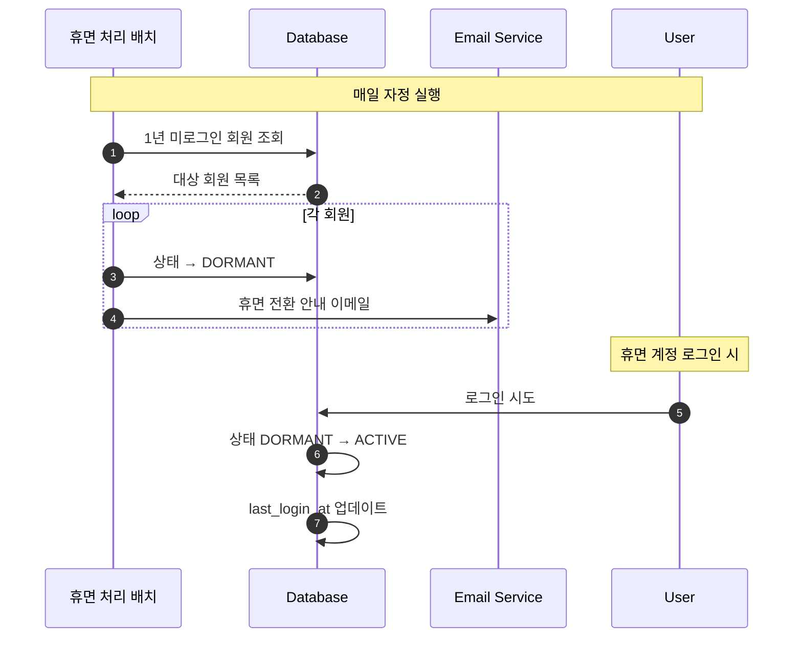

---

## 8. 데이터 모델

> **하위 목차**
> - [8.1 테이블 관계](#81-테이블-관계)
> - [8.2 테이블 DDL](#82-테이블-ddl)

### 8.1 테이블 관계

```mermaid
erDiagram
    auth_users ||--o{ auth_identities : "1:N 소셜 연동"
    auth_users ||--|| members : "1:1 운영정보"
    members ||--|| member_profiles : "1:1 개인정보"
    members ||--o{ addresses : "1:N 배송지"
    members ||--o{ orders : "1:N 주문"
    orders ||--o{ orders_archive : "법적 보관용"

    auth_users {
        uuid id PK
        string email
        timestamp created_at
    }

    auth_identities {
        uuid id PK
        uuid user_id FK
        string provider
        string identity_data
    }

    members {
        uuid id PK_FK
        varchar status
        boolean marketing_agreed
        timestamp terms_agreed_at
        timestamp privacy_agreed_at
        timestamp last_login_at
        timestamp withdrawn_at
        varchar withdrawal_reason
        boolean personal_info_deleted
    }

    member_profiles {
        uuid member_id PK_FK
        varchar email
        varchar name
        varchar phone
        varchar profile_image
    }

    addresses {
        uuid id PK
        uuid member_id FK
        varchar label
        varchar recipient
        varchar phone
        varchar zipcode
        varchar address1
        varchar address2
        boolean is_default
    }

    orders_archive {
        uuid id PK
        varchar member_id_hash
        varchar order_number
        timestamp order_date
        decimal total_amount
        varchar order_status
        timestamp archived_at
        timestamp retention_until
    }
```

### 8.2 테이블 DDL

#### members 테이블 (운영정보)

```sql
CREATE TABLE members (
    id UUID PRIMARY KEY REFERENCES auth.users(id) ON DELETE CASCADE,
    -- 서비스 운영 정보 (개인정보 아님)
    status VARCHAR(20) NOT NULL DEFAULT 'ACTIVE',
    -- PENDING | ACTIVE | DORMANT | SUSPENDED | WITHDRAWN
    marketing_agreed BOOLEAN DEFAULT FALSE,
    terms_agreed_at TIMESTAMPTZ NOT NULL,
    privacy_agreed_at TIMESTAMPTZ NOT NULL,
    last_login_at TIMESTAMPTZ,
    -- 탈퇴 정보
    withdrawn_at TIMESTAMPTZ,
    withdrawal_reason VARCHAR(20),
    personal_info_deleted BOOLEAN DEFAULT FALSE,
    -- 메타데이터
    created_at TIMESTAMPTZ DEFAULT NOW(),
    updated_at TIMESTAMPTZ DEFAULT NOW()
);
```

#### member_profiles 테이블 (개인정보 - 탈퇴 시 5일 내 삭제)

```sql
CREATE TABLE member_profiles (
    member_id UUID PRIMARY KEY REFERENCES members(id) ON DELETE CASCADE,
    -- 개인정보 (탈퇴 시 삭제 대상)
    email VARCHAR(255) NOT NULL,
    name VARCHAR(50) NOT NULL,
    phone VARCHAR(20),                     -- E.164 형식 (+821012345678)
    profile_image VARCHAR(500),
    created_at TIMESTAMPTZ DEFAULT NOW(),
    updated_at TIMESTAMPTZ DEFAULT NOW()
);
```

#### addresses 테이블 (개인정보 - 탈퇴 시 5일 내 삭제)

```sql
CREATE TABLE addresses (
    id UUID PRIMARY KEY DEFAULT gen_random_uuid(),
    member_id UUID REFERENCES members(id) ON DELETE CASCADE,
    label VARCHAR(50),           -- '집', '회사'
    recipient VARCHAR(50) NOT NULL,
    phone VARCHAR(20) NOT NULL,
    zipcode VARCHAR(10) NOT NULL,
    address1 VARCHAR(200) NOT NULL,
    address2 VARCHAR(200),
    is_default BOOLEAN DEFAULT FALSE,
    created_at TIMESTAMPTZ DEFAULT NOW()
);
```

#### orders_archive 테이블 (법적 보관용 - 분리 저장)

```sql
CREATE TABLE orders_archive (
    id UUID PRIMARY KEY,
    -- 익명화된 회원 참조 (FK 없음)
    member_id_hash VARCHAR(64),
    -- 거래 기록 (법적 보관 5년)
    order_number VARCHAR(50) NOT NULL UNIQUE,
    order_date TIMESTAMPTZ NOT NULL,
    total_amount DECIMAL(12,2) NOT NULL,
    order_status VARCHAR(20) NOT NULL,
    shipping_region VARCHAR(50),  -- 마스킹된 주소
    payment_method VARCHAR(20),
    -- 보관 메타
    archived_at TIMESTAMPTZ DEFAULT NOW(),
    archived_reason VARCHAR(20) NOT NULL,
    retention_until TIMESTAMPTZ NOT NULL
);

-- 서비스 앱 접근 차단
REVOKE ALL ON orders_archive FROM authenticated, anon;
```

---

## 9. 테스트 케이스

> **하위 목차**
> - [9.1 소셜 로그인 테스트](#91-소셜-로그인-테스트)
> - [9.2 이메일 가입 테스트](#92-이메일-가입-테스트)
> - [9.3 로그인 테스트](#93-로그인-테스트)
> - [9.4 비밀번호 재설정 테스트](#94-비밀번호-재설정-테스트)
> - [9.5 회원정보 수정 테스트](#95-회원정보-수정-테스트)
> - [9.6 회원 탈퇴 테스트](#96-회원-탈퇴-테스트)

### 9.1 소셜 로그인 테스트

| TC ID | 시나리오 | 예상 결과 |
|-------|----------|-----------|
| TC-S01 | 카카오 최초 로그인 | 200, 회원 생성, 메인 이동 |
| TC-S02 | 카카오 재로그인 | 200, 회원 정보 업데이트 |
| TC-S03 | OAuth 취소 | 로그인 페이지 복귀 |
| TC-S04 | 동일 이메일 다른 Provider | 기존 계정에 연동 추가 |

### 9.2 이메일 가입 테스트

| TC ID | 시나리오 | 예상 결과 |
|-------|----------|-----------|
| TC-E01 | 정상 가입 | 201, PENDING, 인증 이메일 |
| TC-E02 | 중복 이메일 | 400, EMAIL_ALREADY_EXISTS |
| TC-E03 | 비밀번호 형식 오류 | 400, VALIDATION_ERROR |
| TC-E04 | 이메일 인증 완료 | 상태 PENDING → ACTIVE |

### 9.3 로그인 테스트

| TC ID | 시나리오 | 예상 결과 |
|-------|----------|-----------|
| TC-L01 | 소셜 로그인 성공 | 200, JWT 발급, 메인 이동 |
| TC-L02 | 이메일 로그인 성공 | 200, JWT 발급 |
| TC-L03 | 잘못된 비밀번호 | 401, INVALID_CREDENTIALS |
| TC-L04 | 미인증 이메일 | 401, EMAIL_NOT_CONFIRMED |
| TC-L05 | 휴면 계정 로그인 | 200, DORMANT→ACTIVE |
| TC-L06 | 자동 로그인 체크 | 쿠키 만료 30일 |
| TC-L07 | 로그아웃 | 쿠키 삭제, 세션 무효화 |
| TC-L08 | 토큰 만료 후 자동 갱신 | 새 access_token 발급 |

### 9.4 비밀번호 재설정 테스트

| TC ID | 시나리오 | 예상 결과 |
|-------|----------|-----------|
| TC-P01 | 존재하는 이메일로 요청 | 200, 이메일 발송 |
| TC-P02 | 존재하지 않는 이메일 | 200, 동일 응답 (보안) |
| TC-P03 | 유효한 토큰 + 유효한 비밀번호 | 200, 변경 완료 |
| TC-P04 | 만료된 토큰 | 401, TOKEN_EXPIRED |
| TC-P05 | 기존 비밀번호와 동일 | 400, SAME_PASSWORD |

### 9.5 회원정보 수정 테스트

| TC ID | 시나리오 | 예상 결과 |
|-------|----------|-----------|
| TC-M01 | 프로필 조회 | 200, 회원 정보 반환 |
| TC-M02 | 이름/전화번호 수정 | 200, 변경 완료 |
| TC-M03 | 이미지 업로드 (jpg) | 200, webp 변환 저장 |
| TC-M04 | 5MB 초과 이미지 | 400, FILE_TOO_LARGE |
| TC-M05 | 비밀번호 변경 (이메일) | 200, 변경 완료 |
| TC-M06 | 비밀번호 변경 (소셜) | 403, SOCIAL_ACCOUNT |
| TC-M07 | 배송지 등록 | 201, 등록 완료 |
| TC-M08 | 11번째 배송지 등록 | 400, MAX_ADDRESSES |

### 9.6 회원 탈퇴 테스트

| TC ID | 시나리오 | 예상 결과 |
|-------|----------|-----------|
| TC-W01 | 탈퇴 가능 여부 확인 (주문 없음) | canWithdraw: true |
| TC-W02 | 배송 중 주문 있을 때 | canWithdraw: false |
| TC-W03 | 이메일 가입 정상 탈퇴 | 200, WITHDRAWN |
| TC-W04 | 소셜 로그인 정상 탈퇴 | 200, WITHDRAWN |
| TC-W05 | 비밀번호 불일치 | 401, WRONG_PASSWORD |
| TC-W06 | 탈퇴 후 로그인 시도 | 403, ACCOUNT_WITHDRAWN |

---

## 변경 이력

| 버전 | 날짜 | 변경 내용 |
|------|------|-----------|
| 1.0 | 2025-12-25 | TDD v1.6 내용 기반 초기 작성, Mermaid 다이어그램 적용 |
