# 주문/결제 (Order & Payment)

**Version 1.0** | **2025-12-27** | **ko&clo Project**

---

## 목차

1. [개요](#1-개요)
2. [ORD-001 주문서 작성](#2-ord-001-주문서-작성)
3. [ORD-002 결제 처리](#3-ord-002-결제-처리)
4. [ORD-003 주문 목록 조회](#4-ord-003-주문-목록-조회)
5. [ORD-004 주문 상세 조회](#5-ord-004-주문-상세-조회)
6. [ORD-005 주문 취소](#6-ord-005-주문-취소)
7. [ORD-006 배송 추적](#7-ord-006-배송-추적)
8. [비회원 주문](#8-비회원-주문)
9. [데이터 모델](#9-데이터-모델)
10. [변경 이력](#변경-이력)

---

## 1. 개요

> **하위 목차**
> - [1.1 기능 목록](#11-기능-목록)
> - [1.2 주문 운영 정책](#12-주문-운영-정책)
> - [1.3 관련 문서](#13-관련-문서)

### 1.1 기능 목록

| 기능 ID | 기능명 | 사용자 | 우선순위 | 설명 |
|---------|--------|--------|----------|------|
| ORD-001 | 주문서 작성 | Consumer | MVP | 배송지 입력, 결제수단 선택, 주문 요약 |
| ORD-002 | 결제 처리 | Consumer | MVP | PortOne 연동 결제 |
| ORD-003 | 주문 목록 조회 | Consumer | MVP | 내 주문 내역 목록 |
| ORD-004 | 주문 상세 조회 | Consumer | MVP | 주문 상세 정보, 배송 상태 |
| ORD-005 | 주문 취소 | Consumer | MVP | 결제 취소, 환불 처리 |
| ORD-006 | 배송 추적 | Consumer | MVP | 배송 상태 조회 |

### 1.2 주문 운영 정책

| 항목 | 정책 |
|------|------|
| 비회원 주문 | 지원 (주문번호 + 연락처로 조회) |
| 최소 주문금액 | 없음 (MVP) |
| 무료 배송 조건 | 50,000원 이상 |
| 기본 배송비 | 3,000원 |
| 주문 취소 가능 시점 | 배송 시작 전까지 |
| 환불 가능 시점 | 배송 완료 후 7일 이내 |
| 주문번호 형식 | ORD_YYYYMMDDHHmmss_XXXXXX |

### 1.3 관련 문서

| 문서 | 설명 |
|------|------|
| [PAYMENT_결제흐름.md](./PAYMENT_결제흐름.md) | PortOne 연동, 결제 보안, 환불 처리 상세 |
| [CART_장바구니.md](./CART_장바구니.md) | 장바구니 → 주문 연계 |

---

## 2. ORD-001 주문서 작성

| 항목 | 내용 |
|------|------|
| 기능 ID | ORD-001 |
| 기능명 | 주문서 작성 (Checkout) |
| 사용자 유형 | Consumer |
| 우선순위 | 필수 (MVP) |

> **하위 목차**
> - [2.1 주문서 작성 Flow](#21-주문서-작성-flow)
> - [2.2 주문서 구성 요소](#22-주문서-구성-요소)
> - [2.3 API 명세](#23-api-명세)
> - [2.4 검증 규칙](#24-검증-규칙)
> - [2.5 에러 코드](#25-에러-코드)

### 2.1 주문서 작성 Flow

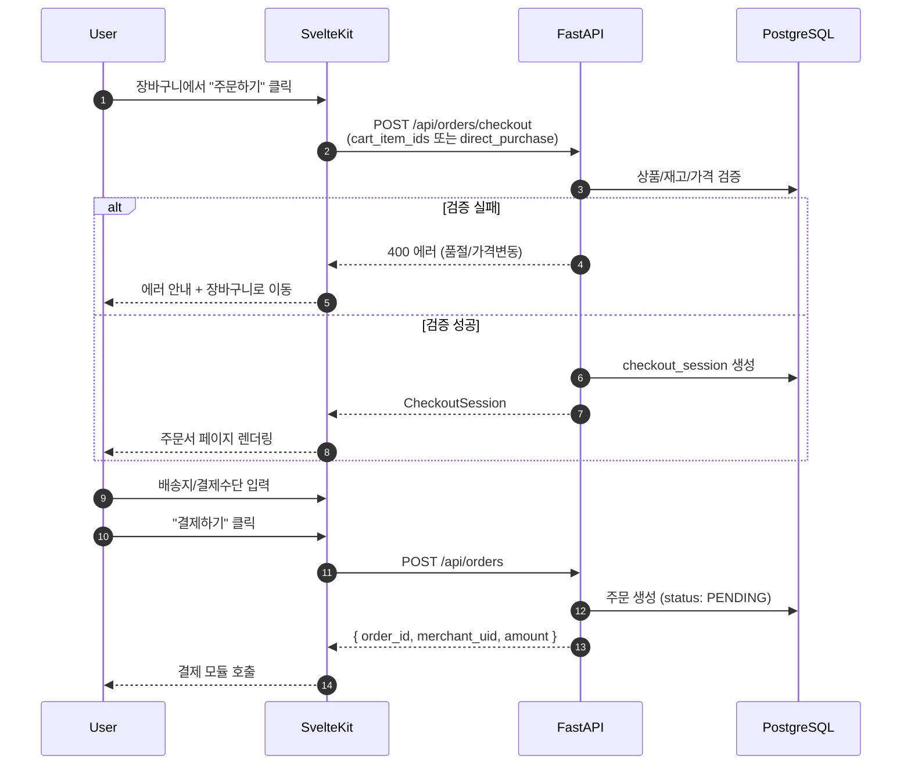

### 2.2 주문서 구성 요소

| 섹션 | 필드 | 필수 | 설명 |
|------|------|------|------|
| 주문 상품 | 상품 목록 | - | 이미지, 상품명, 옵션, 수량, 가격 |
| 주문자 정보 | 이름 | Y | 회원: 자동 입력 |
| | 연락처 | Y | 회원: 자동 입력 |
| | 이메일 | Y | 주문 확인 메일 발송용 |
| 배송지 정보 | 수령인 | Y | |
| | 연락처 | Y | |
| | 주소 | Y | 다음 주소 API |
| | 상세주소 | N | |
| | 배송 메모 | N | 드롭다운 + 직접입력 |
| 결제 정보 | 결제수단 | Y | 카드/계좌이체/간편결제 |
| 결제 금액 | 상품금액 | - | 자동 계산 |
| | 배송비 | - | 조건부 무료 |
| | 할인금액 | - | (MVP 이후 쿠폰) |
| | 총 결제금액 | - | 자동 계산 |

### 2.3 API 명세

#### POST /api/orders/checkout

체크아웃 세션 생성 (장바구니 → 주문서)

**Request**
```json
{
  "type": "cart",
  "cart_item_ids": ["uuid1", "uuid2"]
}
```

또는 바로구매:
```json
{
  "type": "direct",
  "product_option_id": "uuid",
  "quantity": 1
}
```

**Response (200 OK)**
```json
{
  "checkout_session_id": "uuid",
  "items": [
    {
      "product_option_id": "uuid",
      "product": {
        "id": "uuid",
        "name": "베이직 티셔츠",
        "thumbnail_url": "https://..."
      },
      "option": {
        "color": "블랙",
        "size": "M",
        "price": 29000,
        "discount_price": 25000
      },
      "quantity": 2,
      "subtotal": 50000
    }
  ],
  "summary": {
    "items_total": 50000,
    "shipping_fee": 3000,
    "discount": 0,
    "total": 53000
  },
  "shipping_fee_threshold": 50000,
  "expires_at": "2025-12-27T11:00:00Z"
}
```

#### POST /api/orders

주문 생성

**Request**
```json
{
  "checkout_session_id": "uuid",
  "orderer": {
    "name": "홍길동",
    "phone": "010-1234-5678",
    "email": "user@example.com"
  },
  "shipping": {
    "recipient": "홍길동",
    "phone": "010-1234-5678",
    "postal_code": "06000",
    "address": "서울특별시 강남구 테헤란로 123",
    "address_detail": "456호",
    "memo": "문 앞에 놔주세요"
  },
  "payment_method": "card"
}
```

**Response (201 Created)**
```json
{
  "order_id": "uuid",
  "order_number": "ORD_20251227100000_a3f2e1",
  "merchant_uid": "ORD_20251227100000_a3f2e1",
  "amount": 53000,
  "status": "PENDING"
}
```

### 2.4 검증 규칙

| 규칙 | 조건 | 에러 |
|------|------|------|
| 세션 유효성 | checkout_session 만료 전 | SESSION_EXPIRED |
| 재고 확인 | 모든 상품 재고 있음 | OUT_OF_STOCK |
| 가격 확인 | 세션 생성 시점과 동일 | PRICE_CHANGED |
| 상품 상태 | is_deleted = false | PRODUCT_DELETED |
| 연락처 형식 | 유효한 전화번호 | INVALID_PHONE |
| 이메일 형식 | 유효한 이메일 | INVALID_EMAIL |

### 2.5 에러 코드

| HTTP | 에러 코드 | 설명 |
|------|-----------|------|
| 400 | SESSION_EXPIRED | 체크아웃 세션이 만료되었습니다 |
| 400 | OUT_OF_STOCK | 일부 상품이 품절되었습니다 |
| 400 | PRICE_CHANGED | 상품 가격이 변경되었습니다 |
| 400 | INVALID_PHONE | 올바른 연락처를 입력해주세요 |
| 400 | INVALID_EMAIL | 올바른 이메일을 입력해주세요 |
| 410 | PRODUCT_DELETED | 판매 종료된 상품이 포함되어 있습니다 |

---

## 3. ORD-002 결제 처리

| 항목 | 내용 |
|------|------|
| 기능 ID | ORD-002 |
| 기능명 | 결제 처리 (Payment) |
| 사용자 유형 | Consumer |
| 우선순위 | 필수 (MVP) |

> **하위 목차**
> - [3.1 결제 Flow](#31-결제-flow)
> - [3.2 지원 결제수단](#32-지원-결제수단)
> - [3.3 API 명세](#33-api-명세)
> - [3.4 결제 완료 처리](#34-결제-완료-처리)

### 3.1 결제 Flow

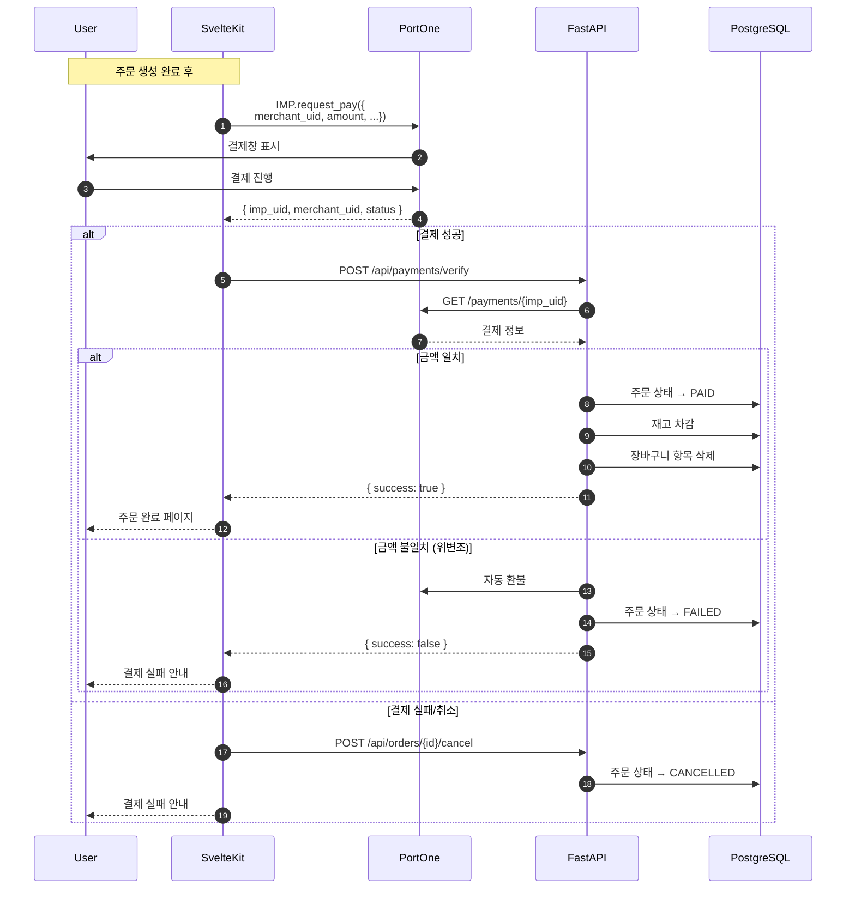

### 3.2 지원 결제수단

| 결제수단 | PG사 | pay_method | 설명 |
|----------|------|------------|------|
| 신용카드 | 이니시스 | card | 일반/할부 결제 |
| 계좌이체 | 이니시스 | trans | 실시간 계좌이체 |
| 카카오페이 | 카카오 | kakaopay | 간편결제 |
| 네이버페이 | 네이버 | naverpay | 간편결제 |

### 3.3 API 명세

#### POST /api/payments/verify

결제 검증 및 완료 처리

**Request**
```json
{
  "imp_uid": "imp_123456789",
  "merchant_uid": "ORD_20251227100000_a3f2e1"
}
```

**Response (200 OK)**
```json
{
  "success": true,
  "order_id": "uuid",
  "order_number": "ORD_20251227100000_a3f2e1",
  "status": "PAID",
  "paid_at": "2025-12-27T10:05:00Z"
}
```

**Response (400 Bad Request)**
```json
{
  "success": false,
  "error": "AMOUNT_MISMATCH",
  "message": "결제 금액이 일치하지 않습니다"
}
```

### 3.4 결제 완료 처리

결제 성공 시 수행되는 작업:

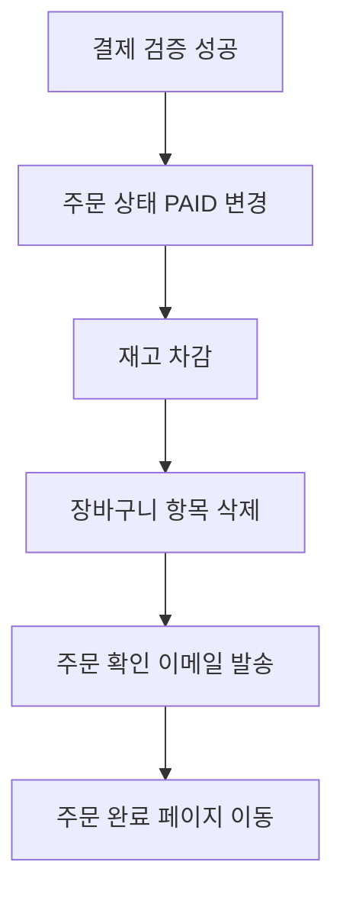

| 순서 | 작업 | 실패 시 처리 |
|------|------|-------------|
| 1 | 주문 상태 변경 | 트랜잭션 롤백 |
| 2 | 재고 차감 | 트랜잭션 롤백 |
| 3 | 장바구니 삭제 | 무시 (비동기) |
| 4 | 이메일 발송 | 무시 (비동기) |

---

## 4. ORD-003 주문 목록 조회

| 항목 | 내용 |
|------|------|
| 기능 ID | ORD-003 |
| 기능명 | 주문 목록 조회 (Order List) |
| 사용자 유형 | Consumer |
| 우선순위 | 필수 (MVP) |

> **하위 목차**
> - [4.1 Flow](#41-flow)
> - [4.2 API 명세](#42-api-명세)
> - [4.3 필터링 옵션](#43-필터링-옵션)

### 4.1 Flow

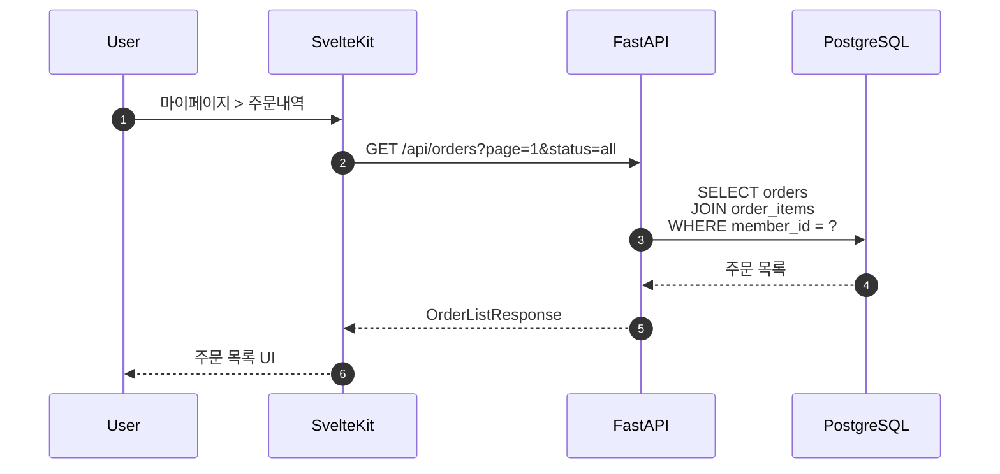

### 4.2 API 명세

#### GET /api/orders

**Request**
```
Headers:
  Authorization: Bearer <JWT>

Query Parameters:
  page: 1 (default)
  limit: 10 (default, max 50)
  status: all | pending | paid | shipping | delivered | cancelled
  from_date: 2025-01-01 (optional)
  to_date: 2025-12-31 (optional)
```

**Response (200 OK)**
```json
{
  "orders": [
    {
      "id": "uuid",
      "order_number": "ORD_20251227100000_a3f2e1",
      "status": "PAID",
      "total_amount": 53000,
      "item_count": 2,
      "representative_item": {
        "product_name": "베이직 티셔츠",
        "thumbnail_url": "https://...",
        "option": "블랙 / M"
      },
      "ordered_at": "2025-12-27T10:00:00Z"
    }
  ],
  "pagination": {
    "page": 1,
    "limit": 10,
    "total_count": 25,
    "total_pages": 3
  }
}
```

### 4.3 필터링 옵션

| 필터 | 값 | 설명 |
|------|-----|------|
| status | all | 전체 |
| | pending | 결제 대기 |
| | paid | 결제 완료 |
| | preparing | 상품 준비중 |
| | shipping | 배송중 |
| | delivered | 배송 완료 |
| | cancelled | 취소/환불 |

---

## 5. ORD-004 주문 상세 조회

| 항목 | 내용 |
|------|------|
| 기능 ID | ORD-004 |
| 기능명 | 주문 상세 조회 (Order Detail) |
| 사용자 유형 | Consumer |
| 우선순위 | 필수 (MVP) |

> **하위 목차**
> - [5.1 Flow](#51-flow)
> - [5.2 API 명세](#52-api-명세)
> - [5.3 상세 화면 구성](#53-상세-화면-구성)

### 5.1 Flow

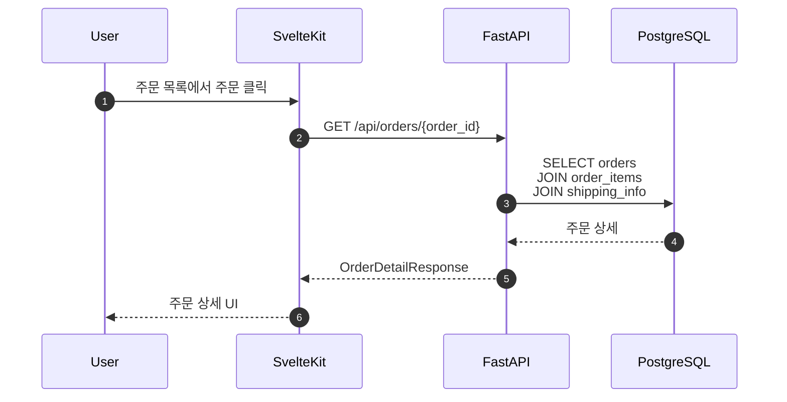

### 5.2 API 명세

#### GET /api/orders/{order_id}

**Response (200 OK)**
```json
{
  "id": "uuid",
  "order_number": "ORD_20251227100000_a3f2e1",
  "status": "SHIPPING",
  "orderer": {
    "name": "홍길동",
    "phone": "010-1234-5678",
    "email": "user@example.com"
  },
  "shipping": {
    "recipient": "홍길동",
    "phone": "010-1234-5678",
    "postal_code": "06000",
    "address": "서울특별시 강남구 테헤란로 123",
    "address_detail": "456호",
    "memo": "문 앞에 놔주세요",
    "tracking_number": "1234567890",
    "carrier": "CJ대한통운"
  },
  "items": [
    {
      "id": "uuid",
      "product": {
        "id": "uuid",
        "name": "베이직 티셔츠",
        "thumbnail_url": "https://...",
        "slug": "basic-tshirt"
      },
      "option": {
        "color": "블랙",
        "size": "M"
      },
      "quantity": 2,
      "unit_price": 25000,
      "subtotal": 50000
    }
  ],
  "payment": {
    "method": "card",
    "method_name": "신용카드",
    "paid_at": "2025-12-27T10:05:00Z",
    "card_name": "신한카드",
    "card_number": "1234-****-****-5678"
  },
  "amounts": {
    "items_total": 50000,
    "shipping_fee": 3000,
    "discount": 0,
    "total": 53000
  },
  "timeline": [
    {
      "status": "PENDING",
      "occurred_at": "2025-12-27T10:00:00Z"
    },
    {
      "status": "PAID",
      "occurred_at": "2025-12-27T10:05:00Z"
    },
    {
      "status": "PREPARING",
      "occurred_at": "2025-12-27T14:00:00Z"
    },
    {
      "status": "SHIPPING",
      "occurred_at": "2025-12-28T09:00:00Z"
    }
  ],
  "ordered_at": "2025-12-27T10:00:00Z",
  "can_cancel": false,
  "can_refund": false
}
```

### 5.3 상세 화면 구성

| 섹션 | 표시 정보 |
|------|----------|
| 주문 정보 | 주문번호, 주문일시, 주문 상태 |
| 상품 정보 | 이미지, 상품명, 옵션, 수량, 가격 |
| 배송 정보 | 수령인, 연락처, 주소, 배송메모 |
| 배송 추적 | 택배사, 송장번호, 추적 링크 |
| 결제 정보 | 결제수단, 카드정보, 결제일시 |
| 결제 금액 | 상품금액, 배송비, 할인, 총액 |
| 주문 타임라인 | 상태 변경 이력 |
| 액션 버튼 | 주문 취소, 환불 요청 (조건부) |

---

## 6. ORD-005 주문 취소

| 항목 | 내용 |
|------|------|
| 기능 ID | ORD-005 |
| 기능명 | 주문 취소 (Order Cancel) |
| 사용자 유형 | Consumer |
| 우선순위 | 필수 (MVP) |

> **하위 목차**
> - [6.1 취소 가능 조건](#61-취소-가능-조건)
> - [6.2 취소 Flow](#62-취소-flow)
> - [6.3 API 명세](#63-api-명세)
> - [6.4 환불 Flow](#64-환불-flow)

### 6.1 취소 가능 조건

| 주문 상태 | 취소 가능 | 환불 방식 |
|----------|----------|----------|
| PENDING | O | 결제 전이므로 환불 없음 |
| PAID | O | 전액 환불 |
| PREPARING | O | 전액 환불 |
| SHIPPING | X | 반품 프로세스 필요 |
| DELIVERED | △ | 7일 이내 환불 요청 |

### 6.2 취소 Flow

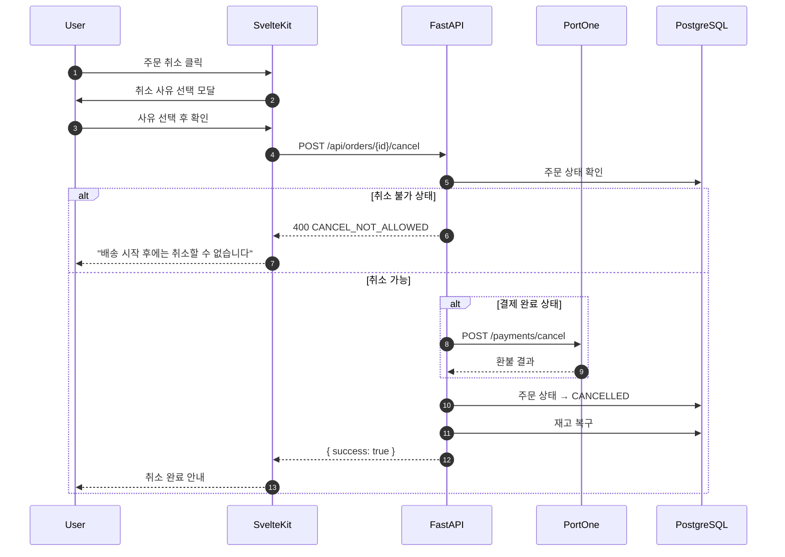

### 6.3 API 명세

#### POST /api/orders/{order_id}/cancel

**Request**
```json
{
  "reason": "CHANGE_MIND",
  "reason_detail": "다른 상품으로 변경하고 싶습니다"
}
```

**취소 사유 코드**

| 코드 | 설명 |
|------|------|
| CHANGE_MIND | 단순 변심 |
| WRONG_ORDER | 잘못 주문함 |
| CHANGE_OPTION | 옵션 변경 |
| FOUND_CHEAPER | 다른 곳에서 더 저렴하게 발견 |
| OTHER | 기타 |

**Response (200 OK)**
```json
{
  "success": true,
  "order_id": "uuid",
  "status": "CANCELLED",
  "refund": {
    "amount": 53000,
    "method": "card",
    "estimated_date": "2025-12-30"
  }
}
```

### 6.4 환불 Flow

> 상세: [PAYMENT_결제흐름.md](./PAYMENT_결제흐름.md) 섹션 5

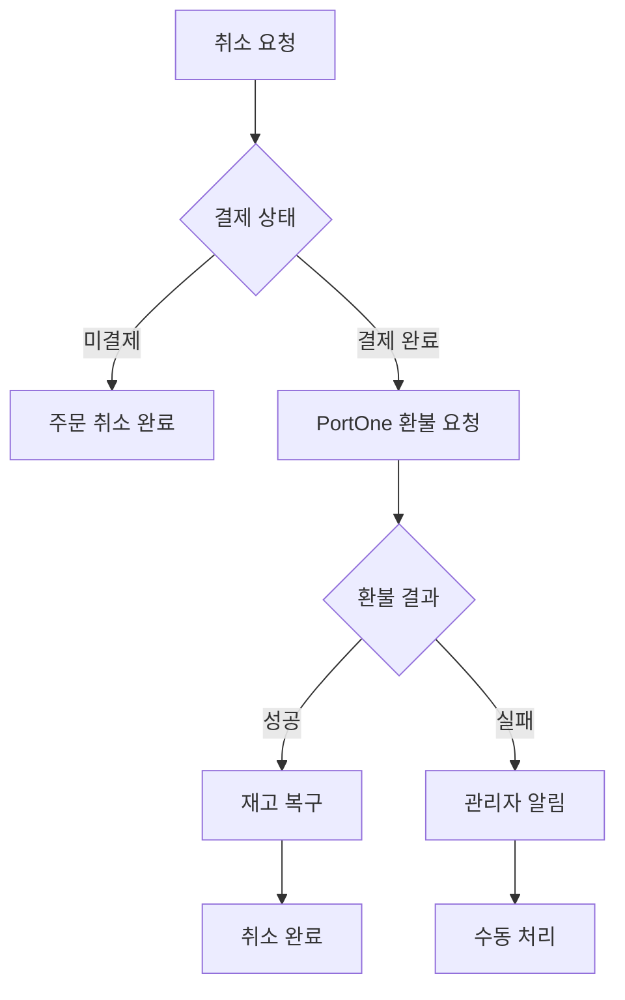

---

## 7. ORD-006 배송 추적

| 항목 | 내용 |
|------|------|
| 기능 ID | ORD-006 |
| 기능명 | 배송 추적 (Delivery Tracking) |
| 사용자 유형 | Consumer |
| 우선순위 | 필수 (MVP) |

> **하위 목차**
> - [7.1 배송 상태](#71-배송-상태)
> - [7.2 Flow](#72-flow)
> - [7.3 API 명세](#73-api-명세)

### 7.1 배송 상태

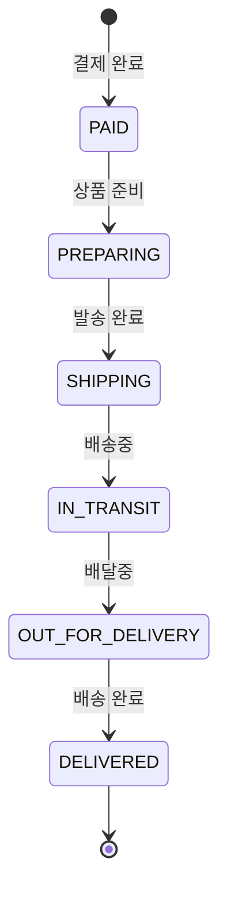

| 상태 | 설명 | 표시 |
|------|------|------|
| PREPARING | 상품 준비중 | 상품을 준비하고 있습니다 |
| SHIPPING | 발송 완료 | 택배사에 인계되었습니다 |
| IN_TRANSIT | 배송중 | 배송중입니다 |
| OUT_FOR_DELIVERY | 배달중 | 배달원이 배달중입니다 |
| DELIVERED | 배송 완료 | 배송이 완료되었습니다 |

### 7.2 Flow

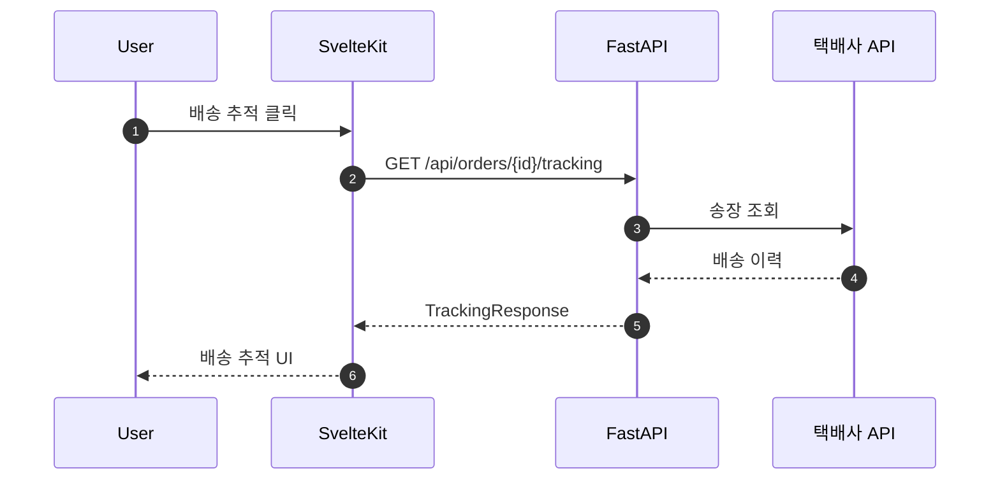

### 7.3 API 명세

#### GET /api/orders/{order_id}/tracking

**Response (200 OK)**
```json
{
  "carrier": {
    "code": "CJGLS",
    "name": "CJ대한통운"
  },
  "tracking_number": "1234567890",
  "tracking_url": "https://www.cjlogistics.com/ko/tool/parcel/tracking?gnbInvcNo=1234567890",
  "status": "IN_TRANSIT",
  "status_text": "배송중",
  "history": [
    {
      "status": "SHIPPING",
      "location": "서울 강남 집화점",
      "description": "물품이 접수되었습니다",
      "occurred_at": "2025-12-28T09:00:00Z"
    },
    {
      "status": "IN_TRANSIT",
      "location": "대전 HUB",
      "description": "간선 상차",
      "occurred_at": "2025-12-28T14:00:00Z"
    },
    {
      "status": "IN_TRANSIT",
      "location": "부산 HUB",
      "description": "간선 하차",
      "occurred_at": "2025-12-28T20:00:00Z"
    }
  ],
  "estimated_delivery": "2025-12-29"
}
```

---

## 8. 비회원 주문

> **하위 목차**
> - [8.1 비회원 주문 Flow](#81-비회원-주문-flow)
> - [8.2 비회원 주문 조회](#82-비회원-주문-조회)
> - [8.3 API 명세](#83-api-명세)

### 8.1 비회원 주문 Flow

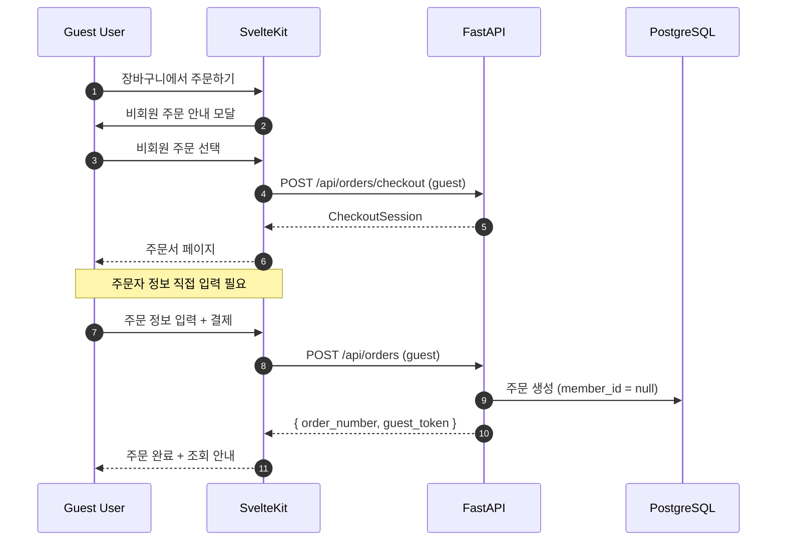

### 8.2 비회원 주문 조회

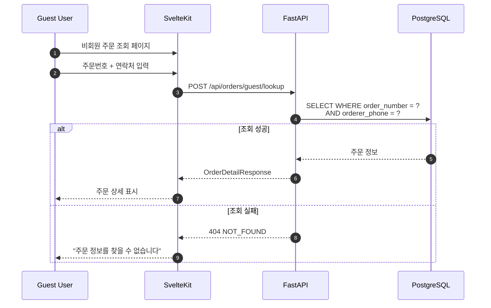

### 8.3 API 명세

#### POST /api/orders/guest/lookup

**Request**
```json
{
  "order_number": "ORD_20251227100000_a3f2e1",
  "phone": "010-1234-5678"
}
```

**Response (200 OK)**

주문 상세 응답과 동일 (ORD-004 참조)

---

## 9. 데이터 모델

> **하위 목차**
> - [9.1 테이블 관계](#91-테이블-관계)
> - [9.2 orders 테이블](#92-orders-테이블)
> - [9.3 order_items 테이블](#93-order_items-테이블)
> - [9.4 payments 테이블](#94-payments-테이블)

### 9.1 테이블 관계

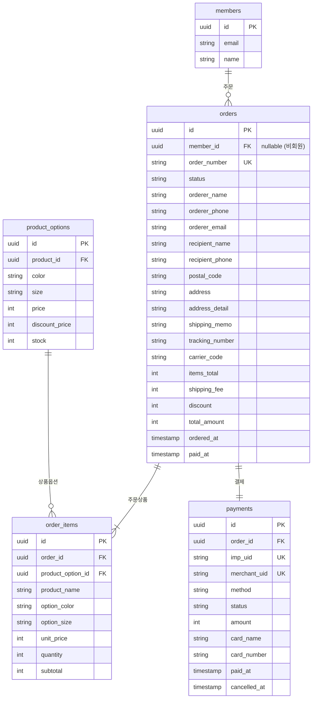

### 9.2 orders 테이블

```sql
CREATE TABLE orders (
    id UUID PRIMARY KEY DEFAULT gen_random_uuid(),
    member_id UUID REFERENCES members(id) ON DELETE SET NULL,
    order_number VARCHAR(30) UNIQUE NOT NULL,
    status VARCHAR(20) NOT NULL DEFAULT 'PENDING',

    -- 주문자 정보
    orderer_name VARCHAR(50) NOT NULL,
    orderer_phone VARCHAR(20) NOT NULL,
    orderer_email VARCHAR(100) NOT NULL,

    -- 배송지 정보
    recipient_name VARCHAR(50) NOT NULL,
    recipient_phone VARCHAR(20) NOT NULL,
    postal_code VARCHAR(10) NOT NULL,
    address VARCHAR(200) NOT NULL,
    address_detail VARCHAR(100),
    shipping_memo VARCHAR(200),

    -- 배송 추적
    tracking_number VARCHAR(50),
    carrier_code VARCHAR(20),

    -- 금액
    items_total INTEGER NOT NULL,
    shipping_fee INTEGER NOT NULL DEFAULT 0,
    discount INTEGER NOT NULL DEFAULT 0,
    total_amount INTEGER NOT NULL,

    -- 타임스탬프
    ordered_at TIMESTAMPTZ DEFAULT NOW(),
    paid_at TIMESTAMPTZ,
    shipped_at TIMESTAMPTZ,
    delivered_at TIMESTAMPTZ,
    cancelled_at TIMESTAMPTZ,

    created_at TIMESTAMPTZ DEFAULT NOW(),
    updated_at TIMESTAMPTZ DEFAULT NOW()
);

-- 인덱스
CREATE INDEX idx_orders_member ON orders(member_id);
CREATE INDEX idx_orders_status ON orders(status);
CREATE INDEX idx_orders_ordered_at ON orders(ordered_at DESC);

-- RLS 정책
ALTER TABLE orders ENABLE ROW LEVEL SECURITY;

-- 회원: 본인 주문만 조회
CREATE POLICY "orders_select_own"
    ON orders FOR SELECT
    USING (auth.uid() = member_id);

-- 비회원: 주문번호 + 연락처로 조회 (서버에서 처리)
```

### 9.3 order_items 테이블

```sql
CREATE TABLE order_items (
    id UUID PRIMARY KEY DEFAULT gen_random_uuid(),
    order_id UUID NOT NULL REFERENCES orders(id) ON DELETE CASCADE,
    product_option_id UUID NOT NULL REFERENCES product_options(id),

    -- 주문 시점 스냅샷 (상품 정보 변경에 영향받지 않음)
    product_name VARCHAR(200) NOT NULL,
    option_color VARCHAR(50),
    option_size VARCHAR(20),
    thumbnail_url VARCHAR(500),

    unit_price INTEGER NOT NULL,
    quantity INTEGER NOT NULL CHECK (quantity > 0),
    subtotal INTEGER NOT NULL,

    created_at TIMESTAMPTZ DEFAULT NOW()
);

-- 인덱스
CREATE INDEX idx_order_items_order ON order_items(order_id);
```

### 9.4 payments 테이블

```sql
CREATE TABLE payments (
    id UUID PRIMARY KEY DEFAULT gen_random_uuid(),
    order_id UUID NOT NULL REFERENCES orders(id) ON DELETE CASCADE,

    -- PortOne 정보
    imp_uid VARCHAR(50) UNIQUE,
    merchant_uid VARCHAR(50) UNIQUE NOT NULL,

    -- 결제 정보
    method VARCHAR(20) NOT NULL,
    status VARCHAR(20) NOT NULL DEFAULT 'READY',
    amount INTEGER NOT NULL,

    -- 카드 정보 (마스킹)
    card_name VARCHAR(50),
    card_number VARCHAR(20),

    -- 타임스탬프
    paid_at TIMESTAMPTZ,
    cancelled_at TIMESTAMPTZ,

    -- 환불 정보
    refund_amount INTEGER DEFAULT 0,
    refund_reason VARCHAR(200),

    created_at TIMESTAMPTZ DEFAULT NOW(),
    updated_at TIMESTAMPTZ DEFAULT NOW()
);

-- 인덱스
CREATE INDEX idx_payments_order ON payments(order_id);
CREATE INDEX idx_payments_status ON payments(status);
```

---

## 변경 이력

| 버전 | 날짜 | 변경 내용 |
|------|------|-----------|
| 1.0 | 2025-12-27 | 초기 작성 |
