# 결제 흐름 (Payment Flow)

**Version 1.0** | **2025-12-25** | **ko&clo Project**

---

## 목차

1. [개요](#1-개요)
2. [결제 아키텍처](#2-결제-아키텍처)
3. [결제 흐름 상세](#3-결제-흐름-상세)
4. [결제 상태 관리](#4-결제-상태-관리)
5. [환불 처리](#5-환불-처리)
6. [보안 및 위변조 방지](#6-보안-및-위변조-방지)

---

## 1. 개요

> **하위 목차**
> - [1.1 결제 시스템](#11-결제-시스템)
> - [1.2 PortOne 연동 정보](#12-portone-연동-정보)

### 1.1 결제 시스템

| 항목 | 내용 |
|------|------|
| PG 통합 | PortOne (구 아임포트) |
| 지원 결제수단 | 카드, 계좌이체, 간편결제 (카카오페이, 네이버페이) |
| 결제 방식 | 클라이언트 SDK → 서버 검증 |

### 1.2 PortOne 연동 정보

| 항목 | 설명 |
|------|------|
| 가맹점 코드 | IMP_CODE (환경변수) |
| API Key | REST API 인증용 |
| API Secret | REST API 인증용 |
| Webhook | 결제 상태 콜백 |

---

## 2. 결제 아키텍처

> **하위 목차**
> - [2.1 전체 결제 구조](#21-전체-결제-구조)
> - [2.2 결제 컴포넌트](#22-결제-컴포넌트)

### 2.1 전체 결제 구조

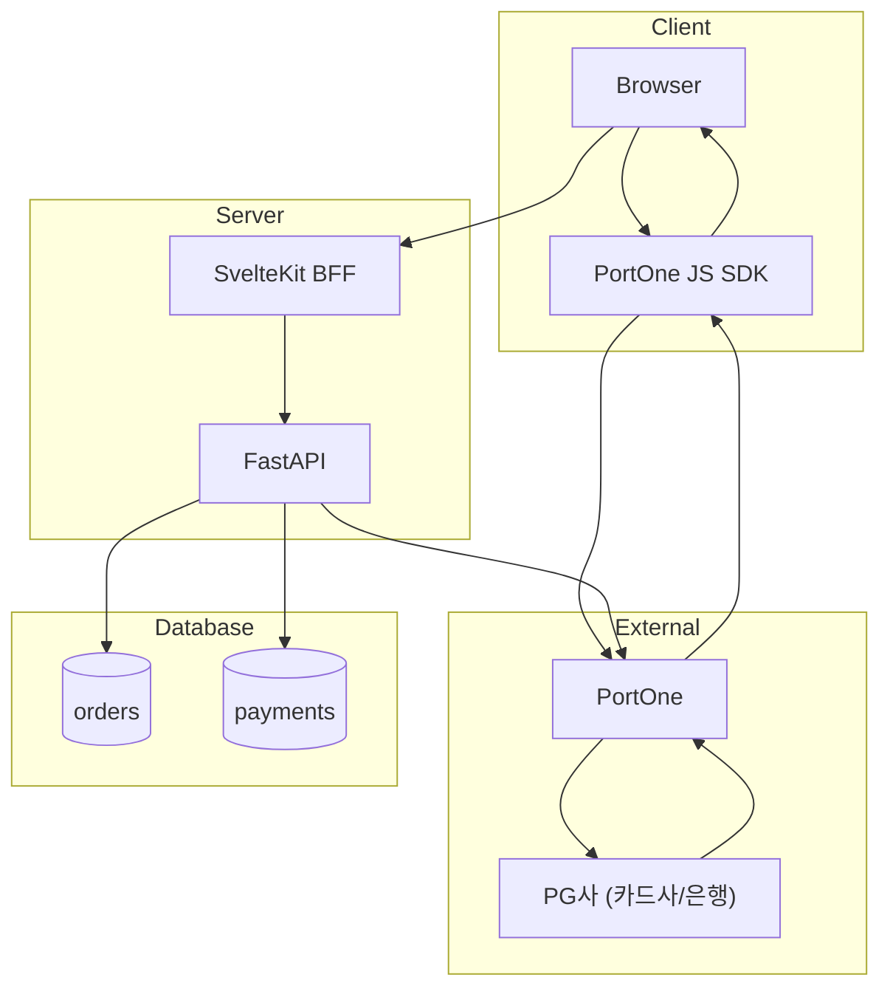

### 2.2 결제 컴포넌트

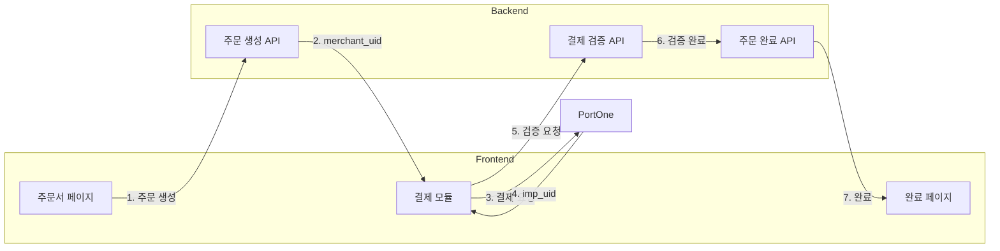

---

## 3. 결제 흐름 상세

> **하위 목차**
> - [3.1 전체 결제 시퀀스](#31-전체-결제-시퀀스)
> - [3.2 주문 생성 Flow](#32-주문-생성-flow)
> - [3.3 merchant_uid 생성 규칙](#33-merchant_uid-생성-규칙)
> - [3.4 PortOne 결제 요청](#34-portone-결제-요청)

### 3.1 전체 결제 시퀀스

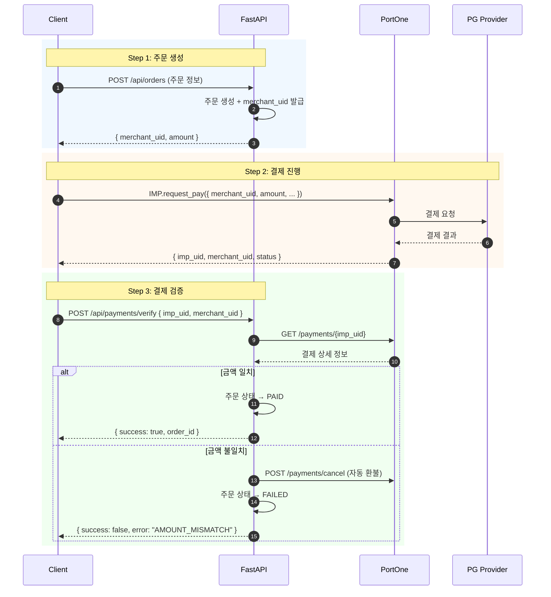

### 3.2 주문 생성 Flow

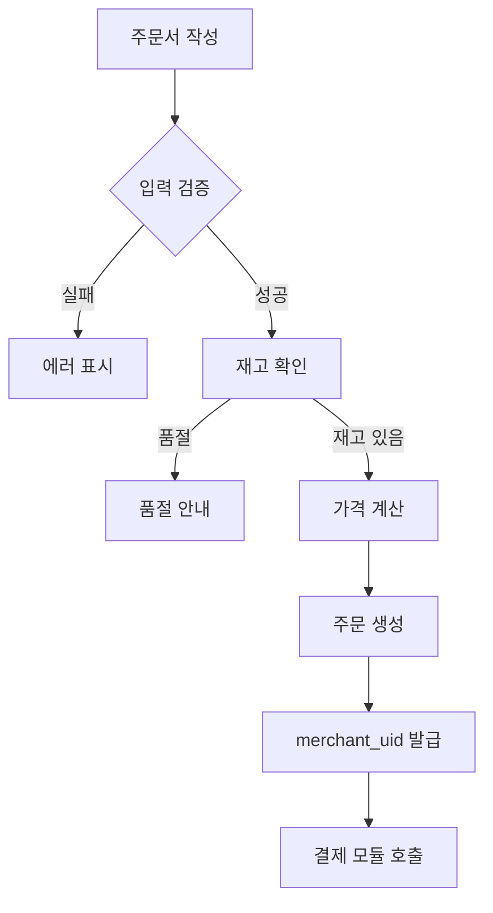

### 3.3 merchant_uid 생성 규칙

```
패턴: {prefix}_{timestamp}_{random}
예시: ORD_20251225143052_a3f2e1
```

| 구성 요소 | 설명 |
|-----------|------|
| prefix | ORD (주문) |
| timestamp | YYYYMMDDHHmmss |
| random | 6자리 랜덤 문자열 |

### 3.4 PortOne 결제 요청

```javascript
// 클라이언트 결제 요청
IMP.request_pay({
  pg: 'html5_inicis',           // PG사
  pay_method: 'card',           // 결제수단
  merchant_uid: 'ORD_20251225143052_a3f2e1',
  name: '주문명',
  amount: 50000,
  buyer_email: 'user@example.com',
  buyer_name: '홍길동',
  buyer_tel: '010-1234-5678',
  buyer_addr: '서울특별시 강남구',
  buyer_postcode: '06000'
}, function(response) {
  if (response.success) {
    // 서버로 검증 요청
    verifyPayment(response.imp_uid, response.merchant_uid);
  } else {
    // 결제 실패 처리
    alert(response.error_msg);
  }
});
```

---

## 4. 결제 상태 관리

> **하위 목차**
> - [4.1 주문 상태 전이](#41-주문-상태-전이)
> - [4.2 상태별 설명](#42-상태별-설명)
> - [4.3 결제 상태 전이](#43-결제-상태-전이)

### 4.1 주문 상태 전이

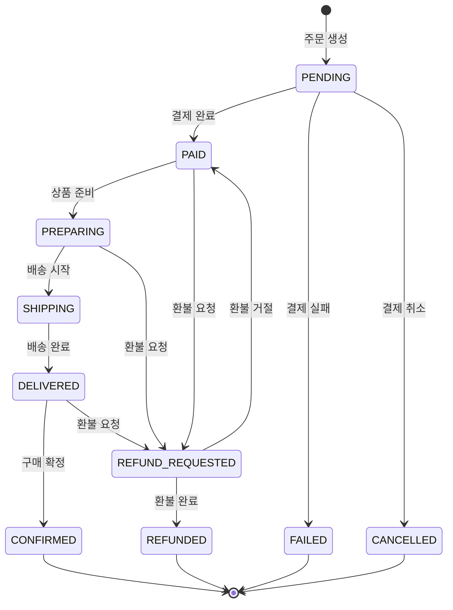

### 4.2 상태별 설명

| 상태 | 설명 | 다음 가능 상태 |
|------|------|----------------|
| PENDING | 결제 대기 | PAID, FAILED, CANCELLED |
| PAID | 결제 완료 | PREPARING, REFUND_REQUESTED |
| PREPARING | 상품 준비 중 | SHIPPING, REFUND_REQUESTED |
| SHIPPING | 배송 중 | DELIVERED |
| DELIVERED | 배송 완료 | CONFIRMED, REFUND_REQUESTED |
| CONFIRMED | 구매 확정 | (종료) |
| REFUND_REQUESTED | 환불 요청 | REFUNDED, PAID |
| REFUNDED | 환불 완료 | (종료) |
| FAILED | 결제 실패 | (종료) |
| CANCELLED | 주문 취소 | (종료) |

### 4.3 결제 상태 전이

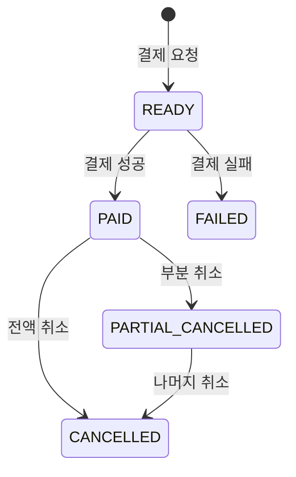

---

## 5. 환불 처리

> **하위 목차**
> - [5.1 환불 Flow](#51-환불-flow)
> - [5.2 환불 유형](#52-환불-유형)
> - [5.3 환불 상태 관리](#53-환불-상태-관리)
> - [5.4 환불 API](#54-환불-api)

### 5.1 환불 Flow

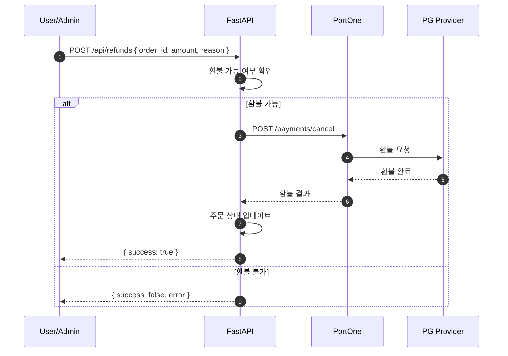

### 5.2 환불 유형

| 유형 | 설명 | 처리 |
|------|------|------|
| 전액 환불 | 결제 금액 전체 환불 | 주문 상태 → REFUNDED |
| 부분 환불 | 일부 금액만 환불 | 주문 상태 유지 + 부분환불 기록 |

### 5.3 환불 상태 관리

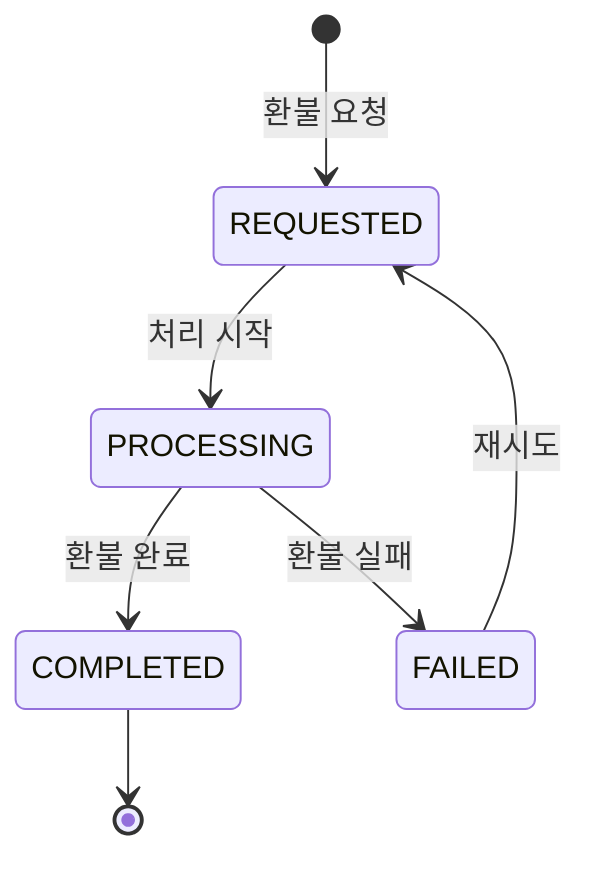

### 5.4 환불 API

```
POST /api/refunds
Content-Type: application/json

{
  "order_id": "uuid",
  "amount": 50000,          // 환불 금액 (부분 환불 시)
  "reason": "고객 변심"
}
```

---

## 6. 보안 및 위변조 방지

> **하위 목차**
> - [6.1 결제 금액 검증](#61-결제-금액-검증)
> - [6.2 검증 로직](#62-검증-로직)
> - [6.3 보안 체크리스트](#63-보안-체크리스트)
> - [6.4 Webhook 처리](#64-webhook-처리)
> - [6.5 동시성 문제 (Race Condition)](#65-동시성-문제-race-condition)

### 6.1 결제 금액 검증

> **중요**: 서버에서 반드시 PortOne API로 결제 금액을 검증해야 합니다.

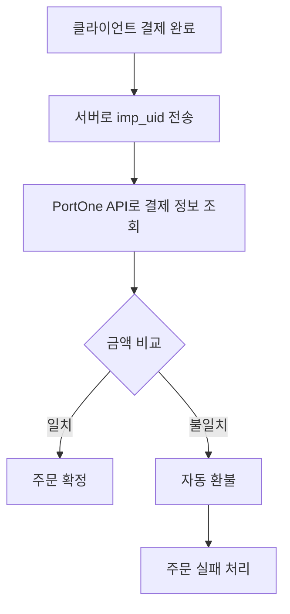

### 6.2 검증 로직

```python
# FastAPI 결제 검증
async def verify_payment(imp_uid: str, merchant_uid: str):
    # 1. 주문 정보 조회
    order = await get_order_by_merchant_uid(merchant_uid)

    # 2. PortOne에서 결제 정보 조회
    payment = await portone_client.get_payment(imp_uid)

    # 3. 금액 검증
    if payment.amount != order.total_amount:
        # 위변조 감지 → 자동 환불
        await portone_client.cancel_payment(imp_uid, reason="금액 불일치")
        raise PaymentVerificationError("AMOUNT_MISMATCH")

    # 4. 상태 검증
    if payment.status != "paid":
        raise PaymentVerificationError("PAYMENT_NOT_COMPLETED")

    # 5. 주문 확정
    await update_order_status(order.id, "PAID")
```

### 6.3 보안 체크리스트

| 항목 | 대응 방안 | 구현 위치 |
|------|-----------|-----------|
| 금액 위변조 | 서버 측 금액 검증 | FastAPI |
| 중복 결제 | merchant_uid 유일성 검사 | Database |
| 결제 상태 조작 | PortOne API로 상태 확인 | FastAPI |
| API Key 노출 | 환경변수 + 서버 전용 | .env |

### 6.4 Webhook 처리

PortOne에서 결제 상태 변경 시 Webhook으로 알림:

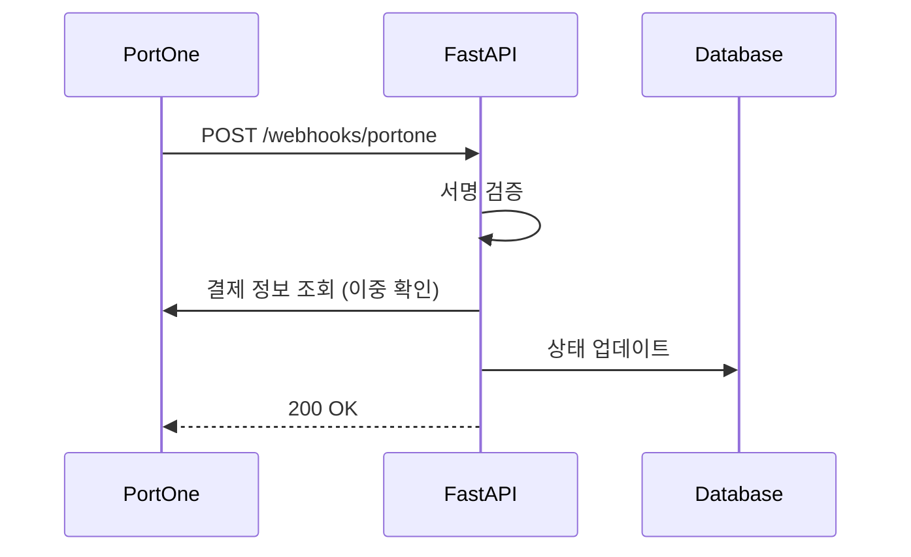

### 6.5 동시성 문제 (Race Condition)

결제 완료와 Webhook이 동시에 도착할 때:

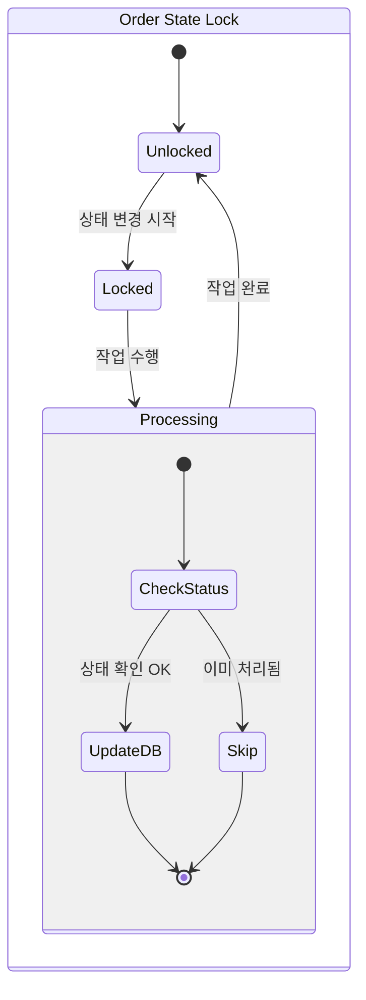

#### 구현 (Optimistic Lock)

```sql
-- 상태 변경 시 현재 상태 확인
UPDATE orders
SET status = 'PAID', updated_at = NOW()
WHERE id = :order_id
  AND status = 'PENDING'  -- 현재 상태가 PENDING일 때만
RETURNING id;

-- 영향받은 행이 0이면 이미 처리됨
```

---

## 환경 변수

```bash
# PortOne
PUBLIC_PORTONE_IMP_CODE=imp12345678
PORTONE_API_KEY=your-api-key
PORTONE_API_SECRET=your-api-secret

# Webhook
PORTONE_WEBHOOK_SECRET=your-webhook-secret
```

---

## 변경 이력

| 버전 | 날짜 | 변경 내용 |
|------|------|-----------|
| 1.0 | 2025-12-25 | TDD v1.6 내용 기반 초기 작성 |
