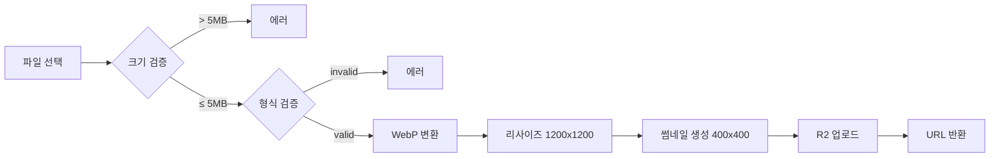
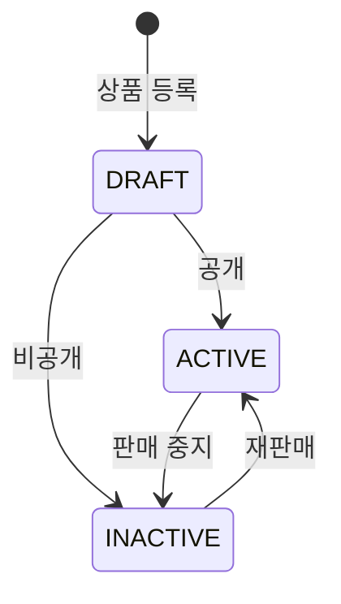
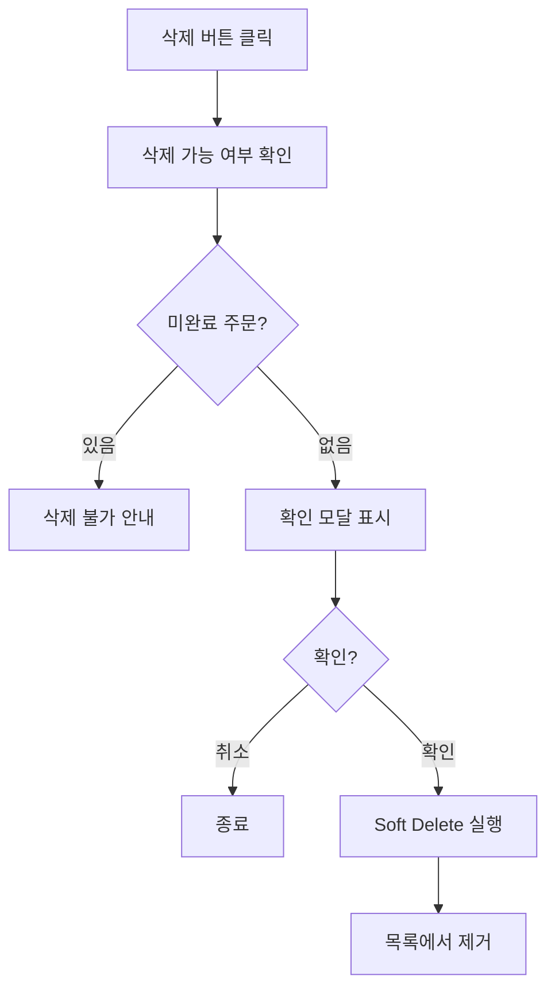
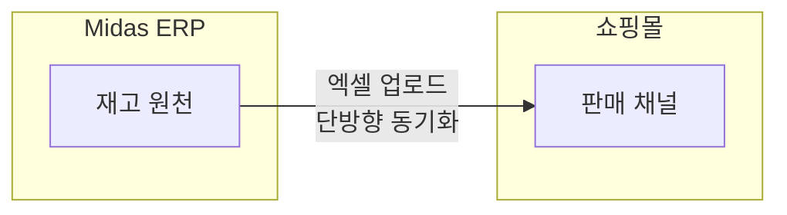
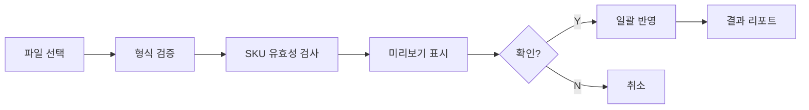

# 상품 관리 (Product Management)

**Version 1.0** | **2025-12-25** | **ko&clo Project**

---

## 목차

1. [개요](#1-개요)
2. [PRD-001 상품 목록 조회](#2-prd-001-상품-목록-조회)
3. [PRD-002 상품 상세 조회](#3-prd-002-상품-상세-조회)
4. [PRD-003 상품 등록](#4-prd-003-상품-등록)
5. [PRD-004 상품 수정](#5-prd-004-상품-수정)
6. [PRD-005 상품 삭제](#6-prd-005-상품-삭제)
7. [PRD-006 재고 관리](#7-prd-006-재고-관리)
8. [PRD-007 카테고리 관리](#8-prd-007-카테고리-관리)

---

## 1. 개요

> **하위 목차**
> - [1.1 기능 목록](#11-기능-목록)
> - [1.2 핵심 비즈니스 의사결정](#12-핵심-비즈니스-의사결정)

### 1.1 기능 목록

| 기능 ID | 기능명 | 사용자 | 우선순위 |
|---------|--------|--------|----------|
| PRD-001 | 상품 목록 조회 | Consumer | MVP |
| PRD-002 | 상품 상세 조회 | Consumer | MVP |
| PRD-003 | 상품 등록 | Admin | MVP |
| PRD-004 | 상품 수정 | Admin | MVP |
| PRD-005 | 상품 삭제 | Admin | MVP |
| PRD-006 | 재고 관리 | Admin | MVP |
| PRD-007 | 카테고리 관리 | Admin | MVP |

### 1.2 핵심 비즈니스 의사결정

| # | 의사결정 | 관련 PRD | 최종 결정 |
|---|----------|----------|-----------|
| 1 | PLP/SRP 통합 | PRD-001 | MVP 통합, Post-MVP 분리 검토 |
| 2 | 검색 MVP 범위 | PRD-001 | PostgreSQL ILIKE만 |
| 3 | URL 구조 | PRD-001 | 단일 라우트 /products/[...slug] |
| 4 | SKU 변경 정책 | PRD-004 | 변경 가능 (Midas 동기화 주의) |
| 5 | 재고 흐름 | PRD-006 | Midas → 쇼핑몰 (단방향) |
| 6 | 에디터 범위 | PRD-003 | TipTap 기본 서식만 |
| 7 | 할인가 입력 | PRD-003 | 직접 + 할인율 모두 지원 |
| 8 | 상품 구조 | PRD-003 | 옵션 방식 (ProductGroup 불필요) |

---

## 2. PRD-001 상품 목록 조회

> **하위 목차**
> - [2.1 기능 상세](#21-기능-상세)
> - [2.2 API 명세](#22-api-명세)
> - [2.3 UI 구성요소](#23-ui-구성요소)
> - [2.4 검색 로직](#24-검색-로직)

| 항목 | 내용 |
|------|------|
| 기능 ID | PRD-001 |
| 기능명 | 상품 목록 조회 (Product List Page) |
| 사용자 유형 | Consumer (비회원/회원) |
| URL 패턴 | `/products`, `/products?category=outer&q=니트` |

### 2.1 기능 상세

PLP(Product List Page)와 SRP(Search Result Page)를 통합한 상품 목록 조회 기능.

#### 조회 유형

| 유형 | URL 패턴 | 설명 |
|------|----------|------|
| 전체 목록 | `/products` | 전체 상품 조회 |
| 카테고리 | `/products?category=outer` | 특정 카테고리 상품 조회 |
| 검색 | `/products?q=니트` | 키워드 검색 결과 (ILIKE) |
| 복합 | `/products?category=top&q=니트&sort=price_asc` | 카테고리 + 검색 + 정렬 조합 |

#### 정렬 옵션

| 파라미터 값 | 정렬 기준 | ORDER BY |
|-------------|-----------|----------|
| newest (기본) | 최신순 | created_at DESC |
| price_asc | 낮은 가격순 | display_price ASC |
| price_desc | 높은 가격순 | display_price DESC |
| popular | 인기순 | view_count DESC (Post-MVP) |

### 2.2 API 명세

#### GET /api/v1/products

**Request Parameters**

| 파라미터 | 타입 | 필수 | 설명 |
|----------|------|------|------|
| page | int | N | 페이지 번호 (기본: 1) |
| limit | int | N | 페이지당 개수 (기본: 20, 최대: 100) |
| category | string | N | 카테고리 슬러그 |
| q | string | N | 검색 키워드 (2자 이상) |
| sort | string | N | 정렬 옵션 |
| min_price | int | N | 최소 가격 필터 |
| max_price | int | N | 최대 가격 필터 |

**Response**

```json
{
  "products": [
    {
      "id": "uuid",
      "name": "상품명",
      "slug": "product-slug",
      "thumbnail_url": "https://...",
      "original_price": 89000,
      "display_price": 60000,
      "discount_rate": 32,
      "is_sold_out": false,
      "is_new": true
    }
  ],
  "pagination": {
    "total": 150,
    "page": 1,
    "limit": 20,
    "total_pages": 8
  }
}
```

### 2.3 UI 구성요소

| 영역 | 구성 요소 |
|------|-----------|
| 헤더 영역 | 카테고리명/검색 타이틀, 총 상품 수, 정렬 드롭다운 |
| 필터 영역 | 카테고리 필터 (계층형), 가격대 필터 (범위 슬라이더) |
| 상품 그리드 | 4열 (데스크탑), 2열 (모바일) |
| 페이지네이션 | 페이지 번호, 이전/다음 버튼 |

### 2.4 검색 로직

```sql
-- MVP: PostgreSQL ILIKE 기반 검색
SELECT * FROM products
WHERE is_deleted = false
  AND status = 'ACTIVE'
  AND (name ILIKE '%검색어%' OR short_description ILIKE '%검색어%')
  AND category_id = :category_id  -- 선택적
ORDER BY created_at DESC
LIMIT 20 OFFSET 0;
```

#### Post-MVP 검색 개선

- Elasticsearch 또는 Algolia 도입
- 자동완성, 오타 교정, 동의어 처리

---

## 3. PRD-002 상품 상세 조회

> **하위 목차**
> - [3.1 UI 구성요소](#31-ui-구성요소)
> - [3.2 옵션 선택 플로우](#32-옵션-선택-플로우)
> - [3.3 API 명세](#33-api-명세)
> - [3.4 SEO 최적화](#34-seo-최적화)

| 항목 | 내용 |
|------|------|
| 기능 ID | PRD-002 |
| 기능명 | 상품 상세 조회 (Product Detail Page) |
| 사용자 유형 | Consumer (비회원/회원) |
| URL 패턴 | `/products/{slug}` |

### 3.1 UI 구성요소

| 영역 | 구성 요소 |
|------|-----------|
| 이미지 갤러리 | 대표 이미지 + 썸네일 목록 + 이미지 확대 |
| 상품 정보 | 상품명, 가격(정가/할인가/할인율), 간략 설명 |
| 옵션 선택 | 색상 → 사이즈 순차 선택, 선택된 옵션 태그 표시 |
| 재고/가격 표시 | 옵션별 재고 상태, 추가금액 표시 |
| 수량 선택 | +/- 버튼, 재고 이상 선택 불가 |
| 액션 버튼 | 장바구니 담기, 바로 구매 |
| 상세 설명 | TipTap 에디터 콘텐츠 (HTML 렌더링) |

### 3.2 옵션 선택 플로우


### 3.3 API 명세

#### GET /api/v1/products/{slug}

**Response**

```json
{
  "id": "uuid",
  "name": "캐시미어 니트",
  "slug": "cashmere-knit",
  "description": "<p>상세 설명 HTML</p>",
  "short_description": "부드러운 캐시미어 니트",
  "original_price": 89000,
  "selling_price": 60000,
  "discount_rate": 32,
  "images": [
    { "id": "uuid", "url": "https://...", "is_thumbnail": true, "sort_order": 1 }
  ],
  "options": [
    { "id": "uuid", "sku": "KNC-BLK-M", "color": "Black", "size": "M", "stock_quantity": 50, "additional_price": 0 }
  ],
  "category": { "id": "uuid", "name": "니트", "slug": "top/knit" },
  "seo_title": "캐시미어 니트 | ko&clo",
  "seo_description": "부드러운 캐시미어 니트"
}
```

### 3.4 SEO 최적화

#### Meta Tags

```html
<title>{seo_title} | ko&clo</title>
<meta name="description" content="{seo_description}">
<meta property="og:title" content="{seo_title}">
<meta property="og:image" content="{thumbnail_url}">
<meta property="og:type" content="product">
```

#### Structured Data (JSON-LD)

```json
{
  "@context": "https://schema.org",
  "@type": "Product",
  "name": "{name}",
  "description": "{short_description}",
  "image": "{thumbnail_url}",
  "offers": {
    "@type": "Offer",
    "price": "{display_price}",
    "priceCurrency": "KRW",
    "availability": "https://schema.org/InStock"
  }
}
```

#### 에러 처리

| 상황 | HTTP 코드 | 처리 |
|------|-----------|------|
| 상품 없음 | 404 | "상품을 찾을 수 없습니다" 페이지 |
| 삭제된 상품 | 404 | "삭제된 상품입니다" 메시지 |
| 비활성 상품 | 404 | "판매 중지된 상품입니다" 메시지 |

---

## 4. PRD-003 상품 등록

> **하위 목차**
> - [4.1 입력 필드](#41-입력-필드)
> - [4.2 할인가 계산 로직](#42-할인가-계산-로직)
> - [4.3 SKU 자동 생성 규칙](#43-sku-자동-생성-규칙)
> - [4.4 이미지 업로드](#44-이미지-업로드)
> - [4.5 API 명세](#45-api-명세)
> - [4.6 상태 전이](#46-상태-전이)

| 항목 | 내용 |
|------|------|
| 기능 ID | PRD-003 |
| 기능명 | 상품 등록 (Admin) |
| 사용자 유형 | Admin |
| URL 패턴 | `/admin/products/new` |

### 4.1 입력 필드

#### 기본 정보 탭

| 필드 | 타입 | 필수 | 검증 규칙 |
|------|------|------|-----------|
| 상품명 | text | Y | 2~100자 |
| 슬러그 | text | Y | 영문/숫자/하이픈, 자동 생성 (수정 가능) |
| 카테고리 | select | Y | 계층형 선택 (대분류 → 소분류) |
| 간략 설명 | textarea | N | 최대 200자 |
| 상세 설명 | TipTap | N | 기본 서식만 (굵게/이탤릭/리스트/링크) |
| 상태 | select | Y | DRAFT/ACTIVE/INACTIVE (기본: DRAFT) |

#### 이미지 탭

| 필드 | 타입 | 필수 | 규칙 |
|------|------|------|------|
| 대표 이미지 | upload | Y | 1장 필수, jpg/png/webp, 최대 5MB |
| 추가 이미지 | upload[] | N | 최대 10장, 드래그로 순서 변경 |

#### 옵션/재고 탭

| 필드 | 타입 | 필수 | 규칙 |
|------|------|------|------|
| 색상 | multi-input | Y | 최소 1개, 예: Black, White, Navy |
| 사이즈 | multi-input | Y | 최소 1개, 예: S, M, L, XL |
| SKU | auto | Y | 색상×사이즈 조합별 자동 생성 |
| 재고 | number | Y | 옵션별 개별 입력, 기본값 0 |
| 추가금액 | number | N | 옵션별 추가 금액 (기본 0) |

#### 가격 탭

| 필드 | 타입 | 필수 | 규칙 |
|------|------|------|------|
| 정가 | number | Y | 1,000원 이상 |
| 할인가 | number | N | 직접 입력 또는 할인율로 자동 계산 |
| 할인율 | number | N | 1~99%, 할인가 입력 시 자동 계산 |

#### SEO 탭

| 필드 | 타입 | 필수 | 규칙 |
|------|------|------|------|
| SEO 타이틀 | text | N | 최대 70자, 미입력 시 상품명 사용 |
| SEO 설명 | textarea | N | 최대 160자, 미입력 시 간략 설명 사용 |

### 4.2 할인가 계산 로직

```javascript
// 할인율로 할인가 계산 (5,000원 단위 반올림)
function calculateSellingPrice(originalPrice, discountRate) {
  const discounted = originalPrice * (1 - discountRate / 100);
  return Math.round(discounted / 5000) * 5000;
}

// 예시: 정가 89,000원, 할인율 30%
// 89,000 × 0.7 = 62,300 → 60,000원 (5,000원 단위 반올림)
```

### 4.3 SKU 자동 생성 규칙

```
패턴: {상품코드}-{색상코드}-{사이즈}

예시:
- 상품: 캐시미어 니트 (KNC)
- 색상: Black, White
- 사이즈: S, M, L

생성되는 SKU:
- KNC-BLK-S, KNC-BLK-M, KNC-BLK-L
- KNC-WHT-S, KNC-WHT-M, KNC-WHT-L
```

### 4.4 이미지 업로드



### 4.5 API 명세

#### POST /api/v1/admin/products

**Request Body**

```json
{
  "name": "캐시미어 니트",
  "slug": "cashmere-knit",
  "category_id": "uuid",
  "short_description": "부드러운 캐시미어 니트",
  "description": "<p>상세 설명 HTML</p>",
  "original_price": 89000,
  "selling_price": 60000,
  "status": "DRAFT",
  "seo_title": "캐시미어 니트 | ko&clo",
  "seo_description": "부드러운 캐시미어 니트",
  "options": [
    { "color": "Black", "size": "M", "sku": "KNC-BLK-M", "stock_quantity": 50, "additional_price": 0 }
  ]
}
```

**Response**

```json
{
  "id": "uuid",
  "name": "캐시미어 니트",
  "slug": "cashmere-knit",
  "status": "DRAFT",
  "created_at": "2025-12-22T10:00:00Z"
}
```

### 4.6 상태 전이



---

## 5. PRD-004 상품 수정

> **하위 목차**
> - [5.1 수정 가능 필드](#51-수정-가능-필드)
> - [5.2 주의사항](#52-주의사항)
> - [5.3 API 명세](#53-api-명세)

| 항목 | 내용 |
|------|------|
| 기능 ID | PRD-004 |
| 기능명 | 상품 수정 (Admin) |
| 사용자 유형 | Admin |
| URL 패턴 | `/admin/products/{id}/edit` |

### 5.1 수정 가능 필드

PRD-003과 동일한 모든 필드 수정 가능:
- 기본 정보 (상품명, 슬러그, 카테고리, 설명, 상태)
- 이미지 (추가/삭제/순서변경)
- 옵션/재고 (색상, 사이즈, SKU, 재고, 추가금액)
- 가격 (정가, 할인가, 할인율)
- SEO (타이틀, 설명)

### 5.2 주의사항

#### SKU 변경 경고

| 상황 | 처리 |
|------|------|
| SKU 변경 시도 | 경고 모달 표시 |
| 경고 내용 | "SKU 변경 시 Midas ERP 동기화에 문제가 발생할 수 있습니다" |
| 확인 | 사용자 명시적 확인 후 변경 허용 |

#### 슬러그 변경

| 상황 | 처리 |
|------|------|
| 슬러그 변경 | SEO 영향 경고 표시 |
| Post-MVP | 이전 URL 301 리다이렉트 자동 생성 |

#### 옵션 삭제 제한

| 조건 | 처리 |
|------|------|
| 해당 옵션이 장바구니에 존재 | 삭제 불가, 안내 메시지 |
| 해당 옵션이 미완료 주문에 존재 | 삭제 불가, 안내 메시지 |
| 완료된 주문만 존재 | 삭제 가능 |

### 5.3 API 명세

#### PUT /api/v1/admin/products/{id}

**전체 수정**

```json
{
  "name": "캐시미어 니트 (수정)",
  "slug": "cashmere-knit-v2",
  "category_id": "uuid",
  "original_price": 99000,
  "selling_price": 70000,
  "status": "ACTIVE",
  "options": [...]
}
```

#### PATCH /api/v1/admin/products/{id}

**부분 수정**

```json
{
  "selling_price": 65000,
  "status": "INACTIVE"
}
```

---

## 6. PRD-005 상품 삭제

> **하위 목차**
> - [6.1 삭제 정책](#61-삭제-정책)
> - [6.2 삭제 플로우](#62-삭제-플로우)
> - [6.3 API 명세](#63-api-명세)
> - [6.4 삭제된 상품 처리](#64-삭제된-상품-처리)

| 항목 | 내용 |
|------|------|
| 기능 ID | PRD-005 |
| 기능명 | 상품 삭제 (Admin) |
| 사용자 유형 | Admin |
| 삭제 방식 | Soft Delete (`is_deleted = true`) |

### 6.1 삭제 정책

| 조건 | 삭제 가능 | 처리 |
|------|----------|------|
| 미결제 장바구니 존재 | ✓ 가능 | 장바구니에서 '품절' 표시 |
| 미완료 주문 존재 | ✗ 불가 | "미완료 주문이 있어 삭제할 수 없습니다" |
| 완료된 주문만 존재 | ✓ 가능 | 주문 내역에서 '삭제된 상품' 표시 |
| 어떤 주문도 없음 | ✓ 가능 | 즉시 삭제 |

### 6.2 삭제 플로우



### 6.3 API 명세

#### DELETE /api/v1/admin/products/{id}

**Response (성공)**

```json
{
  "id": "uuid",
  "is_deleted": true,
  "deleted_at": "2025-12-22T16:00:00Z"
}
```

**Response (실패)**

```json
{
  "error": "PENDING_ORDERS_EXIST",
  "message": "미완료 주문이 있어 삭제할 수 없습니다",
  "pending_order_count": 3
}
```

#### PATCH /api/v1/admin/products/{id}/restore

**복구**

```json
{
  "id": "uuid",
  "is_deleted": false,
  "restored_at": "2025-12-22T17:00:00Z"
}
```

### 6.4 삭제된 상품 처리

| 영역 | 처리 |
|------|------|
| 장바구니 | "품절" 또는 "판매 종료" 표시, 결제 불가 |
| 주문 내역 | 상품명 옆에 "(삭제됨)" 표시, 링크 비활성화 |
| 검색/목록 | 노출되지 않음, Admin에서 필터로 조회 가능 |

---

## 7. PRD-006 재고 관리

> **하위 목차**
> - [7.1 재고 흐름](#71-재고-흐름)
> - [7.2 기능 목록](#72-기능-목록)
> - [7.3 재고 목록 조회](#73-재고-목록-조회)
> - [7.4 엑셀 업로드/다운로드](#74-엑셀-업로드다운로드)
> - [7.5 API 명세](#75-api-명세)

| 항목 | 내용 |
|------|------|
| 기능 ID | PRD-006 |
| 기능명 | 재고 관리 (Admin) |
| 사용자 유형 | Admin |
| URL 패턴 | `/admin/inventory` |

### 7.1 재고 흐름



> **주의**: Midas가 재고의 원천(Source of Truth). 쇼핑몰에서 개별 수정한 재고는 다음 Midas 동기화 시 덮어씌워집니다.

### 7.2 기능 목록

| 기능 | 설명 |
|------|------|
| 재고 목록 조회 | 상품/SKU별 재고 현황, 필터/검색/정렬 |
| 개별 재고 수정 | 특정 SKU 재고 직접 수정 (긴급용) |
| 엑셀 업로드 | Midas 재고 데이터 일괄 동기화 |
| 엑셀 다운로드 | 현재 재고 현황 엑셀 출력 |
| 저재고 알림 | 임계값 이하 상품 하이라이트 (Post-MVP) |

### 7.3 재고 목록 조회

#### 표시 항목

| 컬럼 | 설명 |
|------|------|
| 상품명 | 상품명 + 썸네일 |
| SKU | 재고관리코드 |
| 색상/사이즈 | 옵션 정보 |
| 현재 재고 | 현재 재고 수량 |
| 상태 | 정상 / 저재고 / 품절 |
| 최종 수정 | 마지막 수정 일시 |

#### 필터/정렬 옵션

- 상품별 / SKU별 보기
- 재고 상태 (전체 / 정상 / 저재고 / 품절)
- 카테고리 필터
- 검색 (상품명, SKU)
- 재고 적은/많은 순, 최종 수정일 순

### 7.4 엑셀 업로드/다운로드

#### 업로드 형식

| SKU | 재고수량 | 비고 |
|-----|----------|------|
| KNC-BLK-M | 50 | |
| KNC-WHT-L | 30 | |
| KNC-NAV-S | 0 | 품절 |

#### 업로드 플로우



### 7.5 API 명세

#### GET /api/v1/admin/inventory

**Query Parameters**

| 파라미터 | 타입 | 설명 |
|----------|------|------|
| page | int | 페이지 번호 |
| status | string | 재고 상태 (all/normal/low/out) |
| category | string | 카테고리 슬러그 |
| q | string | 검색어 (상품명, SKU) |

#### PATCH /api/v1/admin/inventory/{option_id}

```json
{
  "stock_quantity": 100,
  "reason": "긴급 재고 추가"
}
```

#### POST /api/v1/admin/inventory/bulk-upload

```
Content-Type: multipart/form-data
file: inventory.xlsx
```

---

## 8. PRD-007 카테고리 관리

> **하위 목차**
> - [8.1 카테고리 구조](#81-카테고리-구조)
> - [8.2 기능 목록](#82-기능-목록)
> - [8.3 삭제 정책](#83-삭제-정책)
> - [8.4 슬러그 자동 생성](#84-슬러그-자동-생성)
> - [8.5 API 명세](#85-api-명세)

| 항목 | 내용 |
|------|------|
| 기능 ID | PRD-007 |
| 기능명 | 카테고리 관리 (Admin) |
| 사용자 유형 | Admin |
| 계층 구조 | 2-depth (대분류 → 소분류) |
| URL 패턴 | `/admin/categories` |

### 8.1 카테고리 구조

```
대분류 (Parent)
├── 소분류 1 (Child)
├── 소분류 2 (Child)
└── 소분류 3 (Child)
```

#### 구조 예시

| 대분류 | 소분류 | 슬러그 |
|--------|--------|--------|
| 아우터 | 코트 | outer/coat |
| 아우터 | 자켓 | outer/jacket |
| 상의 | 니트 | top/knit |
| 상의 | 셔츠 | top/shirt |
| 하의 | 팬츠 | bottom/pants |

### 8.2 기능 목록

| 기능 | 설명 |
|------|------|
| 카테고리 목록 | 트리 구조로 전체 카테고리 표시 |
| 카테고리 추가 | 대분류/소분류 생성, 슬러그 자동 생성 |
| 카테고리 수정 | 이름, 슬러그, 상위 카테고리 변경 |
| 카테고리 삭제 | 하위 카테고리/상품 존재 시 삭제 불가 |
| 순서 관리 | 드래그앤드롭으로 정렬 순서 변경 |

#### 카테고리 추가/수정 필드

| 필드 | 타입 | 필수 | 설명 |
|------|------|------|------|
| 카테고리명 | text | Y | 2~50자 |
| 슬러그 | text | Y | 영문/숫자/하이픈, 자동 생성 |
| 상위 카테고리 | select | N | 없으면 대분류로 생성 |
| 활성화 | toggle | Y | 기본 ON |

### 8.3 삭제 정책

| 조건 | 삭제 가능 | 처리 |
|------|----------|------|
| 하위 카테고리 존재 | ✗ 불가 | "하위 카테고리를 먼저 삭제해주세요" |
| 상품 존재 | ✗ 불가 | "해당 카테고리에 N개 상품이 있습니다" |
| 빈 카테고리 | ✓ 가능 | 확인 후 삭제 |

### 8.4 슬러그 자동 생성

```javascript
function generateSlug(name, parentSlug) {
  const slug = name
    .toLowerCase()
    .replace(/[^a-z0-9가-힣]/g, '-')
    .replace(/-+/g, '-')
    .replace(/^-|-$/g, '');

  return parentSlug ? `${parentSlug}/${slug}` : slug;
}

// 예시
// 대분류: "아우터" → "outer"
// 소분류: "코트" (부모: outer) → "outer/coat"
```

### 8.5 API 명세

#### GET /api/v1/categories

**전체 카테고리 트리 조회**

```json
{
  "categories": [
    {
      "id": "uuid",
      "name": "아우터",
      "slug": "outer",
      "parent_id": null,
      "sort_order": 1,
      "is_active": true,
      "product_count": 25,
      "children": [
        {
          "id": "uuid",
          "name": "코트",
          "slug": "outer/coat",
          "parent_id": "parent-uuid",
          "product_count": 12
        }
      ]
    }
  ]
}
```

#### POST /api/v1/admin/categories

```json
{
  "name": "니트",
  "slug": "top/knit",
  "parent_id": "parent-uuid",
  "is_active": true
}
```

#### DELETE /api/v1/admin/categories/{id}

성공: 204 No Content

실패:
```json
{
  "error": "HAS_CHILDREN",
  "message": "하위 카테고리가 있어 삭제할 수 없습니다",
  "children_count": 3
}
```

#### PATCH /api/v1/admin/categories/reorder

```json
{
  "orders": [
    { "id": "uuid-1", "sort_order": 1 },
    { "id": "uuid-2", "sort_order": 2 }
  ]
}
```

---

## 변경 이력

| 버전 | 날짜 | 변경 내용 |
|------|------|-----------|
| 1.0 | 2025-12-25 | PRD 문서 통합 - 기존 PRD-001~007 및 비즈니스 의사결정 병합 |
