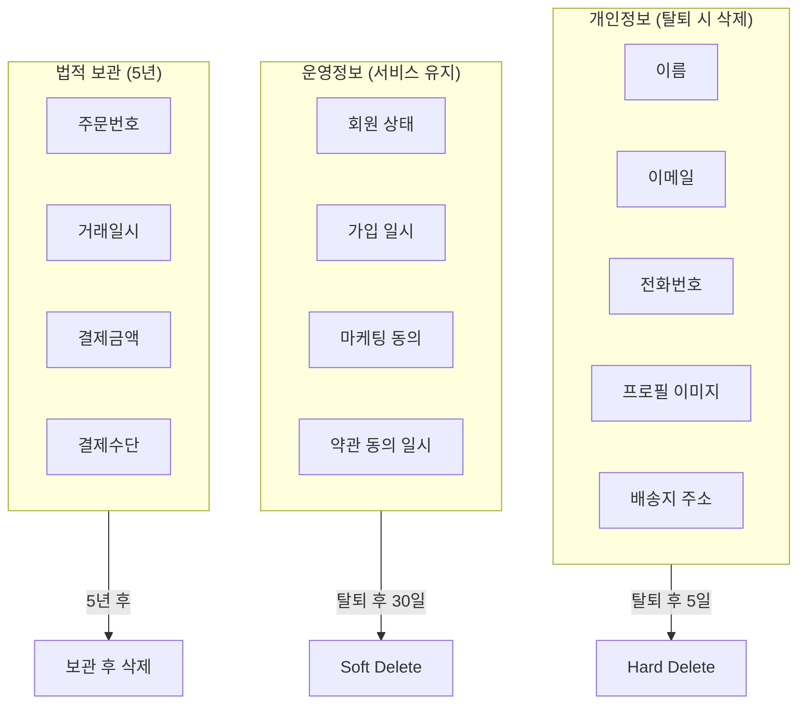
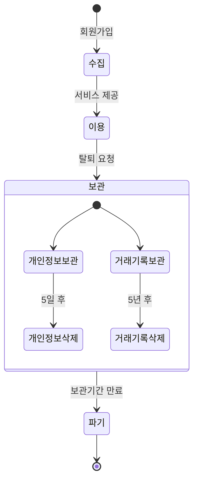
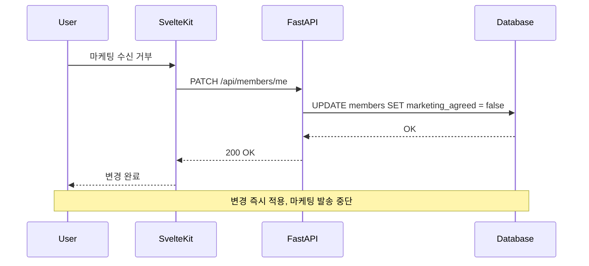
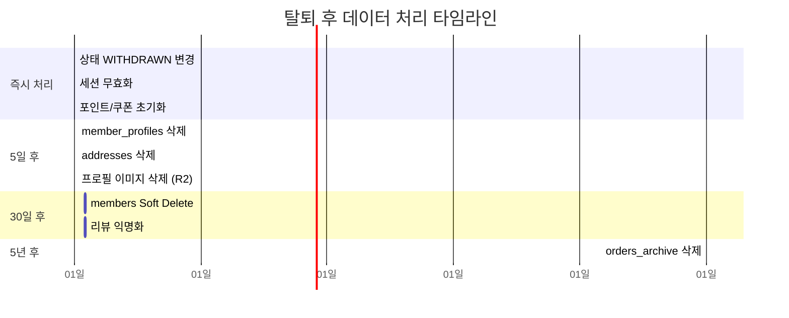
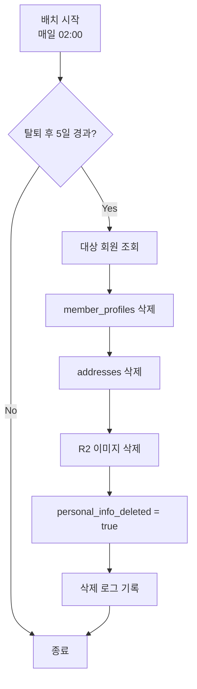
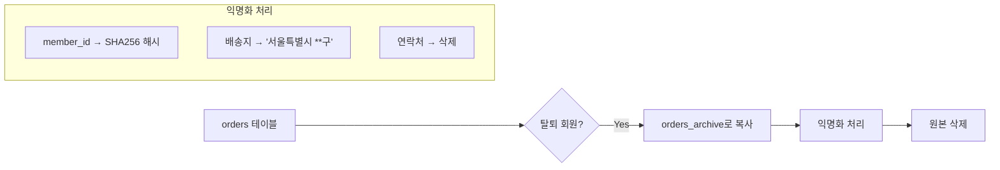
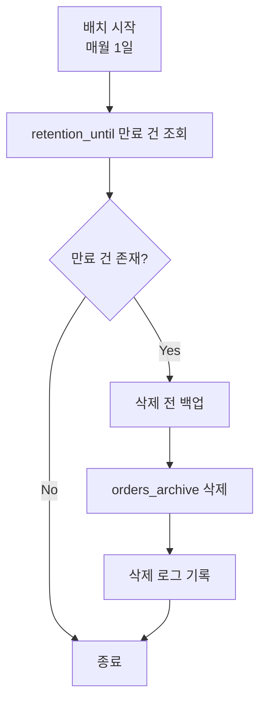
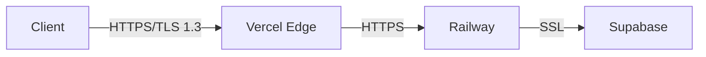
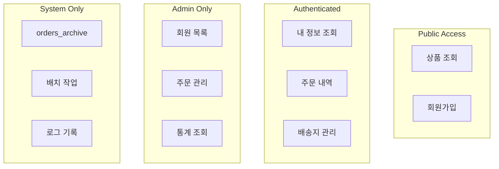

# 개인정보 처리 기술명세

**Version 1.0** | **2025-12-25** | **ko&clo Project**

---

## 목차

1. [개요](#1-개요)
2. [개인정보 분류](#2-개인정보-분류)
3. [데이터 저장 구조](#3-데이터-저장-구조)
4. [개인정보 처리 정책](#4-개인정보-처리-정책)
5. [탈퇴 시 데이터 처리](#5-탈퇴-시-데이터-처리)
6. [법적 보관 의무](#6-법적-보관-의무)
7. [보안 조치](#7-보안-조치)

---

## 1. 개요

> **하위 목차**
> - [1.1 목적](#11-목적)
> - [1.2 관련 법규](#12-관련-법규)
> - [1.3 용어 정의](#13-용어-정의)

### 1.1 목적

본 문서는 ko&clo 쇼핑몰에서 수집하는 개인정보의 기술적 처리 방법을 정의합니다.

### 1.2 관련 법규

| 법규 | 주요 내용 |
|------|-----------|
| 개인정보보호법 | 개인정보 수집·이용·파기 규정 |
| 전자상거래법 | 거래기록 보관 의무 (5년) |
| 정보통신망법 | 개인정보 보호조치 의무 |

### 1.3 용어 정의

| 용어 | 정의 |
|------|------|
| 개인정보 | 살아있는 개인을 식별할 수 있는 정보 |
| 운영정보 | 서비스 운영을 위한 비식별 정보 |
| 익명화 | 개인을 식별할 수 없도록 데이터 변환 |
| 가명화 | 추가 정보 없이 개인을 식별할 수 없도록 처리 |

---

## 2. 개인정보 분류

> **하위 목차**
> - [2.1 수집 정보 분류표](#21-수집-정보-분류표)
> - [2.2 테이블별 개인정보 분류](#22-테이블별-개인정보-분류)

### 2.1 수집 정보 분류표



### 2.2 테이블별 개인정보 분류

| 테이블 | 분류 | 삭제 시점 | 삭제 방식 |
|--------|------|-----------|-----------|
| member_profiles | 개인정보 | 탈퇴 후 5일 | Hard Delete |
| addresses | 개인정보 | 탈퇴 후 5일 | Hard Delete |
| members | 운영정보 | 탈퇴 후 30일 | Soft Delete |
| orders | 법적 보관 | 5년 후 | Archive → Delete |
| orders_archive | 익명화 보관 | 5년 후 | Hard Delete |

---

## 3. 데이터 저장 구조

> **하위 목차**
> - [3.1 개인정보 분리 저장 전략](#31-개인정보-분리-저장-전략)
> - [3.2 분리 저장 이유](#32-분리-저장-이유)

### 3.1 개인정보 분리 저장 전략

```mermaid
erDiagram
    auth_users ||--|| members : "1:1"
    members ||--|| member_profiles : "1:1 개인정보"
    members ||--o{ addresses : "1:N 개인정보"
    members ||--o{ orders : "1:N"
    orders ||--o| orders_archive : "익명화 보관"

    auth_users {
        uuid id PK
        string email "Supabase 관리"
    }

    members {
        uuid id PK_FK
        varchar status "운영정보"
        boolean marketing_agreed "운영정보"
        timestamp last_login_at "운영정보"
        boolean personal_info_deleted "삭제 플래그"
    }

    member_profiles {
        uuid member_id PK_FK
        varchar email "개인정보"
        varchar name "개인정보"
        varchar phone "개인정보"
        varchar profile_image "개인정보"
    }

    addresses {
        uuid id PK
        uuid member_id FK
        varchar recipient "개인정보"
        varchar phone "개인정보"
        varchar address1 "개인정보"
    }

    orders {
        uuid id PK
        uuid member_id FK
        varchar order_number
        decimal total_amount
    }

    orders_archive {
        uuid id PK
        varchar member_id_hash "익명화"
        varchar shipping_region "마스킹"
    }
```

### 3.2 분리 저장 이유

| 이유 | 설명 |
|------|------|
| 삭제 용이성 | 개인정보만 선택적 삭제 가능 |
| 법적 준수 | 거래기록은 보관, 개인정보는 삭제 |
| 보안 강화 | 개인정보 테이블에 추가 보안 적용 가능 |
| 성능 최적화 | 운영에 필요한 데이터만 빠르게 조회 |

---

## 4. 개인정보 처리 정책

> **하위 목차**
> - [4.1 수집 시점별 처리](#41-수집-시점별-처리)
> - [4.2 동의 항목별 처리](#42-동의-항목별-처리)
> - [4.3 마케팅 동의 철회 Flow](#43-마케팅-동의-철회-flow)

### 4.1 수집 시점별 처리



### 4.2 동의 항목별 처리

| 동의 항목 | 필수/선택 | 미동의 시 | 철회 가능 |
|-----------|-----------|-----------|-----------|
| 이용약관 | 필수 | 가입 불가 | 탈퇴로 철회 |
| 개인정보 수집·이용 | 필수 | 가입 불가 | 탈퇴로 철회 |
| 마케팅 수신 | 선택 | 정상 이용 | 언제든 철회 |

### 4.3 마케팅 동의 철회 Flow



---

## 5. 탈퇴 시 데이터 처리

> **하위 목차**
> - [5.1 탈퇴 처리 타임라인](#51-탈퇴-처리-타임라인)
> - [5.2 개인정보 삭제 배치](#52-개인정보-삭제-배치)
> - [5.3 삭제 배치 SQL](#53-삭제-배치-sql)
> - [5.4 주문 기록 익명화 처리](#54-주문-기록-익명화-처리)

### 5.1 탈퇴 처리 타임라인



### 5.2 개인정보 삭제 배치



### 5.3 삭제 배치 SQL

```sql
-- 개인정보 삭제 대상 조회
SELECT m.id, mp.profile_image
FROM members m
JOIN member_profiles mp ON m.id = mp.member_id
WHERE m.status = 'WITHDRAWN'
  AND m.withdrawn_at <= NOW() - INTERVAL '5 days'
  AND m.personal_info_deleted = false;

-- 개인정보 삭제 실행
BEGIN;
  -- 배송지 삭제
  DELETE FROM addresses WHERE member_id = :member_id;

  -- 프로필 삭제
  DELETE FROM member_profiles WHERE member_id = :member_id;

  -- 삭제 완료 플래그
  UPDATE members
  SET personal_info_deleted = true,
      updated_at = NOW()
  WHERE id = :member_id;
COMMIT;
```

### 5.4 주문 기록 익명화 처리



#### 익명화 예시

| 원본 필드 | 익명화 후 |
|-----------|-----------|
| member_id: `uuid-1234-...` | member_id_hash: `a3f2e1...` (SHA256) |
| 서울특별시 강남구 삼성동 123-45 | 서울특별시 강남구 |
| 010-1234-5678 | (삭제) |
| 홍길동 | (삭제) |

---

## 6. 법적 보관 의무

> **하위 목차**
> - [6.1 보관 항목 및 기간](#61-보관-항목-및-기간)
> - [6.2 orders_archive 테이블 접근 제한](#62-orders_archive-테이블-접근-제한)
> - [6.3 보관 기간 만료 처리](#63-보관-기간-만료-처리)

### 6.1 보관 항목 및 기간

| 보관 항목 | 근거 법령 | 보관 기간 |
|-----------|-----------|-----------|
| 계약/청약철회 기록 | 전자상거래법 | 5년 |
| 대금결제/재화공급 기록 | 전자상거래법 | 5년 |
| 소비자 불만/분쟁처리 기록 | 전자상거래법 | 3년 |
| 표시/광고 기록 | 전자상거래법 | 6개월 |
| 로그인 기록 | 통신비밀보호법 | 3개월 |

### 6.2 orders_archive 테이블 접근 제한

```sql
-- 서비스 앱에서 접근 차단
REVOKE ALL ON orders_archive FROM authenticated, anon;

-- 관리자만 조회 가능
GRANT SELECT ON orders_archive TO service_role;

-- 삭제는 배치 전용 역할만
GRANT DELETE ON orders_archive TO batch_role;
```

### 6.3 보관 기간 만료 처리



---

## 7. 보안 조치

> **하위 목차**
> - [7.1 전송 구간 암호화](#71-전송-구간-암호화)
> - [7.2 저장 시 암호화](#72-저장-시-암호화)
> - [7.3 접근 제어](#73-접근-제어)
> - [7.4 Row Level Security (RLS)](#74-row-level-security-rls)
> - [7.5 로깅 및 감사](#75-로깅-및-감사)

### 7.1 전송 구간 암호화



### 7.2 저장 시 암호화

| 데이터 | 암호화 방식 | 비고 |
|--------|-------------|------|
| 비밀번호 | bcrypt (Supabase) | 단방향 해시 |
| JWT Secret | 환경변수 | 서버에서만 접근 |
| 전화번호 | 평문 저장 | 필요시 AES 암호화 검토 |
| 배송지 | 평문 저장 | 필요시 AES 암호화 검토 |

### 7.3 접근 제어



### 7.4 Row Level Security (RLS)

```sql
-- members: 본인만 조회/수정
CREATE POLICY "Users can view own data"
  ON members FOR SELECT
  USING (auth.uid() = id);

CREATE POLICY "Users can update own data"
  ON members FOR UPDATE
  USING (auth.uid() = id);

-- addresses: 본인 배송지만 접근
CREATE POLICY "Users can manage own addresses"
  ON addresses FOR ALL
  USING (auth.uid() = member_id);

-- orders_archive: 서비스 앱 접근 불가
CREATE POLICY "No access for app"
  ON orders_archive FOR ALL
  USING (false);
```

### 7.5 로깅 및 감사

| 로그 유형 | 보관 기간 | 목적 |
|-----------|-----------|------|
| 인증 로그 | 3개월 | 비정상 접근 탐지 |
| 개인정보 조회 로그 | 1년 | 내부 감사 |
| 개인정보 삭제 로그 | 5년 | 삭제 증빙 |
| API 요청 로그 | 1개월 | 디버깅/모니터링 |

---

## 변경 이력

| 버전 | 날짜 | 변경 내용 |
|------|------|-----------|
| 1.0 | 2025-12-25 | 초기 작성 |
