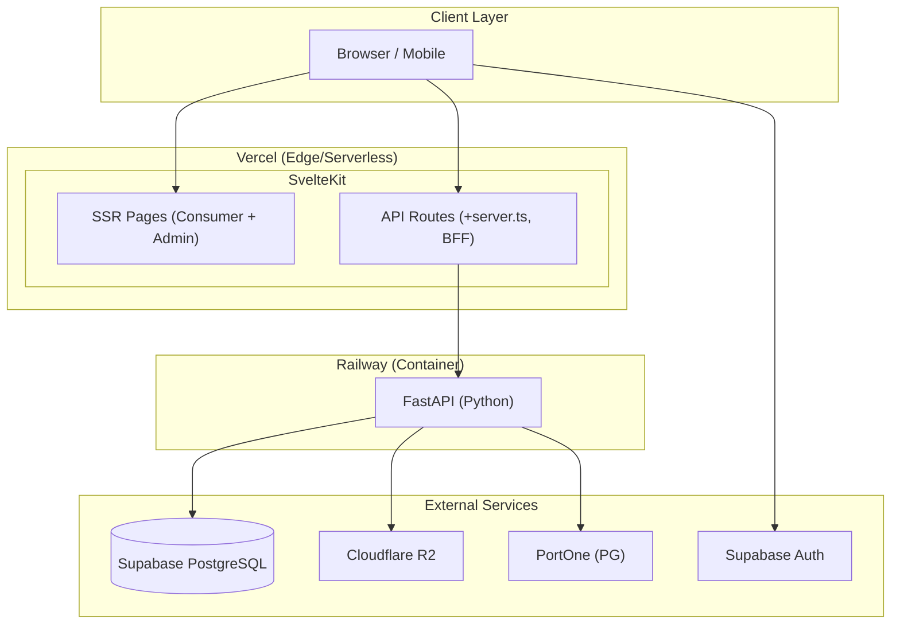
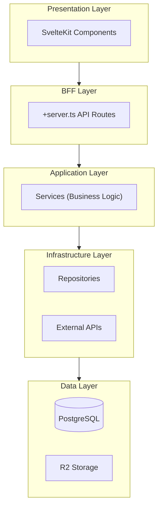

# Shopping Mall Technical Design Document

**Version 2.0** | **2025-12-25** | **ko&clo Project**

---

## 목차

1. [문서 정보](#1-문서-정보)
2. [개요](#2-개요)
3. [시스템 아키텍처](#3-시스템-아키텍처)
4. [기술 스택](#4-기술-스택)
5. [주요 기능 명세](#5-주요-기능-명세)
6. [상세 문서 링크](#6-상세-문서-링크)

---

## 1. 문서 정보

> **하위 목차**
> - [1.1 문서 구조](#11-문서-구조)

| 항목 | 내용 |
|------|------|
| 문서명 | Shopping Mall Architecture TDD |
| 버전 | 2.0 |
| 작성일 | 2025-12-25 |
| 프로젝트 | ko&clo 쇼핑몰 |

### 1.1 문서 구조

본 TDD는 아래와 같이 기능별로 상세 문서가 분리되어 있습니다.

```
TDD/
├── Shopping_Mall_TDD.md          # 본 문서 (개요)
├── MBR_회원관리.md                # 회원관리 상세 (MBR-001~005)
├── PRD_상품관리.md                # 상품관리 상세 (PRD-001~007)
├── PRIVACY_개인정보처리명세.md    # 개인정보 처리 정책
├── AUTH_인증흐름.md               # 인증/세션 관리
├── PAYMENT_결제흐름.md            # 결제 처리
├── DATABASE_설계.md               # DB ERD 및 스키마
└── INFRA_배포전략.md              # 인프라 및 CI/CD
```

---

## 2. 개요

> **하위 목차**
> - [2.1 프로젝트 목표](#21-프로젝트-목표)
> - [2.2 핵심 요구사항](#22-핵심-요구사항)

### 2.1 프로젝트 목표

ko&clo 브랜드를 위한 자사 쇼핑몰 MVP 개발. SEO 최적화와 저비용 운영이 핵심 요구사항이며, 추후 Midas ERP 연동을 고려한 확장 가능한 아키텍처 설계.

### 2.2 핵심 요구사항

| 요구사항 | 설명 |
|----------|------|
| SEO 최적화 | SSR 지원 필수 |
| 저비용 운영 | 월 $0~10 목표 |
| 가벼운 프레임워크 | 빠른 개발 및 유지보수 |
| 확장성 | MVP 이후 Midas ERP 연동 |

---

## 3. 시스템 아키텍처

> **하위 목차**
> - [3.1 전체 아키텍처](#31-전체-아키텍처)
> - [3.2 레이어 구조](#32-레이어-구조)

### 3.1 전체 아키텍처



### 3.2 레이어 구조



| 레이어 | 기술 | 역할 |
|--------|------|------|
| Presentation | SvelteKit (Vercel) | SSR/SSG, 라우팅, UI 렌더링 |
| BFF | SvelteKit +server.ts | API 조합, 응답 가공, 인증 검증 |
| Application | FastAPI (Railway) | 비즈니스 로직, 트랜잭션 처리 |
| Data | Supabase PostgreSQL | 데이터 영속성, 쿼리 처리 |

---

## 4. 기술 스택

> **하위 목차**
> - [4.1 Frontend](#41-frontend)
> - [4.2 Backend](#42-backend)
> - [4.3 Infrastructure](#43-infrastructure)

### 4.1 Frontend

| 구분 | 기술 | 선정 이유 |
|------|------|-----------|
| Framework | SvelteKit | 가볍고 빠름, SSR/SSG 지원, SEO 최적화 |
| Language | TypeScript | 타입 안정성, 개발 생산성 |
| Styling | Tailwind CSS | 유틸리티 기반, 빠른 개발 |
| Validation | Zod | 런타임 타입 검증, TypeScript 연동 |

### 4.2 Backend

| 구분 | 기술 | 선정 이유 |
|------|------|-----------|
| Framework | FastAPI | Python 기반, 비동기 지원, 자동 문서화 |
| Language | Python 3.11+ | 팀 선호도, 풍부한 생태계 |
| ORM | SQLAlchemy 2.0 | 비동기 지원, 타입 힌트 |
| Validation | Pydantic v2 | 데이터 검증, 직렬화 |

### 4.3 Infrastructure

| 구분 | 서비스 | 용도 |
|------|--------|------|
| FE Hosting | Vercel | SvelteKit 배포, Edge Functions |
| BE Hosting | Railway | FastAPI 컨테이너 배포 |
| Database | Supabase | PostgreSQL + Auth |
| Storage | Cloudflare R2 | 이미지 저장소 |
| Payment | PortOne | PG 통합 결제 |

---

## 5. 주요 기능 명세

> **하위 목차**
> - [5.1 회원 관리](#51-회원-관리)
> - [5.2 상품 관리](#52-상품-관리)
> - [5.3 장바구니](#53-장바구니)
> - [5.4 주문/결제](#54-주문결제)
> - [5.5 배송지 관리](#55-배송지-관리)
> - [5.6 관리자 기능](#56-관리자-기능)

### 5.1 회원 관리

> 📄 상세: [MBR_회원관리.md](./MBR_회원관리.md)

| 기능 ID | 기능명 | 유형 | 상세 설명 |
|---------|--------|------|-----------|
| MBR-001 | 회원가입 | Consumer | 소셜 로그인 (카카오/네이버/구글), 이메일 가입 |
| MBR-002 | 로그인/로그아웃 | Consumer | JWT 기반 인증, 자동 로그인 |
| MBR-003 | 비밀번호 재설정 | Consumer | 이메일 인증 링크 발송, 비밀번호 변경 |
| MBR-004 | 회원정보 수정 | Consumer | 이름, 연락처, 기본 배송지 관리 |
| MBR-005 | 회원 탈퇴 | Consumer | 개인정보 삭제, 주문내역 익명화 처리 |
| - | 회원 목록 조회 | Admin | 검색, 필터링, 페이지네이션 |
| - | 회원 상태 관리 | Admin | 활성/휴면/정지 상태 변경 |

### 5.2 상품 관리

> 📄 상세: [PRD_상품관리.md](./PRD_상품관리.md)

| 기능 ID | 기능명 | 유형 | 상세 설명 |
|---------|--------|------|-----------|
| PRD-001 | 상품 목록 조회 | Consumer | PLP/SRP 통합 UI, 카테고리/검색/정렬/필터링 |
| PRD-002 | 상품 상세 조회 | Consumer | PDP, 이미지 갤러리, 옵션 선택, 재고/가격 확인 |
| PRD-003 | 상품 등록 | Admin | 기본정보, 이미지, 옵션/재고, 가격, SEO 메타 |
| PRD-004 | 상품 수정 | Admin | 정보 수정, SKU 변경 가능 (Midas 동기화 주의) |
| PRD-005 | 상품 삭제 | Admin | Soft Delete (is_deleted), 복구 가능 |
| PRD-006 | 재고 관리 | Admin | 옵션별 재고 조회/수정, 엑셀 일괄 업로드 |
| PRD-007 | 카테고리 관리 | Admin | 2-depth 계층형, CRUD, 순서 관리 |

#### 핵심 비즈니스 의사결정

| 의사결정 | 내용 |
|----------|------|
| PLP/SRP 통합 | MVP에서는 동일한 UI/API로 처리 |
| 검색 MVP 범위 | PostgreSQL ILIKE 기반 검색만 |
| URL 구조 | 단일 라우트 /products/[...slug] |
| 상품 구조 | 옵션 방식 채택 (색상/사이즈별 SKU) |
| 에디터 범위 | TipTap 기본 서식만 |
| 할인가 입력 | 직접 입력 + 할인율 계산 모두 지원 |
| SKU 변경 정책 | 변경 가능하나 Midas 동기화 시 주의 |
| 재고 흐름 | Midas → 쇼핑몰 단방향 |

### 5.3 장바구니

| 기능 | 유형 | 상세 설명 |
|------|------|-----------|
| 장바구니 담기 | Consumer | 상품/옵션/수량 추가, 비회원 지원 |
| 장바구니 조회 | Consumer | 담긴 상품 목록, 품절/가격변동 표시 |
| 수량 변경 | Consumer | +/- 버튼, 재고 범위 내 변경 |
| 상품 삭제 | Consumer | 개별/선택 삭제 |
| 전체 삭제 | Consumer | 장바구니 비우기 |

### 5.4 주문/결제

> 📄 상세: [PAYMENT_결제흐름.md](./PAYMENT_결제흐름.md)

| 기능 | 유형 | 상세 설명 |
|------|------|-----------|
| 결제 처리 | Consumer | PortOne 연동, 카드/계좌이체/간편결제 |
| 주문 완료/내역 | Consumer | 주문번호 발급, 목록/상세 조회, 배송 추적 |
| 주문 취소 | Consumer | 결제 취소, 환불 처리 |

### 5.5 배송지 관리

| 기능 | 유형 | 상세 설명 |
|------|------|-----------|
| 배송지 등록 | Consumer | 수령인, 연락처, 주소(다음 API), 기본 배송지 설정 |
| 배송지 관리 | Consumer | 등록된 배송지 조회, 삭제 |

### 5.6 관리자 기능

| 기능 | 유형 | 상세 설명 |
|------|------|-----------|
| 대시보드 | Admin | 신규 주문, 결제 대기, 배송 중, 재고 부족 알림 |

---

## 6. 상세 문서 링크

> **하위 목차**
> - [6.1 기능 문서](#61-기능-문서)
> - [6.2 시스템 문서](#62-시스템-문서)

### 6.1 기능 문서

| 문서 | 설명 |
|------|------|
| [MBR_회원관리.md](./MBR_회원관리.md) | 회원관리 전체 (MBR-001~005), 상태 관리, 데이터 모델 |
| [PRD_상품관리.md](./PRD_상품관리.md) | 상품관리 전체 (PRD-001~007), 비즈니스 의사결정, API 명세 |
| [PRIVACY_개인정보처리명세.md](./PRIVACY_개인정보처리명세.md) | 개인정보 분류, 삭제 정책, 법적 보관 |

### 6.2 시스템 문서

| 문서 | 설명 |
|------|------|
| [AUTH_인증흐름.md](./AUTH_인증흐름.md) | 인증 아키텍처, JWT 관리, 권한 |
| [PAYMENT_결제흐름.md](./PAYMENT_결제흐름.md) | 결제 흐름, 환불, 위변조 방지 |
| [DATABASE_설계.md](./DATABASE_설계.md) | ERD, 테이블 DDL, RLS 정책 |
| [INFRA_배포전략.md](./INFRA_배포전략.md) | CI/CD, 환경 구성, 비용 분석 |

---

## 변경 이력

| 버전 | 날짜 | 변경 내용 |
|------|------|-----------|
| 1.0 | 2025-12-20 | 초기 버전 |
| 1.6 | 2025-12-21 | 회원 관리 상세 추가 |
| 1.8 | 2025-12-22 | 상품 관리 PRD 상세 추가 |
| 2.0 | 2025-12-25 | 문서 구조 개편 - 기능별 분리, Mermaid 다이어그램 적용 |
| 2.1 | 2025-12-25 | PRD 문서를 TDD 폴더로 통합, 단일 파일로 병합 |
