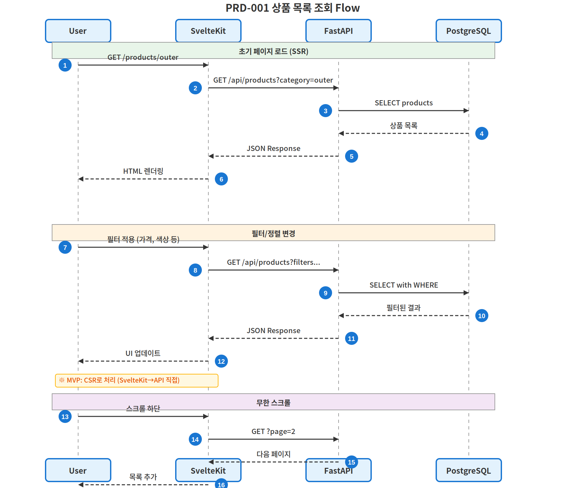

# PRD-001 상품 목록 조회

**Version 2.0** | **2025-12-22**

---

## 문서 개요

| 항목 | 내용 |
|------|------|
| 기능 ID | PRD-001 |
| 기능명 | 상품 목록 조회 (Product List Page) |
| 사용자 유형 | Consumer (비회원/회원) |
| 우선순위 | 필수 (MVP) |
| 관련 PRD | PRD-002 (상품 상세) |

---

## 관련 비즈니스 의사결정

| 의사결정 | 내용 |
|----------|------|
| ✓ PLP/SRP 통합 | MVP에서는 상품 목록과 검색 결과를 동일한 UI/API로 처리 |
| ✓ 검색 MVP 범위 | PostgreSQL ILIKE 기반 검색만 (검색엔진 없음) |
| ✓ URL 구조 | 단일 라우트 /products/[...slug] 사용 |

---

## 기능 상세

PLP(Product List Page)와 SRP(Search Result Page)를 통합한 상품 목록 조회 기능. 카테고리 필터링, 검색, 정렬, 페이지네이션을 지원하며, SSR로 SEO 최적화.

### 조회 유형

| 유형 | URL 패턴 | 설명 |
|------|----------|------|
| 전체 목록 | `/products` | 전체 상품 조회 |
| 카테고리 | `/products?category=outer` | 특정 카테고리 상품 조회 |
| 검색 | `/products?q=니트` | 키워드 검색 결과 (ILIKE) |
| 복합 | `/products?category=top&q=니트&sort=price_asc` | 카테고리 + 검색 + 정렬 조합 |

### 정렬 옵션

| 파라미터 값 | 정렬 기준 | ORDER BY |
|-------------|-----------|----------|
| newest (기본) | 최신순 | created_at DESC |
| price_asc | 낮은 가격순 | display_price ASC |
| price_desc | 높은 가격순 | display_price DESC |
| popular | 인기순 | view_count DESC (Post-MVP) |

---

## API 명세

### GET /api/v1/products

**Request Parameters**

| 파라미터 | 타입 | 필수 | 설명 |
|----------|------|------|------|
| page | int | N | 페이지 번호 (기본: 1) |
| limit | int | N | 페이지당 개수 (기본: 20, 최대: 100) |
| category | string | N | 카테고리 슬러그 |
| q | string | N | 검색 키워드 (2자 이상) |
| sort | string | N | 정렬 옵션 |
| min_price | int | N | 최소 가격 필터 |
| max_price | int | N | 최대 가격 필터 |

**Response - ProductListResponse**

```json
{
  "products": [ProductCard],
  "pagination": {
    "total": 150,
    "page": 1,
    "limit": 20,
    "total_pages": 8
  },
  "category": Category | null,
  "applied_filters": {
    "q": "니트",
    "sort": "newest",
    "min_price": null,
    "max_price": null
  }
}
```

**ProductCard**

| 필드 | 타입 | 설명 |
|------|------|------|
| id | UUID | 상품 ID |
| name | string | 상품명 |
| slug | string | URL 슬러그 |
| thumbnail_url | string | 대표 이미지 URL |
| original_price | int | 정가 |
| display_price | int | 판매가 (할인 적용) |
| discount_rate | int \| null | 할인율 (%) |
| is_sold_out | boolean | 품절 여부 |
| is_new | boolean | 신상품 여부 (7일 이내) |

---

## UI 구성요소

### 헤더 영역
- 카테고리명 또는 검색 결과 타이틀
- 총 상품 수 표시
- 정렬 드롭다운

### 필터 영역 (사이드바)
- 카테고리 필터 (계층형)
- 가격대 필터 (범위 슬라이더)

### 상품 그리드
- 4열 그리드 (데스크탑)
- 2열 그리드 (모바일)
- 상품 카드: 이미지, 상품명, 가격, 할인율 뱃지

### 페이지네이션
- 페이지 번호 표시
- 이전/다음 버튼

---

## 시퀀스 다이어그램



---

## 검색 로직 (MVP)

```sql
SELECT * FROM products 
WHERE is_deleted = false 
  AND status = 'ACTIVE'
  AND (name ILIKE '%검색어%' OR short_description ILIKE '%검색어%')
  AND category_id = :category_id  -- 선택적
ORDER BY created_at DESC
LIMIT 20 OFFSET 0;
```

### Post-MVP 검색 개선
- Elasticsearch 또는 Algolia 도입
- 자동완성
- 오타 교정
- 동의어 처리
