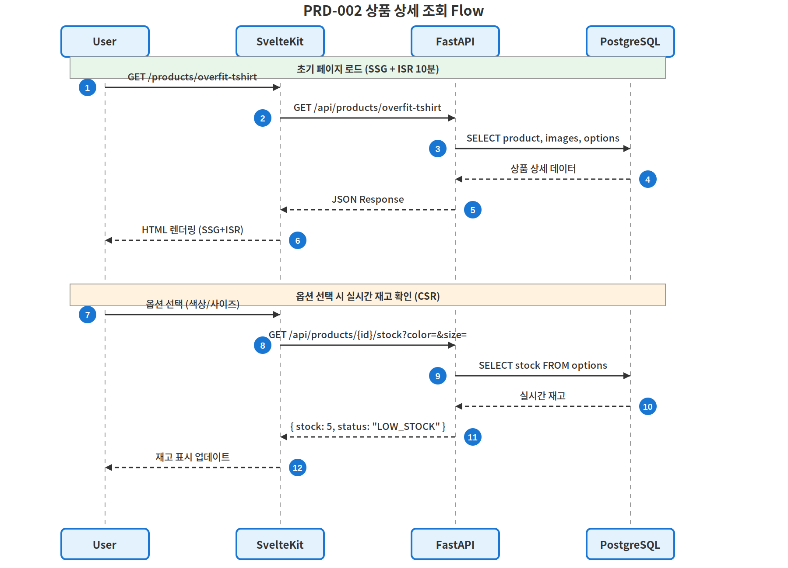

# PRD-002 상품 상세 조회

**Version 1.0** | **2025-12-22**

---

## 문서 개요

| 항목 | 내용 |
|------|------|
| 기능 ID | PRD-002 |
| 기능명 | 상품 상세 조회 (Product Detail Page) |
| 사용자 유형 | Consumer (비회원/회원) |
| 우선순위 | 필수 (MVP) |
| URL 패턴 | `/products/{slug}` |

---

## 기능 상세

PDP(Product Detail Page)로 상품의 전체 정보를 표시. 이미지 갤러리, 옵션 선택, 재고/가격 확인, 장바구니 담기 기능 제공. SSR로 SEO 최적화.

---

## UI 구성요소

| 영역 | 구성 요소 |
|------|-----------|
| 이미지 갤러리 | 대표 이미지 + 썸네일 목록 + 이미지 확대 |
| 상품 정보 | 상품명, 가격(정가/할인가/할인율), 간략 설명 |
| 옵션 선택 | 색상 → 사이즈 순차 선택, 선택된 옵션 태그 표시 |
| 재고/가격 표시 | 옵션별 재고 상태, 추가금액 표시 |
| 수량 선택 | +/- 버튼, 재고 이상 선택 불가 |
| 액션 버튼 | 장바구니 담기, 바로 구매 |
| 상세 설명 | TipTap 에디터 콘텐츠 (HTML 렌더링) |
| 추가 정보 | 배송 안내, 교환/반품 정책 |

---

## 옵션 선택 플로우

```
1단계: 색상 선택
    ↓ 해당 색상의 사이즈 목록 활성화
2단계: 사이즈 선택
    ↓ 재고 확인, 추가금액 표시
3단계: 수량 선택
    ↓ 재고 범위 내에서 선택
4단계: 장바구니 담기 또는 바로 구매
```

---

## API 명세

### GET /api/v1/products/{slug}

**Response - ProductDetail**

| 필드 | 타입 | 설명 |
|------|------|------|
| id | UUID | 상품 ID |
| name | string | 상품명 |
| slug | string | URL 슬러그 |
| description | string | 상세 설명 (HTML) |
| short_description | string | 간략 설명 |
| original_price | int | 정가 |
| selling_price | int \| null | 할인가 |
| discount_rate | int \| null | 할인율 |
| images | ProductImage[] | 상품 이미지 목록 |
| options | ProductOption[] | 옵션 및 재고 정보 |
| category | Category | 카테고리 정보 |
| seo_title | string | SEO 타이틀 |
| seo_description | string | SEO 설명 |

**ProductImage**

| 필드 | 타입 | 설명 |
|------|------|------|
| id | UUID | 이미지 ID |
| url | string | 이미지 URL |
| alt_text | string | 대체 텍스트 |
| is_thumbnail | boolean | 대표 이미지 여부 |
| sort_order | int | 정렬 순서 |

**ProductOption**

| 필드 | 타입 | 설명 |
|------|------|------|
| id | UUID | 옵션 ID |
| sku | string | SKU 코드 |
| color | string | 색상 |
| size | string | 사이즈 |
| stock_quantity | int | 재고 수량 |
| additional_price | int | 추가 금액 |
| is_active | boolean | 활성화 여부 |

---

## 시퀀스 다이어그램



---

## SEO 최적화

### Meta Tags
```html
<title>{seo_title} | ko&clo</title>
<meta name="description" content="{seo_description}">
<meta property="og:title" content="{seo_title}">
<meta property="og:description" content="{seo_description}">
<meta property="og:image" content="{thumbnail_url}">
<meta property="og:type" content="product">
```

### Structured Data (JSON-LD)
```json
{
  "@context": "https://schema.org",
  "@type": "Product",
  "name": "{name}",
  "description": "{short_description}",
  "image": "{thumbnail_url}",
  "offers": {
    "@type": "Offer",
    "price": "{display_price}",
    "priceCurrency": "KRW",
    "availability": "https://schema.org/InStock"
  }
}
```

---

## 에러 처리

| 상황 | HTTP 코드 | 처리 |
|------|-----------|------|
| 상품 없음 | 404 | "상품을 찾을 수 없습니다" 페이지 |
| 삭제된 상품 | 404 | "삭제된 상품입니다" 메시지 |
| 비활성 상품 | 404 | "판매 중지된 상품입니다" 메시지 |
