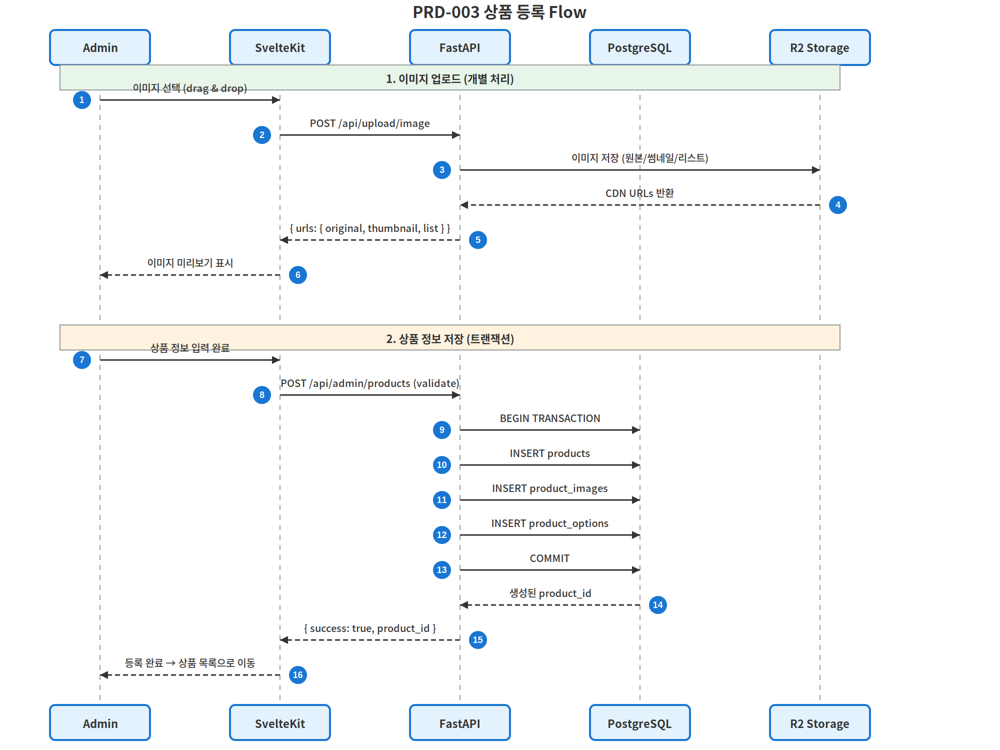

# PRD-003 상품 등록

**Version 1.0** | **2025-12-22**

---

## 문서 개요

| 항목 | 내용 |
|------|------|
| 기능 ID | PRD-003 |
| 기능명 | 상품 등록 (Admin) |
| 사용자 유형 | Admin |
| 우선순위 | 필수 (MVP) |
| URL 패턴 | `/admin/products/new` |

---

## 관련 비즈니스 의사결정

| 의사결정 | 내용 |
|----------|------|
| ✓ 상품 구조 | 옵션 방식 채택 (ProductGroup 불필요). 색상/사이즈별 SKU로 재고 관리 |
| ✓ 에디터 범위 | TipTap 기본 서식만 (굵게/이탤릭/리스트/링크). 이미지는 별도 갤러리 |
| ✓ 할인가 입력 | 직접 입력 + 할인율 계산 모두 지원 (5,000원 단위 반올림) |

---

## 입력 필드 (탭 구성)

### 기본 정보 탭

| 필드 | 타입 | 필수 | 검증 규칙 |
|------|------|------|-----------|
| 상품명 | text | Y | 2~100자 |
| 슬러그 | text | Y | 영문/숫자/하이픈, 자동 생성 (수정 가능) |
| 카테고리 | select | Y | 계층형 선택 (대분류 → 소분류) |
| 간략 설명 | textarea | N | 최대 200자 |
| 상세 설명 | TipTap | N | 기본 서식만 |
| 상태 | select | Y | DRAFT/ACTIVE/INACTIVE (기본: DRAFT) |

### 이미지 탭

| 필드 | 타입 | 필수 | 규칙 |
|------|------|------|------|
| 대표 이미지 | upload | Y | 1장 필수, jpg/png/webp, 최대 5MB |
| 추가 이미지 | upload[] | N | 최대 10장, 드래그로 순서 변경 |

### 옵션/재고 탭

| 필드 | 타입 | 필수 | 규칙 |
|------|------|------|------|
| 색상 | multi-input | Y | 최소 1개, 예: Black, White, Navy |
| 사이즈 | multi-input | Y | 최소 1개, 예: S, M, L, XL |
| SKU | auto | Y | 색상×사이즈 조합별 자동 생성 |
| 재고 | number | Y | 옵션별 개별 입력, 기본값 0 |
| 추가금액 | number | N | 옵션별 추가 금액 (기본 0) |

### 가격 탭

| 필드 | 타입 | 필수 | 규칙 |
|------|------|------|------|
| 정가 | number | Y | 1,000원 이상 |
| 할인가 | number | N | 직접 입력 또는 할인율로 자동 계산 |
| 할인율 | number | N | 1~99%, 할인가 입력 시 자동 계산 |

### SEO 탭

| 필드 | 타입 | 필수 | 규칙 |
|------|------|------|------|
| SEO 타이틀 | text | N | 최대 70자, 미입력 시 상품명 사용 |
| SEO 설명 | textarea | N | 최대 160자, 미입력 시 간략 설명 사용 |

---

## 할인가 계산 로직

```javascript
// 할인율로 할인가 계산 (5,000원 단위 반올림)
function calculateSellingPrice(originalPrice, discountRate) {
  const discounted = originalPrice * (1 - discountRate / 100);
  return Math.round(discounted / 5000) * 5000;
}

// 예시
// 정가: 89,000원, 할인율: 30%
// 계산: 89,000 × 0.7 = 62,300 → 60,000원 (5,000원 단위 반올림)
```

---

## SKU 자동 생성 규칙

```
패턴: {상품코드}-{색상코드}-{사이즈}

예시:
- 상품: 캐시미어 니트 (KNC)
- 색상: Black, White
- 사이즈: S, M, L

생성되는 SKU:
- KNC-BLK-S
- KNC-BLK-M
- KNC-BLK-L
- KNC-WHT-S
- KNC-WHT-M
- KNC-WHT-L
```

---

## API 명세

### POST /api/v1/admin/products

**인증**: Admin JWT 필수

**Request Body**

```json
{
  "name": "캐시미어 니트",
  "slug": "cashmere-knit",
  "category_id": "uuid",
  "short_description": "부드러운 캐시미어 니트",
  "description": "<p>상세 설명 HTML</p>",
  "original_price": 89000,
  "selling_price": 60000,
  "status": "DRAFT",
  "seo_title": "캐시미어 니트 | ko&clo",
  "seo_description": "부드러운 캐시미어 니트",
  "options": [
    {
      "color": "Black",
      "size": "M",
      "sku": "KNC-BLK-M",
      "stock_quantity": 50,
      "additional_price": 0
    }
  ]
}
```

**Response**

```json
{
  "id": "uuid",
  "name": "캐시미어 니트",
  "slug": "cashmere-knit",
  "status": "DRAFT",
  "created_at": "2025-12-22T10:00:00Z"
}
```

---

## 시퀀스 다이어그램



---

## 이미지 업로드 플로우

```
1. 파일 선택/드래그앤드롭
2. 클라이언트에서 미리보기 표시
3. 상품 저장 시 Cloudflare R2에 업로드
4. 업로드된 URL을 DB에 저장
```

### 이미지 최적화
- 리사이즈: 최대 1200x1200
- 포맷: WebP 변환
- 썸네일: 400x400 별도 생성

---

## 상태 전이

```
DRAFT → ACTIVE (공개)
DRAFT → INACTIVE (비공개)
ACTIVE → INACTIVE (판매 중지)
INACTIVE → ACTIVE (재판매)
```
