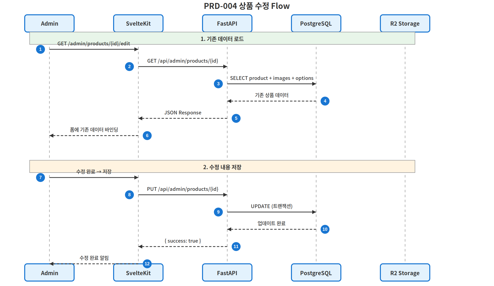

# PRD-004 상품 수정

**Version 1.0** | **2025-12-22**

---

## 문서 개요

| 항목 | 내용 |
|------|------|
| 기능 ID | PRD-004 |
| 기능명 | 상품 수정 (Admin) |
| 사용자 유형 | Admin |
| 우선순위 | 필수 (MVP) |
| URL 패턴 | `/admin/products/{id}/edit` |

---

## 관련 비즈니스 의사결정

| 의사결정 | 내용 |
|----------|------|
| ✓ SKU 변경 정책 | 변경 가능하나 Midas ERP에서 SKU를 PK로 사용하므로 동기화 시 매핑 오류 발생 가능 |

---

## 기능 상세

PRD-003(상품 등록)과 동일한 UI/입력 필드를 사용하되, 기존 데이터를 불러와 수정하는 기능.

---

## 수정 가능 필드

PRD-003과 동일한 모든 필드 수정 가능:
- 기본 정보 (상품명, 슬러그, 카테고리, 설명, 상태)
- 이미지 (추가/삭제/순서변경)
- 옵션/재고 (색상, 사이즈, SKU, 재고, 추가금액)
- 가격 (정가, 할인가, 할인율)
- SEO (타이틀, 설명)

---

## 주의사항

### SKU 변경 경고

| 상황 | 처리 |
|------|------|
| SKU 변경 시도 | 경고 모달 표시 |
| 경고 내용 | "SKU 변경 시 Midas ERP 동기화에 문제가 발생할 수 있습니다" |
| 확인 | 사용자 명시적 확인 후 변경 허용 |

### 슬러그 변경

| 상황 | 처리 |
|------|------|
| 슬러그 변경 | SEO 영향 경고 표시 |
| Post-MVP | 이전 URL 301 리다이렉트 자동 생성 |

### 옵션 삭제 제한

| 조건 | 처리 |
|------|------|
| 해당 옵션이 장바구니에 존재 | 삭제 불가, 안내 메시지 |
| 해당 옵션이 미완료 주문에 존재 | 삭제 불가, 안내 메시지 |
| 완료된 주문만 존재 | 삭제 가능 |

---

## API 명세

### PUT /api/v1/admin/products/{id}

**전체 수정**

```json
{
  "name": "캐시미어 니트 (수정)",
  "slug": "cashmere-knit-v2",
  "category_id": "uuid",
  "short_description": "수정된 설명",
  "description": "<p>수정된 상세 설명</p>",
  "original_price": 99000,
  "selling_price": 70000,
  "status": "ACTIVE",
  "options": [...]
}
```

### PATCH /api/v1/admin/products/{id}

**부분 수정**

```json
{
  "selling_price": 65000,
  "status": "INACTIVE"
}
```

### Response

```json
{
  "id": "uuid",
  "name": "캐시미어 니트 (수정)",
  "slug": "cashmere-knit-v2",
  "status": "ACTIVE",
  "updated_at": "2025-12-22T15:00:00Z"
}
```

---

## 시퀀스 다이어그램



---

## 변경 이력 추적 (Post-MVP)

향후 구현 예정:
- 수정 이력 테이블 (product_histories)
- 누가, 언제, 무엇을 변경했는지 기록
- 이전 버전 조회/복구 기능
