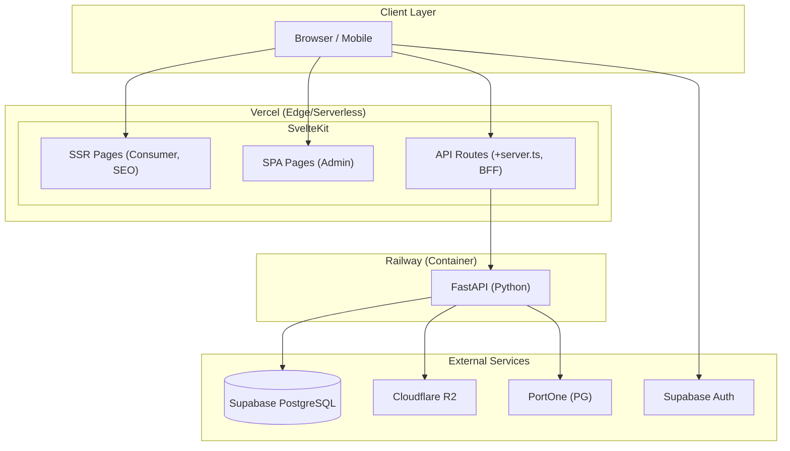

# Shopping Mall Technical Design Document

**Version 1.8** | **2025-12-22** | **ko&clo Project**

---

## 목차

1. [문서 정보](#1-문서-정보)
2. [개요](#2-개요)
3. [시스템 아키텍처](#3-시스템-아키텍처)
4. [기술 스택](#4-기술-스택)
5. [주요 기능 명세](#5-주요-기능-명세)
   - 5.1 회원 관리
   - 5.2 상품 관리 ⭐ (상세)
   - 5.3 장바구니
   - 5.4 주문/결제
   - 5.5 배송지 관리
   - 5.6 관리자 기능
6. [외부 시스템 명세](#6-외부-시스템-명세)
7. [인증 흐름](#7-인증-흐름)
8. [결제 흐름](#8-결제-흐름)
9. [데이터베이스 설계](#9-데이터베이스-설계)
10. [배포 전략](#10-배포-전략)

---

## 1. 문서 정보

| 항목 | 내용 |
|------|------|
| 문서명 | Shopping Mall Architecture TDD |
| 버전 | 1.8 |
| 작성일 | 2025-12-22 |
| 프로젝트 | ko&clo 쇼핑몰 |

---

## 2. 개요

### 2.1 프로젝트 목표

ko&clo 브랜드를 위한 자사 쇼핑몰 MVP 개발. SEO 최적화와 저비용 운영이 핵심 요구사항이며, 추후 Midas ERP 연동을 고려한 확장 가능한 아키텍처 설계.

### 2.2 핵심 요구사항

- SEO 최적화 필수 (SSR 지원)
- 저비용 운영 (월 $0~10 목표)
- 가벼운 프레임워크 선호
- MVP 이후 Midas ERP 연동 확장성

---

## 3. 시스템 아키텍처

### 3.1 전체 아키텍처 다이어그램



### 3.2 레이어 구조

| 레이어 | 기술 | 역할 |
|--------|------|------|
| Presentation | SvelteKit (Vercel) | SSR/SSG, 라우팅, UI 렌더링 |
| BFF | SvelteKit +server.ts | API 조합, 응답 가공, 인증 검증 |
| Application | FastAPI (Railway) | 비즈니스 로직, 트랜잭션 처리 |
| Data | Supabase PostgreSQL | 데이터 영속성, 쿼리 처리 |

---

## 4. 기술 스택

### 4.1 Frontend

| 구분 | 기술 | 선정 이유 |
|------|------|-----------|
| Framework | SvelteKit | 가볍고 빠름, SSR/SSG 지원, SEO 최적화 |
| Language | TypeScript | 타입 안정성, 개발 생산성 |
| Styling | Tailwind CSS | 유틸리티 기반, 빠른 개발 |
| Validation | Zod | 런타임 타입 검증, TypeScript 연동 |

### 4.2 Backend

| 구분 | 기술 | 선정 이유 |
|------|------|-----------|
| Framework | FastAPI | Python 기반, 비동기 지원, 자동 문서화 |
| Language | Python 3.11+ | 팀 선호도, 풍부한 생태계 |
| ORM | SQLAlchemy 2.0 | 비동기 지원, 타입 힌트 |
| Validation | Pydantic v2 | 데이터 검증, 직렬화 |

### 4.3 Infrastructure

| 구분 | 서비스 | 용도 |
|------|--------|------|
| FE Hosting | Vercel | SvelteKit 배포, Edge Functions |
| BE Hosting | Railway | FastAPI 컨테이너 배포 |
| Database | Supabase | PostgreSQL + Auth |
| Storage | Cloudflare R2 | 이미지 저장소 |
| Payment | PortOne | PG 통합 결제 |

---

## 5. 주요 기능 명세

### 5.1 회원 관리

| 기능 | 유형 | 상세 설명 |
|------|------|-----------|
| 회원가입 | Consumer | 소셜 로그인 (카카오/네이버/구글), 이메일 가입 |
| 로그인/로그아웃 | Consumer | JWT 기반 인증, 자동 로그인 |
| 비밀번호 재설정 | Consumer | 이메일 인증 링크 발송, 비밀번호 변경 |
| 회원정보 수정 | Consumer | 이름, 연락처, 기본 배송지 관리 |
| 회원 탈퇴 | Consumer | 개인정보 삭제, 주문내역 익명화 처리 |
| 회원 목록 조회 | Admin | 검색, 필터링, 페이지네이션 |
| 회원 상태 관리 | Admin | 활성/휴면/정지 상태 변경 |

*(상세 내용은 5.1.1~5.1.5 참조)*

---

### 5.2 상품 관리 ⭐

#### 기능 개요

| 기능 ID | 기능명 | 유형 | 상세 설명 |
|---------|--------|------|-----------|
| PRD-001 | 상품 목록 조회 | Consumer | PLP/SRP 통합 UI, 카테고리/검색/정렬/필터링 |
| PRD-002 | 상품 상세 조회 | Consumer | PDP, 이미지 갤러리, 옵션 선택, 재고/가격 확인 |
| PRD-003 | 상품 등록 | Admin | 기본정보, 이미지, 옵션/재고, 가격, SEO 메타 |
| PRD-004 | 상품 수정 | Admin | 정보 수정, SKU 변경 가능 (Midas 동기화 주의) |
| PRD-005 | 상품 삭제 | Admin | Soft Delete (is_deleted), 복구 가능 |
| PRD-006 | 재고 관리 | Admin | 옵션별 재고 조회/수정, 엑셀 일괄 업로드 |
| PRD-007 | 카테고리 관리 | Admin | 2-depth 계층형, CRUD, 순서 관리 |

#### 핵심 비즈니스 의사결정

| 의사결정 | 내용 |
|----------|------|
| ✓ PLP/SRP 통합 | MVP에서는 상품 목록과 검색 결과를 동일한 UI/API로 처리. Post-MVP에서 SRP 분리 검토 |
| ✓ 검색 MVP 범위 | PostgreSQL ILIKE 기반 검색만 (검색엔진 없음). Post-MVP에서 Elasticsearch/Algolia 도입 |
| ✓ URL 구조 | 단일 라우트 /products/[...slug] 사용. 카테고리/검색 쿼리 파라미터로 처리 |
| ✓ 상품 구조 | 옵션 방식 채택 (ProductGroup 불필요). 색상/사이즈별 SKU로 재고 관리 |
| ✓ 에디터 범위 | TipTap 기본 서식만 (굵게/이탤릭/리스트/링크). 이미지는 별도 갤러리로 관리 |
| ✓ 할인가 입력 | 직접 입력 + 할인율 계산 모두 지원 (5,000원 단위 반올림) |
| ✓ SKU 변경 정책 | 변경 가능하나 Midas 동기화 시 주의 필요. Midas는 SKU를 PK로 사용 |
| ✓ 재고 흐름 | Midas → 쇼핑몰 단방향. 엑셀 일괄 업로드로 동기화 |

---

#### 5.2.1 PRD-001 상품 목록 조회

| 항목 | 내용 |
|------|------|
| 기능 ID | PRD-001 |
| 기능명 | 상품 목록 조회 (Product List Page) |
| 사용자 유형 | Consumer (비회원/회원) |
| 우선순위 | 필수 (MVP) |
| 관련 PRD | PRD-002 (상품 상세) |

**기능 상세**

PLP(Product List Page)와 SRP(Search Result Page)를 통합한 상품 목록 조회 기능. 카테고리 필터링, 검색, 정렬, 페이지네이션을 지원하며, SSR로 SEO 최적화.

**조회 유형**

| 유형 | URL 패턴 | 설명 |
|------|----------|------|
| 전체 목록 | `/products` | 전체 상품 조회 |
| 카테고리 | `/products?category=outer` | 특정 카테고리 상품 조회 |
| 검색 | `/products?q=니트` | 키워드 검색 결과 (ILIKE) |
| 복합 | `/products?category=top&q=니트&sort=price_asc` | 카테고리 + 검색 + 정렬 조합 |

**정렬 옵션**

| 파라미터 값 | 정렬 기준 | ORDER BY |
|-------------|-----------|----------|
| newest (기본) | 최신순 | created_at DESC |
| price_asc | 낮은 가격순 | display_price ASC |
| price_desc | 높은 가격순 | display_price DESC |
| popular | 인기순 | view_count DESC (Post-MVP) |

**API 명세**

```
GET /api/v1/products
```

| 파라미터 | 타입 | 필수 | 설명 |
|----------|------|------|------|
| page | int | N | 페이지 번호 (기본: 1) |
| limit | int | N | 페이지당 개수 (기본: 20, 최대: 100) |
| category | string | N | 카테고리 슬러그 |
| q | string | N | 검색 키워드 (2자 이상) |
| sort | string | N | 정렬 옵션 (newest/price_asc/price_desc) |
| min_price | int | N | 최소 가격 필터 |
| max_price | int | N | 최대 가격 필터 |

**응답 구조 - ProductListResponse**

| 필드 | 타입 | 설명 |
|------|------|------|
| products | ProductCard[] | 상품 카드 목록 |
| pagination.total | int | 전체 상품 수 |
| pagination.page | int | 현재 페이지 |
| pagination.total_pages | int | 전체 페이지 수 |
| category | Category \| null | 현재 카테고리 정보 |
| applied_filters | object | 적용된 필터 정보 |

**ProductCard (목록용 경량 DTO)**

| 필드 | 타입 | 설명 |
|------|------|------|
| id | UUID | 상품 ID |
| name | string | 상품명 |
| slug | string | URL 슬러그 |
| thumbnail_url | string | 대표 이미지 URL |
| original_price | int | 정가 |
| display_price | int | 판매가 (할인 적용) |
| discount_rate | int \| null | 할인율 (%) |
| is_sold_out | boolean | 품절 여부 |
| is_new | boolean | 신상품 여부 (7일 이내) |

---

#### 5.2.2 PRD-002 상품 상세 조회

| 항목 | 내용 |
|------|------|
| 기능 ID | PRD-002 |
| 기능명 | 상품 상세 조회 (Product Detail Page) |
| 사용자 유형 | Consumer (비회원/회원) |
| 우선순위 | 필수 (MVP) |
| URL 패턴 | `/products/{slug}` |

**기능 상세**

PDP(Product Detail Page)로 상품의 전체 정보를 표시. 이미지 갤러리, 옵션 선택, 재고/가격 확인, 장바구니 담기 기능 제공. SSR로 SEO 최적화.

**UI 구성요소**

| 영역 | 구성 요소 |
|------|-----------|
| 이미지 갤러리 | 대표 이미지 + 썸네일 목록 + 이미지 확대 |
| 상품 정보 | 상품명, 가격(정가/할인가/할인율), 간략 설명 |
| 옵션 선택 | 색상 → 사이즈 순차 선택, 선택된 옵션 태그 표시 |
| 재고/가격 표시 | 옵션별 재고 상태, 추가금액 표시 |
| 수량 선택 | +/- 버튼, 재고 이상 선택 불가 |
| 액션 버튼 | 장바구니 담기, 바로 구매 |
| 상세 설명 | TipTap 에디터 콘텐츠 (HTML 렌더링) |
| 추가 정보 | 배송 안내, 교환/반품 정책 |

**API 명세**

```
GET /api/v1/products/{slug}
```

**응답 구조 - ProductDetail**

| 필드 | 타입 | 설명 |
|------|------|------|
| id | UUID | 상품 ID |
| name | string | 상품명 |
| slug | string | URL 슬러그 |
| description | string | 상세 설명 (HTML) |
| short_description | string | 간략 설명 |
| original_price | int | 정가 |
| selling_price | int \| null | 할인가 |
| discount_rate | int \| null | 할인율 |
| images | ProductImage[] | 상품 이미지 목록 |
| options | ProductOption[] | 옵션 및 재고 정보 |
| category | Category | 카테고리 정보 |
| seo_title | string | SEO 타이틀 |
| seo_description | string | SEO 설명 |

**옵션 선택 플로우**

1. **1단계**: 색상 선택 → 해당 색상의 사이즈 목록 활성화
2. **2단계**: 사이즈 선택 → 재고 확인, 추가금액 표시
3. **3단계**: 수량 선택 → 재고 범위 내에서 선택
4. **4단계**: 장바구니 담기 또는 바로 구매

---

#### 5.2.3 PRD-003 상품 등록

| 항목 | 내용 |
|------|------|
| 기능 ID | PRD-003 |
| 기능명 | 상품 등록 (Admin) |
| 사용자 유형 | Admin |
| 우선순위 | 필수 (MVP) |
| URL 패턴 | `/admin/products/new` |

**입력 필드 (탭 구성)**

**기본 정보 탭**

| 필드 | 타입 | 필수 | 검증 규칙 |
|------|------|------|-----------|
| 상품명 | text | Y | 2~100자 |
| 슬러그 | text | Y | 영문/숫자/하이픈, 자동 생성 (수정 가능) |
| 카테고리 | select | Y | 계층형 선택 (대분류 → 소분류) |
| 간략 설명 | textarea | N | 최대 200자 |
| 상세 설명 | TipTap | N | 기본 서식만 (굵게/이탤릭/리스트/링크) |
| 상태 | select | Y | DRAFT/ACTIVE/INACTIVE (기본: DRAFT) |

**이미지 탭**

| 필드 | 타입 | 필수 | 규칙 |
|------|------|------|------|
| 대표 이미지 | upload | Y | 1장 필수, jpg/png/webp, 최대 5MB |
| 추가 이미지 | upload[] | N | 최대 10장, 드래그로 순서 변경 |

**옵션/재고 탭**

| 필드 | 타입 | 필수 | 규칙 |
|------|------|------|------|
| 색상 | multi-input | Y | 최소 1개, 예: Black, White, Navy |
| 사이즈 | multi-input | Y | 최소 1개, 예: S, M, L, XL |
| SKU | auto | Y | 색상×사이즈 조합별 자동 생성 |
| 재고 | number | Y | 옵션별 개별 입력, 기본값 0 |
| 추가금액 | number | N | 옵션별 추가 금액 (기본 0) |

**가격 탭**

| 필드 | 타입 | 필수 | 규칙 |
|------|------|------|------|
| 정가 | number | Y | 1,000원 이상 |
| 할인가 | number | N | 직접 입력 또는 할인율로 자동 계산 (5,000원 단위 반올림) |
| 할인율 | number | N | 1~99%, 할인가 입력 시 자동 계산 |

**API 명세**

```
POST /api/v1/admin/products
```

인증: Admin JWT 필수

---

#### 5.2.4 PRD-004 상품 수정

| 항목 | 내용 |
|------|------|
| 기능 ID | PRD-004 |
| 기능명 | 상품 수정 (Admin) |
| 사용자 유형 | Admin |
| 우선순위 | 필수 (MVP) |
| URL 패턴 | `/admin/products/{id}/edit` |

**수정 가능 필드**

PRD-003과 동일한 모든 필드 수정 가능

**주의사항**

| 항목 | 내용 |
|------|------|
| ✓ SKU 변경 | 변경 가능하나 Midas ERP에서 SKU를 PK로 사용하므로 동기화 시 매핑 오류 발생 가능. 변경 전 경고 표시 |
| ✓ 슬러그 변경 | SEO 영향 있음. 변경 시 이전 URL 리다이렉트 필요 (Post-MVP) |
| ✓ 옵션 삭제 | 해당 옵션이 포함된 장바구니/주문 존재 시 삭제 불가 |

**API 명세**

```
PUT /api/v1/admin/products/{id}
PATCH /api/v1/admin/products/{id}  # 부분 수정
```

---

#### 5.2.5 PRD-005 상품 삭제

| 항목 | 내용 |
|------|------|
| 기능 ID | PRD-005 |
| 기능명 | 상품 삭제 (Admin) |
| 사용자 유형 | Admin |
| 삭제 방식 | Soft Delete (is_deleted = true) |

**삭제 정책**

| 조건 | 처리 |
|------|------|
| 미결제 장바구니 존재 | 삭제 가능. 장바구니에서 '품절' 표시 |
| 미완료 주문 존재 | 삭제 불가. 주문 완료 후 삭제 가능 |
| 완료된 주문만 존재 | 삭제 가능. 주문 내역에서 '삭제된 상품' 표시 |

**API 명세**

```
DELETE /api/v1/admin/products/{id}
PATCH /api/v1/admin/products/{id}/restore  # 복구
```

---

#### 5.2.6 PRD-006 재고 관리

| 항목 | 내용 |
|------|------|
| 기능 ID | PRD-006 |
| 기능명 | 재고 관리 (Admin) |
| 사용자 유형 | Admin |
| URL 패턴 | `/admin/inventory` |

**재고 흐름**

| 항목 | 내용 |
|------|------|
| ✓ 재고 흐름 방향 | Midas ERP → 쇼핑몰 (단방향). Midas가 재고 원천 |
| ✓ 동기화 방식 | 엑셀 일괄 업로드로 재고 동기화 |
| ✓ 개별 수정 용도 | 긴급 재고 조정, 오류 수정용. 다음 Midas 동기화 시 덮어씌워짐 |

**기능 목록**

| 기능 | 설명 |
|------|------|
| 재고 목록 조회 | 상품/SKU별 재고 현황, 필터/검색/정렬 |
| 개별 재고 수정 | 특정 SKU 재고 직접 수정 (긴급용) |
| 엑셀 업로드 | Midas 재고 데이터 일괄 동기화 |
| 엑셀 다운로드 | 현재 재고 현황 엑셀 출력 |
| 저재고 알림 | 임계값 이하 상품 하이라이트 (Post-MVP) |

**엑셀 업로드 형식**

| SKU | 재고수량 | 비고 | 처리결과 |
|-----|----------|------|----------|
| KNC-BLK-M | 50 | | 성공 |
| KNC-WHT-L | 30 | | 성공 |
| INVALID-SKU | 10 | SKU 없음 | 실패 |

---

#### 5.2.7 PRD-007 카테고리 관리

| 항목 | 내용 |
|------|------|
| 기능 ID | PRD-007 |
| 기능명 | 카테고리 관리 (Admin) |
| 사용자 유형 | Admin |
| 계층 구조 | 2-depth (대분류 → 소분류) |
| URL 패턴 | `/admin/categories` |

**카테고리 구조 예시**

| 대분류 | 소분류 | 슬러그 |
|--------|--------|--------|
| 아우터 | 코트 | outer/coat |
| 아우터 | 자켓 | outer/jacket |
| 상의 | 니트 | top/knit |
| 상의 | 셔츠 | top/shirt |
| 하의 | 팬츠 | bottom/pants |
| 하의 | 스커트 | bottom/skirt |

**기능 목록**

| 기능 | 설명 |
|------|------|
| 카테고리 목록 | 트리 구조로 전체 카테고리 표시 |
| 카테고리 추가 | 대분류/소분류 생성, 슬러그 자동 생성 |
| 카테고리 수정 | 이름, 슬러그, 상위 카테고리 변경 |
| 카테고리 삭제 | 하위 카테고리/상품 존재 시 삭제 불가 |
| 순서 관리 | 드래그앤드롭으로 정렬 순서 변경 |

**API 명세**

| 메서드 | 엔드포인트 | 설명 |
|--------|------------|------|
| GET | /api/v1/categories | 전체 카테고리 트리 조회 |
| POST | /api/v1/admin/categories | 카테고리 생성 |
| PUT | /api/v1/admin/categories/{id} | 카테고리 수정 |
| DELETE | /api/v1/admin/categories/{id} | 카테고리 삭제 |
| PATCH | /api/v1/admin/categories/reorder | 순서 변경 |

---

#### 5.2.8 데이터 모델 (ERD)

**products 테이블**

| 컬럼 | 타입 | 설명 |
|------|------|------|
| id | UUID | PK, 자동 생성 |
| name | VARCHAR(100) | 상품명 |
| slug | VARCHAR(150) | URL 슬러그 (UNIQUE) |
| category_id | UUID | FK → categories |
| short_description | VARCHAR(200) | 간략 설명 |
| description | TEXT | 상세 설명 (HTML) |
| original_price | INTEGER | 정가 |
| selling_price | INTEGER | 판매가 (NULL이면 정가) |
| status | ENUM | DRAFT/ACTIVE/INACTIVE |
| is_deleted | BOOLEAN | Soft Delete 플래그 |
| seo_title | VARCHAR(70) | SEO 타이틀 |
| seo_description | VARCHAR(160) | SEO 설명 |
| created_at | TIMESTAMPTZ | 생성일시 |
| updated_at | TIMESTAMPTZ | 수정일시 |

**product_options 테이블 (SKU)**

| 컬럼 | 타입 | 설명 |
|------|------|------|
| id | UUID | PK |
| product_id | UUID | FK → products |
| sku | VARCHAR(50) | 재고관리코드 (UNIQUE) |
| color | VARCHAR(30) | 색상 |
| size | VARCHAR(20) | 사이즈 |
| stock_quantity | INTEGER | 재고 수량 |
| additional_price | INTEGER | 추가 금액 (기본 0) |
| is_active | BOOLEAN | 옵션 활성화 여부 |

**categories 테이블**

| 컬럼 | 타입 | 설명 |
|------|------|------|
| id | UUID | PK |
| parent_id | UUID | 상위 카테고리 (NULL이면 대분류) |
| name | VARCHAR(50) | 카테고리명 |
| slug | VARCHAR(100) | URL 슬러그 (UNIQUE) |
| sort_order | INTEGER | 정렬 순서 |
| is_active | BOOLEAN | 활성화 여부 |

**product_images 테이블**

| 컬럼 | 타입 | 설명 |
|------|------|------|
| id | UUID | PK |
| product_id | UUID | FK → products |
| url | VARCHAR(500) | 이미지 URL (R2) |
| alt_text | VARCHAR(200) | 대체 텍스트 |
| is_thumbnail | BOOLEAN | 대표 이미지 여부 |
| sort_order | INTEGER | 정렬 순서 |

---

### 5.3 장바구니

| 기능 | 유형 | 상세 설명 |
|------|------|-----------|
| 장바구니 담기 | Consumer | 상품/옵션/수량 추가, 비회원 지원 |
| 장바구니 조회 | Consumer | 담긴 상품 목록, 품절/가격변동 표시 |
| 수량 변경 | Consumer | +/- 버튼, 재고 범위 내 변경 |
| 상품 삭제 | Consumer | 개별/선택 삭제 |
| 전체 삭제 | Consumer | 장바구니 비우기 |

---

### 5.4 주문/결제

| 기능 | 유형 | 상세 설명 |
|------|------|-----------|
| 결제 처리 | Consumer | PortOne 연동, 카드/계좌이체/간편결제 |
| 주문 완료/내역 | Consumer | 주문번호 발급, 목록/상세 조회, 배송 추적 |
| 주문 취소 | Consumer | 결제 취소, 환불 처리 |

---

### 5.5 배송지 관리

| 기능 | 유형 | 상세 설명 |
|------|------|-----------|
| 배송지 등록 | Consumer | 수령인, 연락처, 주소(다음 API), 기본 배송지 설정 |
| 배송지 관리 | Consumer | 등록된 배송지 조회, 삭제 |

---

### 5.6 관리자 기능

| 기능 | 유형 | 상세 설명 |
|------|------|-----------|
| 대시보드 | Admin | 신규 주문, 결제 대기, 배송 중, 재고 부족 알림 |

---

## 6. 외부 시스템 명세

*(상세 내용 TDD v7 참조)*

---

## 7. 인증 흐름

*(상세 내용 TDD v7 참조)*

---

## 8. 결제 흐름

*(상세 내용 TDD v7 참조)*

---

## 9. 데이터베이스 설계

*(상세 내용 TDD v7 참조)*

---

## 10. 배포 전략

*(상세 내용 TDD v7 참조)*

---

## 부록

### A. 변경 이력

| 버전 | 날짜 | 변경 내용 |
|------|------|-----------|
| 1.0 | 2025-12-20 | 초기 버전 |
| 1.6 | 2025-12-21 | 회원 관리 상세 추가 |
| 1.8 | 2025-12-22 | **5.2 상품 관리 상세 추가 (PRD-001~007)** |

### B. 관련 문서

- PRD_비즈니스의사결정.docx
- PRD-001_상품목록조회_v2.docx
- PRD-002_상품상세조회.docx
- PRD-003_상품등록.docx
- PRD-004_상품수정.docx
- PRD-005_상품삭제.docx
- PRD-006_재고관리.docx
- PRD-007_카테고리관리.docx
